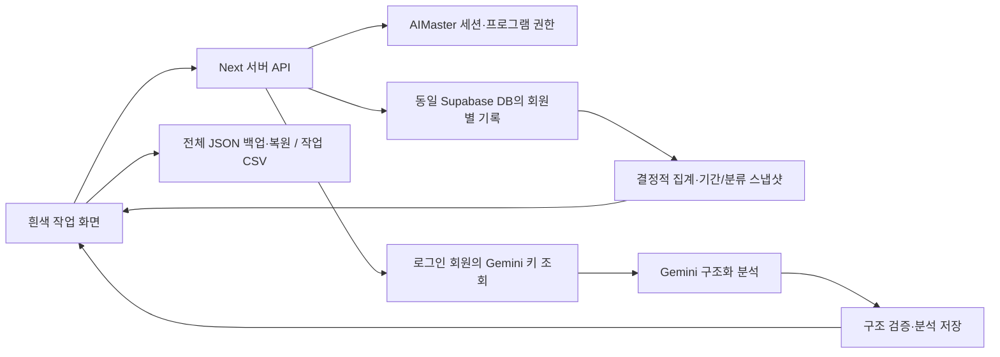

# AI 할 일·성과 관리 — 개발 계획

2026-10-13 작성 당시의 초기 계획입니다. 공통 틀·핵심 기록 구현은 [PHASE1_IMPLEMENTATION](PHASE1_IMPLEMENTATION.md)에 업데이트했습니다. 서버 저장은 초기 7테이블 설계 대신 회원별 JSONB·revision·원자적RPC로 구현했으며 주인님의 일괄 진행 지시에 따라 공유 DB·공통 인증 설정을 적용했습니다. 아래 계획은 최초 제안과 후속 AI·복원·CSV·출시 검수 기준으로 보존합니다. 작업용 이름 `AI 할 일·성과 관리`, 폴더 `ai-task-planner`. 참고 앱의 앱 소스20개·실제 Chrome33개 관측에 기반합니다. 원본 상세는 [REFERENCE_ANALYSIS](REFERENCE_ANALYSIS.md).

## 1. 목표와 출시 범위

첫 출시 목표는 **회원 본인의 할 일을 계획하고 집중시간을 정확히 기록하여, 날짜별 성과와 개선 제안을 확인하는 웹 프로그램**입니다. 화면의 숫자·저장 문구·AI 분석이 실제 기록과 일치해야 합니다.

첫 버전에 원본의 할 일·카테고리·우선순위·예상시간, 집중/휴식 타이머, 성과 요약, 시간대별 완료수, 성과 노트, Gemini 분석, JSON/CSV 내보내기, 설정·설명서를 모두 포함합니다. 일시정지·저장·측정·날짜·AI 구조 문제를 수정하고 백업 복원·휴지통을 추가합니다.

반복 일정, 주간/월간 심화 보고, Google Calendar/Notion/Drive, 팀 공유, 모바일 앱, Chrome 확장, 다중 AI 공급사, 자동 일정 생성은 첫 출시 범위에서 제외하고 후속 후보로 기록합니다. 원본에 있는 기능이라고 표시하지 않습니다.

기본 관리·타이머·집계는 AI 키 없이도 이용 권한을 가진 회원이 사용합니다. AI 분석 버튼만 회원 본인 키를 요구합니다. 공급사 비용은 본인 계정으로 발생합니다. 서버 저장량·API 트래픽은 플랫폼 운영 비용이므로 운영 후 관측하되 프리미엄·FREE·가격은 임의 확정하지 않습니다.

## 2. 사용자 화면과 작업 흐름

공통 좌측 메뉴: 프로그램명/첫 출시 v1.01 → 다른 프로그램 보기(`https://www.buylife.xyz/programs`) → 대시보드 → **1 할 일 계획 / 2 집중 실행 / 3 성과·AI 분석 / 4 기록·백업** → API키등록·플랫폼연동 → 사용 안내 → 바로 아래 회원 이메일·로그아웃.

| 화면 | 제공 내용 |
|---|---|
| 대시보드 | 오늘의 미완료·진행중·완료 개수, 현재 집중 세션, 기록 미측정 안내 |
| 할 일 계획 | 날짜 선택·새 할 일·분류/우선순위·예상시간, 필터·검색·명시적 정렬 |
| 집중 실행 | 선택 작업·남은시간·실제 누적, Focus/짧은휴식/긴휴식, 시작/정지/재개/종료 |
| 성과·AI 분석 | 동일 날짜·분류 범위의 수치·시간대 차트·노트·AI 결과, 근거 표시 |
| 기록·백업 | 과거 날짜·휴지통·복원, 전체 JSON·작업 CSV 다운로드/JSON 가져오기 |
| API키등록·플랫폼연동 | 본인 Gemini 키 저장·모델/연결 확인, 연동 매뉴얼 팝업 |

본문 흰색·연한 중성 카드·회색 테두리·어두운 글자, indigo를 제한적으로 사용합니다. 원본의 작업 목록은 공통 사이드바와 구분해 **작업 영역 안**에 둡니다. 데스크톱에서 목록/실행/성과를 넓이에 맞춰 배치하고 모바일에서는 목록·집중·성과 탭을 제공합니다. 상단 버튼을 한 줄에 억지로 넣지 않습니다.

## 3. 옵션별 신규 동작 규격

아래 범위는 원본 값과 구분한 **구현 제안값**입니다. 기본25/5/15·분류4개·우선순위3개를 유지합니다.

| 옵션 | 첫 버전 동작·검증 |
|---|---|
| 제목 | trim 후1~200자, 공백 단독 차단. 수정에도 동일 검사 |
| 카테고리 | 기본 업무/개인/학습/기타를 회원별 ID로 생성; 추가1~30자·중복 차단 |
| 전체 필터 | 분류 데이터와 별개 ID; `전체`라는 사용자 분류는 혼동 방지를 위해 차단 |
| 사용 중 분류 | 삭제 대신 숨김/보관 또는 다른 분류로 옮기기. 기본분류는 항상 유효 ID |
| 우선순위 | 높음/보통/낮음, 기본 보통; 선택한 우선순위 정렬에 반영 |
| 예상시간 | 정수0~1440분 제안;0은 예상 미설정으로 표시 |
| 실행 상태 | 미완료→시작 시 진행중→완료, 완료 취소는 미완료. 이력은 별도 보존 |
| 완료 | 활성 세션의 현재 시간 정산·종료 후 완료 기록, 두 요청을 하나의 원자적 명령으로 처리 |
| 수정 | 제목/분류/우선순위/예상시간/계획날짜만 PATCH; 시간·세션은 덮어쓰지 않음 |
| 삭제 | 휴지통 이동, 활성 세션 정산/중지. 복원 가능; 첫 버전 영구삭제 자동화 없음 |
| 계획날짜 | 회원 시간대의 오늘 기본, UTC timestamp와 일자 필드를 분리 |
| 필터 범위 | 선택 날짜·분류·검색 범위를 화면에 표시; AI/차트/수치가 같은 범위를 사용 |
| 정렬 | 계획 순서 기본; 우선순위/생성순 명시적 선택. 변경은 데이터 삭제와 무관 |
| Focus | 25분 기본, 정수1~180분 제안; 실행 중 설정은 다음 세션에 적용 |
| Short Break | 5분 기본, 정수1~60분 제안; 집중 시간에 합산하지 않음 |
| Long Break | 15분 기본, 정수1~120분 제안; 집중 시간에 합산하지 않음 |
| 일시정지/재개 | 남은시간과 누적 유지, 같은 세션 재개 |
| 모드/작업 전환 | 이전 세션을 먼저 정산; 새 모드는 새 세션. 이전 기록 보존 |
| 타이머 초기화 | 현재 세션을 정산해 종료 후 새 대기 상태, 과거 집중시간 삭제 없음 |
| 타이머 종료 | 정확히 한 번 확정·완료 알림, 다음 휴식 선택 안내. 자동전환 기본 없음 |
| 오늘 마감 | 일자 마감/다음 날 이동, 원본의 전체삭제 리셋을 그대로 쓰지 않음 |
| 노트 | 날짜별 실제 자동 저장, 500ms debounce 제안·저장중/완료/실패 구분 |
| AI 분석 | 완료0개면 호출 안 함; 0분 미측정 데이터는 미측정으로 설명 |
| JSON | 전체 작업·세션·분류·설정·노트·검증된 AI 결과와 schemaVersion 포함 |
| CSV | 작업표, 예상분·실제초/분·측정여부·계획일·상태·완료시각을 명확히 분리 |

## 4. 시스템 구성

이 저장소의 기존 Next.js/React/TypeScript 기반 독립 웹 서브프로젝트로 만듭니다. 새 구현 시점의 공식 문서·설치 호환성·빌드·보안 감사를 확인해 버전을 고정하며 원본 CDN importmap을 그대로 가져오지 않습니다.

원본의 중앙 App에 몰린 로직을 `tasks`, `timer`, `metrics`, `storage`, `ai`, `export`로 나눕니다. 계산은 순수함수, 타이머는 reducer/상태 전이, 저장은 소유자·리비전·원자성 검증 API가 담당합니다.

## 5. 기록 저장·테이블 설계안

**기존 공유 Supabase 프로젝트 한 개**를 사용합니다. 이 표는 적용 전 설계안이며 DB를 변경한 사실이 아닙니다.

| 제안 테이블 | 주요 필드·보호 |
|---|---|
| `task_planner_categories` | id UUID, user_id, name, sort_order, archived_at. 회원별 정규화 이름 unique |
| `task_planner_tasks` | id UUID, user_id, category_id, title, priority, estimated_minutes, planned_date, status, completed_at, deleted_at, revision, created_at/updated_at |
| `task_planner_timer_sessions` | id UUID, user_id, task_id, mode, duration_seconds, state, remaining_seconds, running_since, deadline_at, accumulated_focus_seconds, ended_at, revision |
| `task_planner_timer_events` | id UUID, user_id, session_id, command_id unique, type, server_occurred_at, elapsed_seconds. 상태 변경·날짜 경계를 넘는 집계 이력 |
| `task_planner_daily_notes` | user_id+local_date unique, note, revision, updated_at |
| `task_planner_settings` | user_id unique, timezone, durations, default_category_id, revision |
| `task_planner_ai_analyses` | id UUID, user_id, scope, metrics/input_snapshot, model, prompt_version, analysis, suggestions, created_at |

실제 시간은 초를 저장하고 예상시간은 분으로 입력합니다. 날짜는 `Asia/Seoul`을 초기값으로 한 회원 시간대를 사용합니다. Task의 actualTime를 편집 가능한 값으로 이중 보관하지 않고 세션 이력을 시간의 근거로 삼습니다. 날짜 경계를 넘는 집중 구간은 자정에서 나누어 날짜별로 합산합니다.

회원 데이터 테이블은 모두 user_id·RLS owner-only입니다. category/task/session 외래키는 user_id를 포함한 복합 관계 또는 서버 소유자 검사로 다른 회원의 ID 참조를 막습니다. 행 수정은 revision 비교 후 수행하고 409 충돌 시 기존 입력을 보존합니다. 노트/API 실패는 다른 데이터의 저장 상태를 망가뜨리지 않습니다.

브라우저 IndexedDB는 회원 ID별 미전송 초안·응답 캐시를 위한 보조 저장소로만 사용합니다. 서버에 저장되지 않은 것을 “저장 완료”로 표시하지 않습니다. 로그아웃/다른 회원 전환 때 전 회원 데이터가 화면에 잠깐 표시되지 않게 하고, 미전송 데이터도 회원별로 분리합니다. 서버 보존 전 단계의 로컬 모의 구현을 운영 다중 기기 동기화 성공으로 보고하지 않습니다.

동시 수정·중복 요청은 revision+command_id로 처리합니다. 동일 회원의 running timer는 휴식 포함1개만 허용하며 DB unique 조건과 트랜잭션으로 강제합니다. 휴지통은 soft delete, 원본 전체삭제 버튼을 운용하지 않습니다.

RLS·GRANT·UPDATE의 USING/WITH CHECK를 함께 설계하며 service role은 서버에만 둡니다. 역할 권한과 행 정책은 별개라는 것은 [Supabase RLS 문서](https://supabase.com/docs/guides/database/postgres/row-level-security)를 따릅니다. 실제 SQL 작성 전에 changelog와 현재 API를 재확인합니다. 이번 세션에서는 changelog.md가 웹 도구의 markdown content-type 제한으로 읽히지 않았습니다.

## 6. 타이머의 정확성 규격

타이머 상태: `idle → running → paused → running → completed`. 수동 종료는 `ended`, 작업 전환은 이전 세션 ended + 새 세션 running입니다. UI의 isActive 하나로 모든 동작을 표현하지 않습니다.

- running 진입 때 서버 기준 `deadline_at = server_now + remaining_seconds`를 확정합니다.
- 화면 countdown은 deadline−현재시각을 표시하며 1초 tick은 화면 업데이트용입니다. 매초 DB 쓰기를 하지 않습니다.
- pause는 유효 집중 구간을 **한 번만 정산**하고 남은초를 고정합니다. resume은 같은 세션에서 새 running_since/deadline을 만듭니다.
- 완료/휴지통 이동/새 작업 시작/모드 전환은 기존 구간 정산과 데이터 변경을 같은 서버 명령·트랜잭션으로 처리합니다.
- 새로고침·탭 전환·절전 후 복귀는 서버 session/deadline을 다시 읽어 복원합니다. 기본 정책은 실행 중 경과시간을 deadline까지만 집중으로 계산합니다. 사용자가 실제로 집중했는지를 자동 판별하는 기능은 없습니다.
- 네트워크가 끊겨도 이미 확인된 세션의 countdown 표시를 유지할 수 있지만 정지/종료 명령이 아직 서버 미확정임을 알립니다. 재전송은 command_id로 중복 정산을 막고 서버 시각을 최종 기준으로 삼습니다.
- 두 탭·두 기기에서 충돌하면 두 번째 시작을409로 막거나 현재 세션으로 이동시킵니다. 강제 인수는 명시적인 버튼과 안내를 제공합니다.
- 알림은 첫 버전에서 화면 상태·토스트로 처리합니다. 앱/브라우저가 완전히 닫힌 상태의 알림을 보장하지 않습니다. 브라우저 알림/자동 휴식/4회 cycle은 후속입니다.

## 7. 성과 지표와 AI 규격

선택한 날짜·분류 범위를 화면과 결과에 표시합니다. 완료율은 그 범위의 계획 작업 중 완료한 비율이며 휴지통은 제외합니다. 밀린 작업은 별도 목록으로 표시해 과거 기록을 오늘의 완료율 분모에 몰래 섞지 않습니다. 시간대 차트는 선택 범위 작업의 완료 현지 시각, 집중시간은 해당 날짜 구간으로 나누어 집계합니다.

예측 정확도는 **완료+예상>0+측정됨**의 작업만 `min(예상,실제)/max(예상,실제)`를 평균합니다. 미측정은0점이 아니라 N/A입니다. 성과지수는 비교 가능 데이터가 있을 때 원본70/30식을 사용하되, 정확도 표본0개면 완료율 기반 참고값이라는 사실을 표시합니다. 정확도 표본개수·빠른 완료와 정확도의 차이를 설명합니다. AI가 계산한 숫자를 지표의 원천으로 사용하지 않습니다.

AI 첫 버전은 Gemini입니다. 회원 본인 키로 접근 가능한 구조화 출력 지원 모델을 설정에서 선택·확인하고, 실패 시 다른 회원 키나 운영자 키·임의 공급사로 폴백하지 않습니다. 원본의 gemini-2.5-flash는 원본 사실로 기록하며 새 앱의 영구 기본 모델로 고정하지 않습니다. [지원 모델](https://ai.google.dev/gemini-api/docs/models)을 구현/출시 시 확인합니다.

AI 입력 snapshot: 현재 연도/현지 날짜/시간대, 선택 범위, 완료 작업의 제목·분류·우선순위·예상·실측 또는 미측정·완료시간, 서버 계산 지표, 사용자가 별도로 **노트 포함을 선택했을 때만** 노트. 원본에는 노트 포함 선택 기능이 없습니다. 완료0개면 호출하지 않으며 기간·시간대 패턴 근거가 적으면 확신하지 않도록 요청합니다.

AI 출력: analysis, suggestions 정확히3개(title/description), evidence의 관련 작업 ID·확인 가능한 지표, limitations. model·promptVersion·입력 snapshot을 저장해 결과 근거를 다시 볼 수 있게 합니다. 표시 문구는 “AI 분석”, 숫자는 기록 기반 지표로 구분합니다.

Google [구조화 출력](https://ai.google.dev/gemini-api/docs/structured-output)으로 필수 필드·array 길이를 제한하고 서버/화면에서 런타임 검증합니다. JSON이 읽혀도 형식/증거 ID/범위가 틀리면 저장하지 않습니다. 로딩 중 재요청 방지, request_id로 늦은 응답 격리, 실패 시 이전 결과 보존, 401/403/429/timeout 안내를 나눕니다. 자동 재생성으로 유료 호출을 무한 반복하지 않습니다.

## 8. API와 권한 경계

| API 설계 | 역할 |
|---|---|
| GET `/api/workspace?date=...` | 본인 작업·분류·노트·설정·현재 세션 조회 |
| POST/PATCH `/api/tasks` | 메타데이터 작성·수정, revision 검증 |
| POST `/api/tasks/:id/complete` | 세션 정산+완료를 원자적으로 확정 |
| POST `/api/tasks/:id/trash`, `/restore` | 복구 가능한 숨김/복원 |
| POST `/api/timer/commands` | start/pause/resume/end/switch, command_id·revision |
| GET/POST `/api/categories`, `/api/settings`, `/api/notes` | 본인 설정, 카테고리 기본값 유효성 검사 |
| POST `/api/ai/analyze` | 권한+본인 키, 서버 snapshot 구성, Gemini 검증 결과 |
| POST `/api/backups/import` | 파일검사·미리보기 후 본인 새 데이터로 복원 |

로그인 인증과 프로그램 이용 권한을 모든 API에서 확인합니다. 페이지는 requireProgramAccess, API는 JSON 오류를 반환하는 checkProgramAccessApi를 사용합니다. entitlement 조회는 createAdminClient, 실제 개인 행 접근은 user_id 필터/RLS를 적용합니다. 서비스 역할을 쓰는 경로도 명시적인 user_id 조건과 소유자 검사를 생략하지 않습니다.

루트 현재 권한 판정을 그대로 재사용합니다: 정지→관리자→핸드폰→FREE→결제구독→공통 최소등급/개별 기간 규칙. 새로운 자격 판정을 독자 구현하지 않습니다. 인증/권한 라우트는 force-dynamic+force-no-store 및 배포 후 캐시 헤더를 확인합니다. .buylife.xyz SSO 쿠키 규칙과 기존 주소 보존을 따릅니다. 구현 시 [SSR 공식 지침](https://supabase.com/docs/guides/auth/server-side/nextjs)을 재확인합니다.

## 9. 백업·복원 정책

전체 JSON은 schemaVersion/프로그램 버전/시간대/내보낸 시각/모든 개인 작업·분류·노트·설정·정산 세션·AI 결과를 담습니다. **API 키·세션 토큰·로그인 쿠키는 포함하지 않습니다.** 내보내기 중 running session은 해당 시점의 일관된 snapshot을 만들고 복원 시 일시정지/종료 상태로 가져옵니다. 백업에서 timer가 자동 재시작하지 않습니다.

복원은 크기·타입·날짜·enum·참조·음수시간·NaN·중복·스키마 버전을 검사하고, 미리보기→사본으로 추가를 기본으로 합니다. 이전 원본의 tasks-only JSON도 변환 대상으로 지원하되 노트/분류 설정/집중 세션이 없다는 사실을 안내합니다. 원본 actualTime는 검증된 과거 집중 합계로 가져오고 세부 시각을 지어내지 않습니다.

CSV는 모든 필드 RFC 방식 quote, UTF-8 BOM, 수식 시작값 보호를 적용하고 선택 범위/전체 중 어떤 결과인지 명확히 합니다. CSV는 구조적 전체 복원용으로 안내하지 않습니다. 다운로드 클릭 이후 파일 존재·내용·한글·시간 단위를 확인합니다.

## 10. 단계별 구현과 완료 기준

| 단계 | 구현 | 완료 증거 |
|---|---|---|
| 1 공통 틀·모델 | 독립 프로젝트, 공통 로그인·권한·흰색 메뉴, tasks/categories/settings 타입·검증·메타데이터 CRUD | 빌드·잘못된 값 차단·회원별 차단·모바일 화면, 원본 예시가 회원 데이터로 섞이지 않음 |
| 2 실제 기록 저장 | 승인 후 개인 테이블/RLS/리비전, 날짜별 작업·노트, 휴지통·복원 | 새로고침/재로그인/다른 기기 조회, 다른 회원 ID 공격 차단, 저장실패 입력 보존 |
| 3 정확한 타이머 | 상태 전이·deadline·세션 정산·두 탭/기기 단일 실행·수정 필드 분리 | pause/resume 시간 보존, 종료1회, 완료/삭제시중지, 절전/재로드복원, 중복가산없음 |
| 4 성과·AI | 범위 일치 집계·미측정 N/A·차트·노트, 본인키·Gemini 구조검증·분석보관 | 계산 예제 일치, 노트 포함 옵션 반영, 불완전 JSON 화면 유지, 실제 본인 모델 소량 생성 결과 |
| 5 백업·출시 | 전체JSON/원본JSON복원/CSV, 가이드, 카탈로그·기본요금제·썸네일·도메인·v1.01 | 다운파일 파싱·복원후 데이터 일치, 일반 회원 운영 흐름·라이브 캐시/권한/저장/버전 확인 |

각 단계는 다른 기능 요청과 섞지 않고 결과를 구분합니다. 배포 가능한 단계는 검수→문서→커밋→푸시→해당 프로그램 운영배포→운영검증→보고를 이어서 수행합니다. 먼저 배포하는 앱은 준비되지 않은 AI/저장 기능을 성공 동작처럼 보여주지 않습니다. 이미 출시한 이후의 변경은 프로그램 버전을0.01씩 올리고 DB version과 일치시킵니다.

DB 스키마·환경변수 실제 적용은 승인 필요 작업입니다. 구현 지시를 받으면 먼저 review 가능한 SQL·필요 환경변수 이름·변경 범위·검수안을 만들어 **해당 단계에서만** 확인받습니다. 지금의 계획 작성은 그 승인을 대신하지 않습니다.

## 11. 검수표

| 범위 | 핵심 시나리오 |
|---|---|
| 입력·분류 | 빈/공백/긴 제목, 예상0/음수/소수, 전체 예약어, 분류 삭제 후 기본값, 참조 소유권 |
| 타이머 | 시작·정지·재개·모드/작업 전환, running 작업 수정, 완료·휴지통 이동,0초종료1회,휴식제외 |
| 저장 | 새로고침·두탭409·두기기시작409·네트워크단절·재시도·늦은응답·로그아웃·계정전환 |
| 집계 | 원본30/15→50%와30/60→50%,미측정N/A,예상0제외,자정넘기,UTC/한국날짜,과거완료/밀린작업 |
| AI | 완료0·키없음·모델불가·401/429/timeout·누락필드·2개/4개제안·잘못된증거ID·중복클릭·분석중범위변경 |
| 백업 | 원본JSON변환·신규전체백업동일성·중복ID/유해참조·실행세션복원정지·쉼표/개행/수식CSV·한글 |
| UI·회원 | Chrome390/768/1600,긴제목/노트,낮은화면메뉴,키보드모달,일반회원SSO·FREE/유료·기간만료·핸드폰차단 |
| 출시 | npm build·관련단위/화면검수·감사,커밋/푸시,프로덕션READY,DB/화면v1.01,도메인/카탈로그링크 |

모의 Gemini 응답과 실제 본인 API 생성, 로컬 재현과 실제 일반 회원 운영 결과를 별도 기록합니다. 스크립트/DB 확인에 이어 주인님과 보이는 Chrome 화면을 열고 확인합니다. 테스트의 목적은 원본 결함의 재발과 데이터 소실·중복 계측을 막는 것입니다.

## 12. 구현 시작 전에 남은 결정·확인

작업용 이름·슬러그/도메인 등록 충돌, FREE/요금 정책, 서버 저장 테이블·환경변수 적용 승인, 회원 키로 사용 가능한 Gemini 모델은 출시 전 확인할 사항입니다. 해당 사항이 확정되기 전에도 모델/타이머/집계/UI 구현은 가능하지만 실회원 운영 검수는 관련 연결 후 완료합니다.

AI Studio 운영 미리보기와 실제 Gemini 결과는 이번 조사에서 확인하지 않았습니다. 원본의 반응을 더 비교해야 하면 로그인 가능한 브라우저에서 확인합니다. 지금은 원본 소스·옵션·프롬프트·결함 재현·설계 계획까지 확보되어 구현을 시작할 자료가 준비돼 있습니다.
