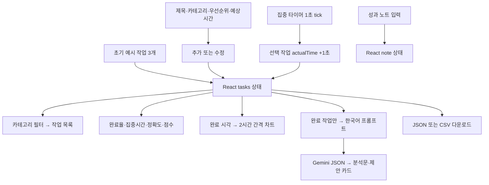

# 참고 앱 전체 로직·옵션·결과 분석

작성: 2026-10-13. 대상: [오늘의 할 일 & 성과](https://aistudio.google.com/apps/drive/1iLQSTMxTbksuw5yv54XUgYP9q79ITS3I?showAssistant=true&showPreview=true).

## 1. 근거와 확인 범위

| 항목 | 확인 내용 |
|---|---|
| Drive 파일 ID | `1iLQSTMxTbksuw5yv54XUgYP9q79ITS3I` |
| 파일명 | 오늘의 할 일 & 성과 (Today's To-Do & Achievements) |
| 형식 | `application/vnd.google-makersuite.applet+zip` |
| 크기·최종 수정 | 23,446바이트 / 2025-10-12T04:50:38.012Z |
| 원본 ZIP SHA-256 | `C19BF22BB022744473195CC50D35CB561259BEB13E1F26F884CD8A096CE55793` |
| 열람 | 20개 파일 전체: 진입점·HTML·상수·타입·App·14개 components |
| 실행 확인 | 표시되는 독립 Chrome, 원본 React 소스의 로컬 번들, 33개 시나리오 |
| AI 실행 | SDK만 모의 구현. 요청 프롬프트·모델·스키마를 포착, 유료 공급사 호출 없음 |
| 화면 증거 | [데스크톱](evidence/01-desktop.png), [모바일](evidence/02-mobile.png), [타이머 종료](evidence/03-timer-complete.png) |
| 원본 자료 | 로컬 `scratch/today-todo-reference/reference.zip`, `source/` |

HTML와 빌드 전 원본 소스를 직접 확보했습니다. AI Studio 호스트의 메인 JS 번들을 긁는 것보다 앱의 상태·이벤트·계산·프롬프트를 명확히 확인할 수 있습니다. 단, ZIP에는 package.json·서버 코드·AI Studio 주입 프록시·호스트 설정이 없습니다. 따라서 **확보된 앱 소스 전수 분석**과 **호스팅 플랫폼 내부까지 100% 확인**은 다릅니다.

원본 HTML는 React `^19.2.0`, Google GenAI `^1.24.0`, Recharts `^3.2.1`을 `aistudiocdn.com` importmap으로 로드하고 Tailwind CDN 스크립트를 사용합니다. 재현은 설치된 React/Recharts 및 Tailwind 4로 번들했습니다. CSS·라이브러리 버전·Chrome 자동화/가상 시계의 차이가 있으므로 레이아웃의 정확한 픽셀·운영 환경 알림 횟수·실제 Gemini 품질까지 검증했다고 주장하지 않습니다.

## 2. 프로그램 성격과 전체 흐름

앱은 **브라우저 메모리 안의 일일 할 일 목록 + 포모도로 타이머 + 수치 성과 계산 + 완료한 일에 대한 AI 조언**입니다. 복잡한 업무 자동화·캘린더·일정 반복·알림 예약 서버는 없습니다. AI는 작업을 생성하거나 일정을 자동 배치하지 않습니다.

데이터는 `useState`에만 있습니다. `localStorage`, IndexedDB, 파일 자동 저장, DB, 사용자 인증, 사용자별 저장 API, 복원 기능이 없습니다. 새로고침은 모든 변경을 없애고 예시 작업을 다시 만듭니다.

## 3. 소스 구조와 역할

| 파일 | 역할 |
|---|---|
| `metadata.json` | 앱명·설명·iframe 권한 빈 목록 |
| `index.html`, `index.tsx` | CDN/importmap, root, React StrictMode |
| `types.ts` | Category/Priority/Status/TimerMode 및 Task |
| `constants.ts` | 기본 카테고리·우선순위·예시 작업 3개·25/5/15분 |
| `App.tsx` | 모든 상태·타이머 effect·CRUD·필터·내보내기·초기화·AI 요청 |
| `Header.tsx` | 제목·날짜·타이머 모드·START/PAUSE·JSON/CSV·설정/관리/설명 |
| `TaskList.tsx` | 전체/분류 탭, 미완료와 진행중을 한 그룹으로 묶음, 완료 그룹 |
| `TaskItem.tsx` | 시간·색상 배지·시작/완료/되돌리기/수정/삭제 |
| `MainPanel.tsx` | 입력 폼과 성과 요약 배치 |
| `AddTaskForm.tsx`, `EditTaskModal.tsx` | 제목·분류·우선순위·예상시간 입력 |
| `SettingsModal.tsx` | 타이머 3개 기간 변경 |
| `CategoryManagerModal.tsx` | 분류 추가·사용 여부별 삭제 제한 |
| `PerformanceSummary.tsx` | 결정적 계산식, AI 미사용 |
| `AnalysisPanel.tsx` | 완료수 차트, AI 버튼, 노트 |
| `AIAnalysisModal.tsx` | JSON parse·분석/제안 표시·오류 문자열 표시 |
| `Modal.tsx` | 공통 모달, 바깥 클릭·Escape·닫기 |
| `AppInfoModal.tsx` | 사용자 설명서 전문, 6개 기능 안내 |
| `Icon.tsx` | SVG 9종, 설정 아이콘도 자체 path |

`App`의 상태는 tasks/filterCategory/timerMode/timerDurations/time/isActive/activeTaskId/note, AI 모달·분석값·loading, 수정 대상, 설정/카테고리/설명 모달 및 categories입니다. 작업과 타이머·노트·설정·AI 결과를 하나의 영속 모델로 묶는 코드가 없습니다.

## 4. 데이터 모델과 기본 예시

| 필드 | 단위·의미·기본 처리 |
|---|---|
| id | number, 새 작업은 `Date.now()` |
| title | 문자열, 추가에서 공백만 있는 제목 차단; 실제 저장은 trim하지 않음 |
| category | TypeScript enum이지만 사용자 입력을 강제 cast해 새 문자열도 저장 |
| priority | 높음/보통/낮음 |
| estimatedTime | **분**, 기본 30; 0 허용; 별도 서버 검증 없음 |
| actualTime | **초**, 기본 0; 집중 모드에서만 tick마다 +1 |
| status | 미완료/진행중/완료 |
| createdAt | 생성 Date |
| completedAt | 완료 시 Date, 완료 취소 시 undefined |

예시 3개: 보고서 작성(업무·높음·예상60분·실제1512초·진행중), 이메일 확인(업무·보통·예상10분·실제0초·완료), 영어 학원(학습·보통·예상120분·실제0초·완료). 두 완료 시각은 당일 18시로 강제 설정되며 현재 분·초가 그대로 남습니다. 오전에는 미래 완료가 될 수 있습니다. 이 값은 실제 회원의 활동 기록이 아닙니다.

초기 화면 수치: 완료율 `round(2/3×100)=67%`, 전체 집중시간 `floor(1512/60)=25분`, 완료 작업 정확도 0%, 성과점수 `round(67×0.7)=47점`. AI 프롬프트에는 완료된 두 작업의 실제 시간이 모두 0분으로 들어갑니다.

## 5. 입력·필터 옵션과 각각의 결과

| 옵션 | 선택값·기본값 | 실제 결과 | 제한·주의 |
|---|---|---|---|
| 제목 | 자유 입력, 초기 빈 값 | 카드 제목·내보내기·완료 후 AI에 포함 | 추가 공백 차단; 수정은 required만 있어 공백 제목 가능 |
| 카테고리 | 업무/개인/학습/기타, **학습 기본** | 해당 배지·필터 탭·AI 입력 분류 | 작업마다 같은 기본색; 사용자가 추가한 분류는 기타색 |
| 우선순위 | 높음/보통/낮음, **보통 기본** | 빨강/파랑/초록 배지 | **정렬·타이머·점수·AI 프롬프트 변화 없음** |
| 예상시간 | 0 이상, **30분 기본** | 카드 예상시간·정확도 계산·AI 프롬프트 | 실제 시간·타이머 기간과 별개 |
| + 추가 | 입력값으로 Task 생성 | 목록 뒤에 추가, actual0, 미완료 | 입력 폼을 빈 제목/학습/보통/30으로 복원 |
| 전체 필터 | 전체 기본 | 모든 작업 표시 | 성과·차트·AI는 항상 전체 tasks 사용 |
| 개별 분류 필터 | 기본 4개 + 사용자 분류 | **왼쪽 작업 목록과 건수만** 변경 | 분류를 바꿔도 중앙·오른쪽 분석은 해당 분류 결과가 아님 |
| 분류 추가 | trim된 빈 값·중복값 차단 | 관리창 로컬 목록 추가 | 닫기 및 저장 전에는 실제 categories 미반영 |
| 분류 삭제 | 참조 작업이 없는 분류만 UI에서 가능 | 탭/추가/수정 선택 항목에서 제거 | 미완료뿐 아니라 완료 작업 참조도 삭제 차단 |
| 분류 저장 | 닫기 및 저장 | App categories 교체 | Escape/바깥 클릭/×는 저장 없이 닫음 |
| 설정 취소·닫기 | 취소/Escape/바깥 클릭/× | 변경 취소 | 공통 모달과 AI 모달의 접근성/닫기 구현은 다름 |

브라우저 예: 개인·높음·45분으로 작업 추가 → 카드의 동일 값·미완료·실제00:00 확인, 폼은 학습·보통·30으로 복원. 개인 탭으로 이동하면 보고서가 사라지지만 성과는 전체 4개 작업 중 2개 완료로 50%·35점입니다.

분류의 숨은 결함 두 가지가 재현됐습니다. `전체`를 새 분류로 등록할 수 있어 전체 탭이 2개가 됩니다. `학습`을 지우면 `<select>` 화면은 첫 항목인 **업무**로 보이지만 React 내부값은 학습으로 남아, 추가한 카드에는 **학습**이 저장됩니다. 필터로 찾아볼 항목이 없는 잘못된 값입니다.

## 6. 작업 동작·상태 전이

| 버튼·상황 | 소스 동작 | 실제 확인·영향 |
|---|---|---|
| 작업 시작 | activeTaskId 지정, Focus, 기간 전체값, isActive=true | 기존 진행 시간을 유지하되 새 타이머 시작; **미완료를 진행중으로 바꾸지 않음** |
| 카드 Pause task | 시작과 동일한 `start` action | **일시정지가 아니라 기간 초기화+실행 유지** |
| 헤더 START | isActive 반전 | Focus에 선택 task ID 없으면 영문 alert |
| 작업 완료 | status=완료, completedAt=현재 | 완료 목록·수치·차트 갱신, **실행 중 타이머는 계속 가산** |
| 완료 취소 | status=진행중, completedAt 제거 | 실제 시간은 유지; 항상 진행중으로 복원 |
| 작업 수정 | 모달을 열 때 Task 전체 snapshot 생성 | 제목·분류·우선순위·예상시간 편집 |
| 수정 저장 | 전체 Task snapshot 교체 | **수정 중 추가된 actualTime가 이전 값으로 되돌아감** |
| 작업 삭제 | 배열에서 즉시 제거 | 개별 확인창·휴지통 없음, activeTaskId/isActive 미정리 |

수정 오류 재현값: 모달 열기 전 실제25:13 → 열린 동안25:15 → 저장 후25:13. 따라서 수정 API는 메타데이터 필드만 바꾸고 집중시간은 독립 세션으로 관리해야 합니다.

삭제된 task ID로도 timer는 실행됩니다. 과거 actualTime도 해당 작업 삭제와 함께 집계에서 사라집니다. 원본에는 정렬, 검색, 기한, 반복 일정, 날짜별 보기, 작업별 메모, 이력·되돌리기, 드래그 이동 기능이 없습니다.

## 7. 타이머 옵션·계산·종료

| 모드 | 초기값 | task.actualTime 반영 | 작업 선택 필요 |
|---|---:|---|---|
| Focus | 25분 =1500초 | 선택 작업에 1초마다 +1 | 예, 단 ID 존재 여부만 체크 |
| Short Break | 5분 =300초 | 없음 | 없음 |
| Long Break | 15분 =900초 | 없음 | 없음 |

모드 버튼을 누르면 현재 실행을 멈추고 그 모드 전체시간으로 재설정합니다. 4회 집중 후 긴 휴식, 자동 다음 모드, 집중 횟수, 알림음·브라우저 알림, background deadline은 없습니다.

설정창은 분 단위 3개 number input, HTML `min=1`, onChange는 `parseInt` 후 0 이상을 state에 허용합니다. 0 입력은 브라우저 validity가 저장을 막는 것이 확인됐습니다. UI 입력과 코드 검증 기준이 다르며 상한은 없습니다. 저장 시 분×60으로 변환합니다. 미실행 중에는 현재 모드 시간을 새 값으로 바꾸고, 실행 중에는 time을 즉시 바꾸지 않습니다.

설정 실험: Focus40/Short8/Long20 저장 → Long 표시20:00, Focus 버튼 →40:00. 다시 로드하면25/5/15로 돌아갑니다.

두 effect의 상호작용이 핵심 결함입니다. 타이머 effect는 1초 interval마다 남은 time−1을 만들고 실제시간을 +1합니다. 별도 effect는 `isActive=false`가 되면 항상 time을 모드 기본값으로 바꿉니다. 그래서 헤더 PAUSE 시 **24:59→25:00**이 됩니다. 절대 종료시각이 없으므로 백그라운드 interval 지연이나 기기 절전에 대한 정확성도 보장되지 않습니다(소스상 위험, 실제 장시간 절전 미시험).

종료 가상시계 실험: Focus1분을 61초 진행 → START 상태·표시01:00으로 돌아왔고 `Focus time is over!` alert가 재현 환경에서 2회 기록됐습니다. 알림 횟수는 StrictMode·effect·재현 환경의 영향을 받을 수 있지만, 종료를 정확히 한 번 확정하는 모델이 없다는 설계 문제는 확인됩니다. 휴식 모드로 자동 전환하지 않습니다.

## 8. 성과 지표의 정확한 계산식

| 지표 | 원본 계산 | 해석 |
|---|---|---|
| 완료율 C | 전체 tasks 중 완료개수/전체개수×100 반올림, 0개면0 | 우선순위·분류 가중치 없음 |
| 집중시간 F | 모든 tasks.actualTime 합계/60 내림 | 미완료·진행중·완료 모두 포함 |
| 예측 정확도 A | 완료이면서 예상>0인 작업만, 작업별 `min(실제분,예상분)/max(실제분,예상분)`을 평균×100 반올림 | 예상0은 제외, 실제0은0% |
| 성과 점수 S | `round(C×0.7+A×0.3)` | 가중치는 하드코딩, 사용자 변경 불가 |
| 완료수 차트 | completedAt의 브라우저 현지 hour를2로 나눈 내림값에 +1 | 0/2/4/…/22시의12구간, **집중시간 그래프가 아님** |

옵션별 계산 예:

| 완료 작업의 예상/실제 | 정확도 | 의미 |
|---|---:|---|
| 30분 / 30분 | 100% | 예상과 실제 일치 |
| 30분 / 15분 | 50% | 빨리 끝났어도 예측 정확도는 낮음 |
| 30분 / 60분 | 50% | 초과시간도 동일하게 낮음 |
| 30분 / 0분 | 0% | 타이머 없이 완료한 작업을0점 취급 |
| 0분 / 15분 | 집계 제외 | 예상시간을 설정하지 않은 작업 |
| 총4개·완료3개·정확도80% | 점수77 | C75×0.7+A80×0.3=76.5, 반올림77 |

이 점수는 AI가 평가한 능력·노력 수준이 아니라 **임의 가중치의 참고 지수**입니다. 빠른 완료와 높은 정확도는 다른 개념입니다. 타이머를 쓰지 않은 작업은 실제0이 “미측정”인지 “시간0”인지 구분할 수 없어 점수 해석을 왜곡합니다.

명칭은 “오늘의 성과”지만 createdAt/completedAt 날짜로 오늘 범위를 거르는 코드가 없습니다. 필터도 적용하지 않습니다. 화면 날짜는 렌더링 시 현지 Date, 내보내기 파일명 날짜는 UTC이므로 한국 시각00~09시에는 서로 하루 다를 수 있습니다. 실제 자정 넘어가기 실험은 하지 않았고 계산 구조로 확인했습니다.

## 9. AI 분석의 입력·옵션·결과

원본의 AI는 사용자가 버튼을 누를 때만 1회 요청합니다. 로딩창을 열고 이전 결과를 지웁니다. 완료 작업0개이면 안내문으로 종료하고 SDK 호출을 하지 않습니다.

| 입력·설정 | 실제 사용 여부 |
|---|---|
| 완료 작업 제목 | 사용 |
| 완료 작업 카테고리 | 사용 |
| 예상시간(분) | 사용 |
| 실제시간 | 초÷60 **내림한 정수 분** 사용, 59초는0분 |
| 우선순위 | **미사용** |
| 미완료·진행중 작업 | **미사용** |
| 완료시각·시간대 | **미사용** |
| 성과 노트 | **미사용** |
| 완료율·정확도·점수 | **미사용** |
| 날짜·현재 연도 | **미주입** |
| 모델 | `gemini-2.5-flash` 고정, 선택 UI 없음 |
| 키 | 브라우저 코드의 `process.env.API_KEY`, 회원 등록 화면 없음 |
| 출력 | `application/json` + responseSchema |
| temperature/topP/max tokens/재시도/검색 | 별도 지정 없음 |

프롬프트는 완료한 일의 제목·분류·예상/실제분을 줄별로 나열하고, 생산성 패턴을 분석해 업무/학습 개선 조언 **3가지**를 한국어로 요청합니다. 응답은 `analysis` 문자열 + `suggestions[{title,description}]`를 기대합니다. 프롬프트 전문은 이번 조사 요청 증거 JSON의 AI request에 보관됐습니다.

스키마는 개별 제안의 title/description만 required로 지정하며 최상위 analysis/suggestions 필수·제안 정확히3개·문자 길이를 강제하지 않습니다. 모달은 `JSON.parse()` 성공을 구조 검증 성공으로 간주해 바로 `suggestions.map()`을 호출합니다.

| 경우 | 관측·소스 결과 |
|---|---|
| 모의 정상 JSON | 분석문·제안3개 카드 표시 |
| JSON이 아닌 문자열 | 원문 문자열 표시, parse 오류 로그 |
| 모의 공급사 예외 | “AI 분석 중 오류…” 하나의 일반 안내 |
| 유효 JSON인데 suggestions 없음 | **undefined.map 예외, root 빈 화면 재현** |
| 키 없음 | SDK 전 예외, 같은 일반 오류문; 등록 이동 없음(소스) |
| 빠른 중복 클릭·닫고 재요청 | 버튼 잠금·취소·응답 버전 검사 없음(소스 위험) |

실제 모델이 같은 작업에 어떤 조언을 반환하는지는 생성마다 달라집니다. 이번에는 회원 키를 임의 사용하지 않았으므로 **실제 Gemini 내용·품질·비용·호스트 인증 성공은 미검증**입니다. 우선순위·노트를 바꿔도 AI 입력이 바뀌지 않는다는 것은 소스와 포착 요청으로 확정할 수 있습니다.

신규 앱에서는 회원별 키, 출력 구조 검증, 분석 근거와 불확실성 표시를 추가합니다. Google의 [구조화 출력 문서](https://ai.google.dev/gemini-api/docs/structured-output)는 JSON Schema 설정과 별도 결과 검증 예제를 제공하며, 출시 시 지원 모델은 [모델 문서](https://ai.google.dev/gemini-api/docs/models)와 회원 키로 확인합니다.

## 10. 노트·백업·초기화·화면

| 기능 | 결과 |
|---|---|
| 성과 노트 | textarea→note state만 갱신, **자동 저장 문구와 실제 구현 불일치** |
| JSON | tasks 배열9필드, Date는 ISO 문자열, 예시 포함 전체 목록 |
| CSV | 동일9열, 제목은 큰따옴표/내부 quote 이스케이프, UTF-8 BOM 확인 |
| export 범위 | 분류 필터와 무관하게 전체 작업, **노트·분류 설정·기간·AI 결과 미포함** |
| 파일 이름 | tasks-YYYY-MM-DD.json/csv, UTC 날짜 |
| 백업 복원 | 가져오기 기능 없음 |
| 하루 리셋 | 확인창 후 **전체 tasks=[]**, note='', 선택없음, 정지, Focus 기본값 |
| 리셋 후 유지 | categories·timerDurations·AI 결과 state는 초기화하지 않음 |
| 설명서 | 할 일·포모도로·성과·내보내기·AI·사용자화6항목, 기능 동작 자체 없음 |

CSV의 사용자 카테고리는 제목과 달리 필드별 quote 처리하지 않아 쉼표/줄바꿈을 넣으면 열 구조를 깨뜨릴 수 있습니다. 제목/분류의 수식 시작 문자는 스프레드시트 수식 해석 위험도 있어 신규 버전에서 출력 정책을 정합니다(소스 위험, Excel 실행 미시험).

화면은 어두운 slate 배경, indigo 버튼, 상단 모든 도구, 본문 12열의3/5/4 배치(작업목록/추가·성과/차트·AI·노트)입니다. 작은 화면에서는 본문이 한 열이 되지만 header는 한 줄 flex를 유지합니다. 재현 CSS에서 뷰포트390px에 문서너비848px을 관측했습니다. 원본 CDN의 정확한 너비 수치는 미검증이지만 고정 상단 도구 배치는 개선 대상입니다. 신규 화면은 AIMaster 흰색 베이스·공통 좌측 메뉴로 설계합니다.

## 11. 구현 전 우선 해결 목록

| 순위 | 문제 | 신규 설계 |
|---|---|---|
| 필수 | 새로고침 전체 소실·허위 자동 저장 | 회원별 실제 저장·저장 상태·실패 원고 보존 |
| 필수 | PAUSE 초기화·카드 Pause 재시작 | 명시적인 타이머 상태 전이·deadline |
| 필수 | 완료/삭제 후 계속 실행 | 같은 저장 트랜잭션에서 세션 정산/중지 |
| 필수 | 수정이 실제시간 덮어씀 | 메타데이터 PATCH와 독립 session 기록 |
| 필수 | 회원 구분·개인 키 등록 없음 | AIMaster 권한·소유자 필터·본인 키 |
| 필수 | AI JSON 불완전 시 화면 소실 | 서버/화면 구조 검증·오류 경계 |
| 높음 | 당일 구분 없음·리셋 전체삭제 | planned_date·현지 날짜 범위·보관/휴지통 |
| 높음 | 미측정=0·근거 없는 점수 | 측정 여부 분리·N/A·산식 설명 |
| 높음 | 전체 분류 중복·기본 분류 불일치 | 분류 ID·예약 필터 분리·기본값 보정 |
| 높음 | 노트/설정 백업 누락·복원 없음 | 스키마 버전 포함 전체 JSON 백업·복원 |
| 높음 | 모바일 상단 가로 넘침 | 분리된 타이머/도구·모바일 메뉴 |
| 후속 | 반복 일정·자동 휴식·주간 추세 | 원본 기능으로 오인하지 않고 별도 구현 |

관측33개는 앱이 정상이라는33개 통과 판정이 아닙니다. 정상 동작과 결함을 함께 재현한 조사 결과이며, 상세값은 evidence/browser-results.json을 기준으로 삼습니다.
