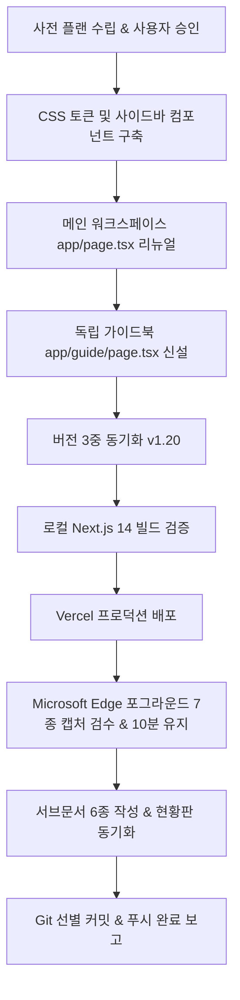

# 상세페이지 자동생성기 v1 (auto-detail-page) 디자인 리뉴얼 & 가이드북 구축 플랜

> **작성일시**: 2026-10-19  
> **담당**: Antigravity (윈도우 환경)  
> **목표 버전**: `v1.20` (기존 `v1.13`)  
> **서비스 주소**: `https://auto-detail-page.buylife.xyz`  
> **컨셉 테마**: **이커머스 셀러 스튜디오 (E-Commerce Seller Studio) — 상세페이지 기획 에디션**

---

## 1. 개요 및 목적
- **배경**: 
  - `auto-detail-page`는 쿠팡, 네이버 스마트스토어, 프리미엄 럭셔리 몰 3대 플랫폼에 최적화된 상세페이지를 AI 카피라이팅 및 이미지 자동 배치로 완성하는 고효율 이커머스 셀러 자동화 도구입니다.
  - 현재 단일 뷰(`app/page.tsx` 중심의 단일 카드 레이아웃)로 되어 있어 사이드바 네비게이션이 부재하고, 가이드북(`/guide`) 페이지가 없어 신규 셀러 및 초보 사용자의 이커머스 기획 접근성이 낮습니다.
- **목적**:
  - `DESIGN.md`의 표준 9대 원칙을 적용하여 **이커머스 셀러 스튜디오 — 상세페이지 기획 에디션**으로 전면 리뉴얼합니다.
  - 좌측 사이드바(데스크톱 고정 + 모바일 반응형 햄버거 드로어)를 표준화하여 메인 제작기(`/`), `📖 연동 & 사용 매뉴얼` (`/guide`), `🔑 API 키 설정` (`/settings`), 메인 허브 링크로의 이동을 원활하게 합니다.
  - 메인 워크스페이스 상단에 프리미엄 `.studio-hero` 배너, 3대 핵심 KPI 통계 카드, 상세페이지 4단계 제작 파이프라인 가이드 바를 탑재합니다.
  - 독립 비주얼 가이드북(`app/guide/page.tsx`)을 구축하여 플랫폼별 이미지 권장 규격 매트릭스, 이커머스 상세페이지 전환율 7대 수칙, FAQ 5종을 완비합니다.
  - 버전 3중 동기화(`v1.20`), Next.js 14 빌드 통과, Vercel 프로덕션 배포, Microsoft Edge 포그라운드 실세션 검수(7종 캡처)를 성공적으로 완수합니다.

---

## 2. 디자인 시스템 및 시각 아이덴티티

### 2.1 컬러 팔레트 (이커머스 셀러 스튜디오)
- **Primary Color (셀러 로열 블루)**: `#2563eb` (Blue 600) — 이커머스 비즈니스의 신뢰와 전문성 상징
- **Accent Color (세일즈 오렌지/앰버)**: `#f97316` (Orange 500) / `#f59e0b` (Amber 500) — 구매 전환, 특가, 매출 극대화 상징
- **Dark Neutral (스튜디오 네이비)**: `#0f172a` (Slate 900) — 차분하고 깊이 있는 전문가 톤앤매너
- **Background & Card (클린 라이트)**: `#f8fafc` (Slate 50), `#ffffff` (White), 서브 `#f1f5f9` (Slate 100)
- **Status & Platform Colors**:
  - 쿠팡 레드: `#dc2626` (Red 600)
  - 스마트스토어 그린: `#03c75a` / `#16a34a` (Green 600)
  - 프리미엄 골드: `#d97706` (Amber 600)

### 2.2 타이포그래피 & UI 컴포넌트
- 명확한 계층 구조: 제목(H1/H2), 배지(Tag), 카드(Card), 스텝 인디케이터(Step Indicator)
- 버튼 및 폼: 둥근 모서리(`rounded-xl`), 섬세한 보더 및 호버 트랜지션, 반응형 터치 타깃 최적화(44px 이상)

---

## 3. 핵심 리뉴얼 컴포넌트 및 페이지 구성

### 3.1 반응형 사이드바 레이아웃 (`components/layout/Sidebar.tsx` 신설 및 `app/layout.tsx` 연동)
- **데스크톱 (lg 이상)**:
  - 좌측 260px 고정 사이드바.
  - 상단: `🛍️ 상세페이지 자동생성기` 로고 + `v1.20` 보라/블루 배지 + 부제(이커머스 기획 에디션).
  - 메뉴 목록:
    1. `🛍️ 상세페이지 제작` (`/`)
    2. `📖 연동 & 사용 매뉴얼` (`/guide`)
    3. `🔑 API 키 설정` (`/settings`)
    4. `← 전체 프로그램 목록` (`https://buylife.xyz/programs`)
  - 하단: 사용자 계정 이메일 표기, 로그아웃 버튼, 시스템 상태 표시.
- **모바일 (lg 미만)**:
  - 상단 헤더 바(로고 + 햄버거 메뉴 버튼 + API 설정 숏컷).
  - 햄버거 클릭 시 좌측에서 부드럽게 슬라이드되는 오버레이 드로어 네비게이션 제공.

### 3.2 메인 워크스페이스 (`app/page.tsx`)
- **`.studio-hero` 프리미엄 배너**:
  - 역동적인 로열 블루 & 앰버 그라디언트 배경.
  - 타이틀: "AI 이커머스 상세페이지 자동생성기 스튜디오"
  - 설명: "쿠팡 · 스마트스토어 · 프리미엄 럭셔리 몰 맞춤형 고전환율 상세페이지를 단 30초 만에 기획·제작합니다."
- **3대 핵심 KPI 통계 카드**:
  1. `⏱️ 기획 완성 시간`: `평균 30초` (수작업 대비 95% 단축)
  2. `🎯 플랫폼 최적화`: `3대 템플릿 지원` (쿠팡 로켓 / 네이버 스토어 / 럭셔리)
  3. `📈 전환율 설득 파이프라인`: `7단계 고전환 구조` (문제제기 ➔ 해결 ➔ 신뢰 ➔ 구매보장)
- **4단계 제작 파이프라인 가이드 바**:
  - `① 템플릿 선정` ➔ `② 제품 기본정보 & 이미지` ➔ `③ 신뢰 & 보장 데이터` ➔ `④ AI 카피라이팅 & 프리뷰/내보내기`
- **제품 제작 폼 (`ProductForm.tsx`)**:
  - 사이드바 레이아웃과 조화를 이루는 넓고 쾌적한 2컬럼/반응형 카드 컨테이너 적용.

### 3.3 독립 비주얼 가이드북 신설 (`app/guide/page.tsx`)
1. **상단 네비게이션 및 가이드 히어로 배너**:
   - "상세페이지 완벽 제작 & 플랫폼별 입점 매뉴얼"
   - `← 제작 스튜디오로 돌아가기` 퀵 링크 버튼.
2. **이커머스 상세페이지 4단계 완벽 워크플로우**:
   - 타깃 분석 및 템플릿 선택 ➔ 핵심 셀링포인트 도출 ➔ 신뢰/보장 데이터 주입 ➔ 원클릭 고해상도 이미지/HTML 내보내기.
3. **플랫폼별 권장 규격 및 템플릿 매트릭스 표**:
   - 쿠팡, 스마트스토어, 백화점/프리미엄 몰의 가로폭 권장 규격, 대표 이미지 비율, 필수 표기 항목, 강조 전략 비교.
4. **전환율을 극대화하는 상세페이지 7대 기획 수칙**:
   - 3초 후킹 헤드카피, 고객 결핍(Pain-point) 공감, 전후 비교(Before/After), 객관적 신뢰 수치, 품질 보증 3대 요소 등.
5. **자주 묻는 질문 (FAQ 5종)**:
   - Claude API 키 연동, 이미지 생성 비용, 스마트스토어/쿠팡 HTML 삽입 방법, 상업적 사용 권한 등.

---

## 4. 버전 3중 동기화 계획 (`v1.20`)
1. `package.json`: `"version": "1.20.0"`
2. `lib/version.ts`: `export const APP_VERSION = "v1.20";`
3. Supabase DB `programs` 테이블: `UPDATE programs SET version = 'v1.20' WHERE slug = 'auto-detail-page';`
   - 스크립트: `scripts/update_auto_detail_version.cjs` 실행 및 검증.

---

## 5. 실행 및 검수 로드맵

1. **Step 1: CSS & 공통 컴포넌트 확장**
   - `app/globals.css`: `.studio-hero`, `.kpi-card`, `.step-pill`, `.glass-card` 등 전용 스타일 클래스 보강.
   - `components/layout/Sidebar.tsx` 신설: 데스크톱 260px 좌측 사이드바 + 모바일 햄버거 슬라이드 드로어 완비.
2. **Step 2: 메인 페이지 리뉴얼 (`app/page.tsx`)**
   - 상단 히어로 배너, 3대 KPI 카드, 4단계 파이프라인 가이드 바 탑재.
3. **Step 3: 독립 가이드북 신설 (`app/guide/page.tsx`)**
   - 비주얼 가이드북, 규격 매트릭스 표, 7대 기획 수칙, FAQ 5종 카드.
4. **Step 4: 버전 3중 동기화 (`v1.20`)**
   - 코드 2곳 및 Supabase DB `programs` 동기화.
5. **Step 5: 로컬 빌드 및 Vercel 배포**
   - `npm run build` 무오류 통과 ➔ `npx vercel --prod --yes` 배포.
6. **Step 6: Edge 전용 브라우저 실세션 검수 (7종 캡처 & 10분 유지)**
   - 데스크톱 메인, 히어로/KPI 영역, 템플릿 선택 및 폼 영역, 데스크톱 가이드북, 가이드북 매트릭스, 모바일 메인(375px), 모바일 드로어/가이드북.
7. **Step 7: 서브문서 6종 및 루트 현황판 동기화, 커밋/푸시**
   - `DESIGN_HANDOFF.md`, `IMPROVEMENTS.md`, `IMPROVEMENT_HANDOFF_20261019.md`, `AGENTS.md`, `README.md`.
   - `DESIGN.md` (누적 77개 완료 / 92.8%), `docs/ACTIVE_WORK.md`, `docs/DESIGN_TEMPLATE_CATALOG.md`, `docs/HANDOFF.md`.
