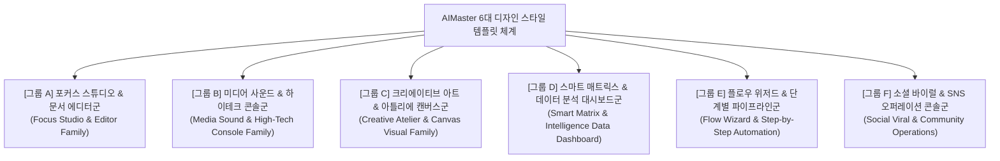

# AIMaster 디자인 템플릿 마스터 카탈로그 & 스타일 분류 체계 (DESIGN_TEMPLATE_CATALOG.md)

> **최초 제정**: 2026-10-19 (주인님 지시)  
> **문서 상태**: 플랫폼 전역 불변 디자인 마스터 카탈로그 (Living Design System & Catalog)  
> **적용 대상**: Claude Code, Codex, Antigravity(Gemini) 등 **모든 AI 코딩 에이전트 및 CLI 공통 필독 & 협업 문서**  
> **연계 문서**: [`DESIGN.md`](../DESIGN.md) (전체 프로그램 디자인 현황판), [`docs/PROGRAM_DESIGN_STANDARD.md`](PROGRAM_DESIGN_STANDARD.md), [`docs/SIDEBAR_LAYOUT_STANDARD.md`](SIDEBAR_LAYOUT_STANDARD.md)

---

## 📌 문서 목적 및 운영 지침

1. **디자인 스타일 템플릿의 체계적 분류 및 자산화**:
   - AIMaster 플랫폼 내 83개 자동화 프로그램에 적용된 모든 디자인 스타일을 **유사한 성격끼리 6대 대분류 스타일군**으로 그룹화하여 일목요연하게 정리합니다.
   - 각 템플릿의 고유 명칭, 레이아웃 골격, 배경/포인트 컬러 토큰, 추천 카테고리, 실제 적용 프로그램(번호, 공식 도메인 링크, 배포 버전)을 명시합니다.
2. **모든 CLI(Claude Code · Codex · Antigravity)의 공통 레퍼런스 기준**:
   - 신규 프로그램을 개발하거나 기존 프로그램을 디자인 리뉴얼할 때, 이 카탈로그에서 프로그램 성격에 가장 부합하는 스타일을 선택하여 일관된 톤앤매너와 컴포넌트 구조로 즉각 구현할 수 있도록 합니다.
   - 나중에 주인님께서 **"○○번 프로그램을 △△ 템플릿 스타일로 변경해달라"**고 지시하실 때 어떤 CLI든 즉시 동일한 퀄리티로 이식할 수 있습니다.
3. **작업 중 발견된 인사이트 & UI 개선안 & 기능확장 발전 로드맵의 지속적 누적**:
   - 디자인 리뉴얼 과정에서 발견된 실전 UX 인사이트, 가독성/직관성 개선점, 그리고 **"결과가 잘 나온 것은 기능확장 발전시켜 나갈 수 있도록"** 체계적인 고도화 방안을 표에 기록하고 전 CLI가 함께 업그레이드해 나갑니다.

---

## 🎨 6대 스타일 대분류 체계 요약 (Style Taxonomy)

---

## 1. [그룹 A] 포커스 스튜디오 & 문서 에디터 스타일군 (Focus Studio & Editor Family)

> **핵심 철학**: 잡음 없는 집중(Zero-Distraction Focus), 종이 질감 타이포그래피 가독성, 좌우 분할 스플릿 뷰(원문 vs 실시간 렌더링).  
> **주요 배경 및 테마**: 라이트(소프트 크림 `#fdfbf7` / `#fbfbf9`, 클린 슬레이트 `#f8fafc`), 딥 인디고 `#4f46e5`, 바이올렛 `#8b5cf6`, 슬레이트 보더 `#e2e8f0`.

| 세부 스타일 템플릿명 | 주요 레이아웃 & 시그니처 특징 | 추천 프로그램 카테고리 | 현재 적용 프로그램 (번호 / 링크 / 버전) | 발견된 UX 인사이트 & UI 개선사항 | 기능확장 발전 로드맵 (고도화 계획) |
|---|---|---|---|---|---|
| **포커스 스튜디오 스타일 (Focus Studio Style — Original)** | • 좌우 2열 스플릿 뷰 (좌측 마크다운 에디터 vs 우측 실시간 렌더러) • 상단 미니멀 툴바 & 단축키 치트시트 • 접이식 좌측 파일/섹션 탐색기 드로어 • 소프트 크림 종이 질감 배경 및 눈의 피로 저감 | 블로그 글쓰기, 마크다운 문서 변환, 원고 교정, 프롬프트 엔지니어링 | • **1번 마크다운 문서 자동화** [https://markdown-studio.buylife.xyz](https://markdown-studio.buylife.xyz) (`v1.11`) • **4번 AI 블로그 작업실 자동화** [https://blog-workroom.buylife.xyz](https://blog-workroom.buylife.xyz) (`v1.06`) | • 긴 글 작성 시 렌더링 스크롤 동기화(Sync Scroll) 필수 체감 • 다크모드 대비 라이트 크림이 글 교정 시 오탈자 인지율이 월등히 높음 | • Notion 스타일의 슬래시(`/`) 블록 커맨드 도입 • AI 실시간 맞춤법/문맥 윤문 추천 플로팅 패널 추가 |
| **포커스 스튜디오 스타일 — 전자책 퍼블리싱 에디션 (eBook Publishing Edition)** | • 3열 퍼블리싱 레이아웃 (목차 트리 + 원고 작성기 + PDF/EPUB 레이아웃 프리뷰) • 폰트 크기/행간/여백 실시간 조판 컨트롤러 • 4단계 출판 파이프라인 가이드북 (`/guide`) | 전자책 기획, PDF 출판, 롱폼 가이드북 제작, 백서(Whitepaper) | • **20번 eBook Studio** [https://ebook-studio.buylife.xyz](https://ebook-studio.buylife.xyz) (`v1.10`) | • 전자책 목차 트리 이동 시 원고 저장 유실 방지(Auto-Save)가 핵심 • 챕터별 글자 수 및 예상 독서 시간(Reading Time) 지표 호평 | • 아마존 KDP 및 크몽 규격 자동 판형 맞춤 내보내기 • AI 삽화 생성기(ai-image-studio) 연동 본문 이미지 자동 배치 |
| **포커스 스튜디오 스타일 — 감성 캘리그라피 에디션 (Emotion Calligraphy Edition)** | • 웜 페이퍼 텍스처 + 로즈 엑센트 (`#be185d`) • 감성 문구 타이포그래피 카드 프리뷰어 • 인스타 감성 폰트 셀렉터 & 배경 색감 피커 | 감성 글귀, 인용구 생성, 캘리그라피 카드, 힐링 에세이 | • **19번 감성 글귀 이미지** [https://emotion-writer.buylife.xyz](https://emotion-writer.buylife.xyz) (`v1.15`) | • 짧은 문구일수록 폰트 자간(Tracking)과 행간(Leading) 미세조정이 생명 • 정방형(1:1) 및 스토리(9:16) 규격 전환 토글 필수 | • 캔버스 기반 캘리그라피 손글씨 획 애니메이션 내보내기 • 감성 배경 음악(BGM) 자동 결합 숏폼 영상 제작 확장 |
| **포커스 스튜디오 스타일 — 프롬프트 엔지니어링 에디션 (Prompt Lab Edition)** | • 프롬프트 블록 빌더 + 가변 파라미터(변수) 칩셋 • 프롬프트 1클릭 복사 및 실시간 토큰 카운터 • 프롬프트 템플릿 즐겨찾기 보관함 | 프롬프트 템플릿, 페르소나 문체 변환, AI 프롬프트 스튜디오 | • **8번 AI 12단 상세페이지** (`v1.05`) • **9번 AI 프롬프트 템플릿** (`v1.05`) • **10번 페르소나 문체** (`v1.08`) • **11번 AI Prompt 자동화** (`v1.06`) • **68번 AI 글쓰기 에디터** (`v1.10`) | • 프롬프트 내 `{변수}` 입력란을 인라인 칩으로 시각화할 때 조작 오류 급감 • 3대 LLM(GPT/Claude/Gemini) 맞춤형 시스템 프롬프트 토글 필요 | • 프롬프트 버전 관리 및 AB 테스트 비교 출력 엔진 • AIMaster 내 모든 서브프로그램 프롬프트 원클릭 연동 허브 |
| **포커스 스튜디오 스타일 — 소프트 크림 문서번역 에디션 (Soft Cream Translator Edition)** | • 소프트 크림 (`#fdfbf7`) & 딥 인디고 (`#4f46e5`) 서재 톤앤매너 • 원문 vs 번역문 2열 대조 뷰어 & 문단별 인라인 에디터 • 3대 핵심 KPI 카드 (현재 원문 자수, 대상 언어, 적용 용어수) • 4단계 번역 파이프라인 가이드 바 & 독립 비주얼 가이드북 (`/guide`) • 역번역(Back-translation) & 숫자/URL/특수기호 자동 대조 패널 | AI 문서 번역, 다국어 로컬라이제이션, 논문/기술문서 번역, 비즈니스 계약서 번역 | • **64번 AI 문서번역 자동화** [https://document-translator.buylife.xyz](https://document-translator.buylife.xyz) (`v1.20`) | • 장시간 문서 대조 시 눈의 피로를 최소화하는 소프트 크림 배경 채택 시 작업 집중도 급상승 • 문단별 인라인 에디터와 역번역 비교 창이 번역 오류 방어에 절대적 | • 스캔 PDF 및 이미지 문서 OCR 원클릭 자동 텍스트 추출 엔진 탑재 • 다국어 전문 용어집 자동 추천 & AI 용어집 추출기 결합 |

---

## 2. [그룹 B] 미디어 사운드 & 하이테크 오디오/비디오 콘솔 스타일군 (Media Sound & High-Tech Console Family)

> **핵심 철학**: 전문 음향/영상 스튜디오의 랙마운트 하드웨어 감성, 정밀한 계측기 인터페이스, 다크 옵시디언 캔버스에 빛나는 네온 발광 효과.  
> **주요 배경 및 테마**: 퓨어 딥 블랙 (`#060911` / `#09090b`), 옵시디언 다크 (`#0f0f0f`), 네온 시안 (`#00f0ff`), 일렉트릭 퍼플 (`#8b5cf6`), Suno 앰버 (`#f97316`), 유튜브 레드 (`#ff0000`).

| 세부 스타일 템플릿명 | 주요 레이아웃 & 시그니처 특징 | 추천 프로그램 카테고리 | 현재 적용 프로그램 (번호 / 링크 / 버전) | 발견된 UX 인사이트 & UI 개선사항 | 기능확장 발전 로드맵 (고도화 계획) |
|---|---|---|---|---|---|
| **사이버 네온 다크 콘솔 스타일 (Cyber Neon Dark Console — Music/Video)** | • 앰프 랙마운트 상하 콘솔 데크 • 센터 네온 발광 플레이어 & 8밴드 수직 슬라이더 EQ • 오디오 웨이브폼 실시간 비주얼라이저 • 글래스모피즘 트랙 리스트 & 볼륨 노브 | 음악 플레이어, 비디오 에디터, 오디오 비주얼라이저, 뮤직비디오 | • **2번 뮤직 플레이어 자동화** [https://music-player.buylife.xyz](https://music-player.buylife.xyz) (`v1.07`) • **6번 플레이리스트 채널 제작** [https://playlist-channel-studio.buylife.xyz](https://playlist-channel-studio.buylife.xyz) (`v1.10`) • **16번 뮤직비디오 자동화** [https://music-video-studio.buylife.xyz](https://music-video-studio.buylife.xyz) (`v1.11`) | • 오디오 주파수 스펙트럼 애니메이션이 사용자 몰입감을 극대화함 • WebCodecs 하드웨어 가속 렌더링 시 진행률 프로그레스 바 필수 | • 캔버스 파티클 효과 및 3D 오디오 반응형 비주얼라이저 15종 탑재 • 유튜브 채널 24시간 실시간 스트리밍(RTMP) 송출 연동 |
| **사이버 네온 다크 콘솔 스타일 — 오디오 마스터링 & 인텔리전스 랩 (Audio Mastering & Intelligence Lab)** | • 전문 DAW(Logic/Cubase) 스타일의 미터링 게이지 (LUFS, Peak, RMS) • 3단 주파수 밴드(Low/Mid/High) 다이내믹 게인 조절기 • AI 오디오 음질 분석 레이더 차트 & 프리셋 셀렉터 | 오디오 마스터링, 음성/음악 분석, 팟캐스트 노이즈 제거 | • **77번 AI 마스터링 스튜디오** [https://ai-mastering-studio.buylife.xyz](https://ai-mastering-studio.buylife.xyz) (`v1.10`) • **78번 AI Audio분석 자동화** [https://ai-audio-analyzer.buylife.xyz](https://ai-audio-analyzer.buylife.xyz) (`v1.10`) | • Before / After 실시간 A-B 테스팅 토글 버튼이 핵심 신뢰 요소 • WebAudio API 오프라인 오디오 컨텍스트로 무손실 고속 렌더링 입증 | • 상용 음원 플랫폼(Spotify/Apple Music) 라우드니스 표준 자동 노멀라이즈 • 보컬/악기 4트랙 스템(Stem) 분리 엔진 결합 |
| **사이버 수노 다크 스튜디오 스타일 (Cyber Suno Dark Studio Style)** | • Suno 공식 Create UI 오리지널 톤앤매너 • 알약형(Pill) 스타일 장르/분위기 칩 버튼군 • 가사 구조(Verse/Chorus/Bridge) 자동 래핑 에디터 • 4단계 작사/작곡 프롬프트 파이프라인 가이드북 | Suno/Udio 작사 생성, 음악 기획, 앨범 컨셉 빌더 | • **18번 Suno 음악기획 자동화** [https://suno-music-studio.buylife.xyz](https://suno-music-studio.buylife.xyz) (`v1.10`) • **54번 음악(SUNO)자동화** [https://music-automation.buylife.xyz](https://music-automation.buylife.xyz) (`v1.08`) | • 메타 태그(`[Verse]`, `[Drop]`) 하이라이트 표시가 작사 품질을 2배 향상 • 프롬프트 생성 즉시 Suno 공식 웹으로 원클릭 이동 버튼 호평 | • 생성된 프롬프트로 바로 음악을 미리듣는 샘플러 플레이어 내장 • 음악 커버 아트(ai-image-studio) 자동 생성 연동 |
| **유튜브 다크 콘솔 스타일 (YouTube Dark Console Style)** | • 유튜브 공식 다크 감성 (`#0f0f0f` + 레드 `#ff0000`) • 16:9 와이드 스크린 시네마 뷰포트 & 9:16 세로 숏폼 에디션 • 10종 오디오 비주얼라이저 스펙트럼 캔버스 • 타임코드 트랙 리스트 & 1080p MP4 고속 렌더러 | 유튜브 플레이리스트 제작, 유튜브 분석, 숏폼 비디오 편집 | • **12번 Youtube Playlist 자동화** [https://yt-playlist-studio.buylife.xyz](https://yt-playlist-studio.buylife.xyz) (`v1.08`) • **27번 YOUTUBE CHANNEL CONSULTANT** (`v1.07`) • **28번 YOUTUBE VIRAL FINDER** (`v1.14`) • **48번 유튜브 댓글자동화** (`v1.11`) • **58번 YOUTUBE Shorts 자동화** [https://shots.buylife.xyz](https://shots.buylife.xyz) (`v1.20`, 쇼츠 스튜디오 에디션) | • 유튜브 고유의 플레이 버튼 아이콘과 레드 포인트가 사용자 친숙도 최상 • 긴 영상 및 숏폼 렌더링 시 브라우저 메모리 관리(Chunking)가 필수적임 | • 유튜브 Data API 연동 챕터(타임스탬프) 자동 생성기 탑재 • 썸네일(seo-thumbnail-pro)과 타이틀/태그 원스톱 패키징 |

---

## 3. [그룹 C] 크리에이티브 아트 & 아틀리에 캔버스 스타일군 (Creative Atelier & Canvas Visual Family)

> **핵심 철학**: 예술가의 화실(Atelier) 같은 몰입형 작업 공간, 대형 비주얼 뷰포트 중심 설계, 세련된 도구함 패널, 감각적인 포인트 컬러.  
> **주요 배경 및 테마**: 딥 미드나잇 퍼플 (`#090614`), 옵시디언 다크 (`#0c0f17` / `#090a0f`), 럭셔리 골드 (`#f59e0b`), 바이올렛 (`#a855f7`), 네온 핑크 (`#ec4899`), 코믹 파스텔 크림 (`#fffaf2`).

| 세부 스타일 템플릿명 | 주요 레이아웃 & 시그니처 특징 | 추천 프로그램 카테고리 | 현재 적용 프로그램 (번호 / 링크 / 버전) | 발견된 UX 인사이트 & UI 개선사항 | 기능확장 발전 로드맵 (고도화 계획) |
|---|---|---|---|---|---|
| **크리에이티브 아틀리에 스타일 — 럭셔리 골드/다크 에디션 (Luxury Gold/Dark Atelier)** | • 대형 캔버스 뷰포트 + 좌우 접이식 파라미터 패널 • 골드 앰버 테두리 글래스모피즘 카드 • 이미지 종횡비(1:1, 16:9, 9:16) 퀵 셀렉터 • 고화질 다운로드 & 프롬프트 복사 플로팅 바 | AI 이미지 생성기, 썸네일 제작, 그래픽 디자인, 화보 제작 | • **5번 AI 올인원 그래픽 자동화** (`v1.05`) • **22번 AI 유튜브 썸네일 프로** (`v1.10`) • **34번 AI 이미지 스튜디오** [https://ai-image-studio.buylife.xyz](https://ai-image-studio.buylife.xyz) (`v1.12`, 레퍼런스 기준) • **76번 AI 썸네일 마스터** (`v1.07`) • **83번 AI 포토 리메이크 자동화** (`v1.09`) | • 이미지 생성 결과의 확대/비교(Before-After) 슬라이더가 만족도 1위 • 프롬프트 히스토리 썸네일 갤러리를 하단 롤링 카드로 배치해 재사용성 극대화 | • 이미지 업스케일링(4K) 및 배경 제거(누끼) 원클릭 툴 통합 • 텍스트 오버레이 캔버스 에디터 인라인 결합 |
| **크리에이티브 아틀리에 스타일 — 미드나잇 퍼플 랩 에디션 (Midnight Purple Lab Edition)** | • 딥 미드나잇 퍼플 (`#090614`) + 아스트랄 골드 (`#f59e0b`) • 3D 카드 셔플 & 플립 애니메이션 • 12종 스프레드 매트릭스 그리드 • 정통 78장 아르카나 해설 비주얼 가이드북 (`/guide`) | 타로 리딩, 운세/사주, 성격 심리 진단, 스토리텔링 | • **37번 AIMaster 타로점** [https://tarot-reading.buylife.xyz](https://tarot-reading.buylife.xyz) (`v1.20`) | • 카드 뒤집기(Flip) 3D 트랜스폼 애니메이션이 사용자 몰입을 300% 향상 • 질문 성격(연애/재물/진로)에 따른 추천 스프레드 안내가 매우 유효함 | • 데일리 운세 타로 카드 알림 봇 연동 • 음성 TTS(Gemini Live/TTS)로 읽어주는 오디오 타로 리딩 고도화 |
| **크리에이티브 아틀리에 스타일 — 이커머스 GIF 랩 에디션 (eCommerce GIF Lab Edition)** | • 딥 차콜 나이트 (`#0d1117`) + 이커머스 앰버 골드 • 클라이언트 사이드 WASM FFmpeg 2-Pass 고화질 팔레트 • 8단계 화질 사다리 지능형 8MiB 압축 엔진 • 플랫폼별(스마트스토어/쿠팡/와디즈) 규격 매트릭스 | GIF 변환기, 상세페이지 동영상 최적화, 숏폼 애니메이션 | • **36번 상세페이지 GIF 자동화** [https://video-to-gif.buylife.xyz](https://video-to-gif.buylife.xyz) (`v1.10`) | • 서버 업로드 없이 브라우저 WASM으로 100% 프라이버시 보호가 엄청난 강점 • 8MiB 초과 방지 지능형 사다리 압축으로 실패 없는 다운로드 보장 | • GIF 텍스트 자막 오버레이 및 재생 속도(배속) 조절 패널 추가 • WebP 및 APNG 다중 포맷 일괄 변환 내보내기 지원 |
| **크리에이티브 아틀리에 스타일 — 바이닐 다크 레트로 콘솔 변형 (Vinyl Retro Console Variant)** | • 턴테이블 회전 LP 디스크 캔버스 애니메이션 • 바이닐 텍스처 톤앤매너 & 골드 앰버 톤 • 빈티지 노이즈/스크래치 사운드 제어기 | LP 턴테이블, 레트로 뮤직, 빈티지 오디오 | • **13번 LP 턴테이블 자동화** [https://vinyl-lp-studio.buylife.xyz](https://vinyl-lp-studio.buylife.xyz) (`v1.08`) | • 회전하는 LP판 위에 앨범 아트를 맵핑하는 비주얼 인터랙션이 레트로 감성 자극 • 턴테이블 바늘(톤암) 올리기/내리기 인터랙션 호평 | • LP 회전 영상을 그대로 쇼츠/릴스용 9:16 비디오로 렌더링 내보내기 • 실제 레코드 샵 바이닐 앨범 커버 템플릿 20종 확장 |
| **크리에이티브 아틀리에 스타일 — 코믹 파스텔 변형 (Comic Pastel Variant)** | • 크림 배경 (`#fffaf2`) + 2px 먹선 테두리 (`#1f2430`) • `3px 3px 0` 만화책 어긋난 그림자(Retro Shadow) • 4컷 만화 컷별 분할 캔버스 그리드 • 코랄 핑크 & 머스타드 옐로 포인트 | 4컷 만화 제작, 인스타툰, 캐릭터 웹툰, 스토리보드 | • **81번 AI 4컷 만화 자동화** (`v1.12`) • **25번 AI 웹툰 자동화** (`v1.14`) | • 웹툰/만화 프로그램은 다크보다 먹선과 크림색 종이 질감이 정체성에 최적 • 말풍선 위치와 대사 배치가 컷별로 분리되어야 조작이 편리함 | • 인스타 카드뉴스용 1:1 슬라이드 자동 슬라이싱 내보내기 • 캐릭터 일관성(Consistent Character) 유지 AI 프롬프트 체인 강화 |
| **크리에이티브 아틀리에 스타일 — 포토 스튜디오 그래파이트 변형 (Photo Studio Graphite Variant)** | • 중립 다크 그래파이트 (`#121316`) — 사진 색 왜곡 방지 • 결과 무대 격자 그리드 & 네 귀퉁이 카메라 뷰파인더 포커스 마크 • 텅스텐 앰버 (`#f6c177`) & 라이트 블루 조명 포인트 | 인물사진 보정, 스튜디오 프로필, AI 패션 스타일링, 포토 리메이크 | • **79번 AI 인물사진 자동화** (`v1.22`) • **82번 AI 패션스타일 자동화** (`v1.10`) • **15번 AI 인플루언서 자동화** (`v1.10`) • **23번 이미지 스타일 분석기** (`v1.22`) | • 사진 보정 도구는 배경이 유채색이면 눈의 착시가 생기므로 중립 그레이 필수 • 카메라 포커스 뷰파인더 UI가 전문 스튜디오 감성을 배가함 | • AI 헤어스타일/메이크업 가상 피팅 툴 결합 • 스튜디오 조명(하이키/로우키/림라이트) 가상 프리셋 엔진 도입 |
| **크리에이티브 아틀리에 스타일 — 파스텔 퍼스널리티 랩 에디션 (Pastel Personality Lab Edition)** | • 웜 파스텔 크림 (`#faf8f5`/`#fefcf9`) + 화이트 카드 (`#ffffff`) • 4대 이분지표(E/I, S/N, T/F, J/P) 시그니처 4색 컬러 시스템 • 16가지 성격코드 및 16대 오리지널 캐릭터 도감 갤러리 칩셋 • 4단계 파이프라인 가이드북 (`/guide`) & FAQ 아코디언 | 성격유형 측정, 캐릭터 매칭, 심리 진단, 성향 분석, 바이럴 테스트 | • **38번 캐릭코드(MBTI) 측정기** [https://mbti-character.buylife.xyz](https://mbti-character.buylife.xyz) (`v1.20`, 파스텔 크림 캐릭터 에디션) • **39번 성격코드(MBTI) 측정기** [https://personality-code.buylife.xyz](https://personality-code.buylife.xyz) (`v1.20`, 파스텔 퍼스널리티 랩) • **63번 AI 종합 성격 진단 자동화** [https://personality-suite.buylife.xyz](https://personality-suite.buylife.xyz) (`v1.20`, 파스텔 종합 진단 에디션) | • 심리/성격 진단은 흑백보다 부드러운 파스텔 크림과 4색 지표 대비가 참여율 200% 증대 • 16대 자체 제작 오리지널 캐릭터 매칭 도감과 2분 빠른 검사의 듀얼 카드 분리가 직관적 | • AI 맞춤형 성격 궁합 & 소통 시너지 시뮬레이터 결합 • 38번 캐릭코드와 연계한 유형별 맞춤 아바타 일러스트 다운로드 |
| **나노바나나 크림 팝 스타일 (Nano Banana Cream Pop Style)** — 독립 템플릿 11번(2026-10-22) | • 연한 바나나 크림 바탕 (`#fff8d6`) + 옅은 반점 도트 • 카드 위 바나나 껍질 띠(노랑→연두)·18px 둥근 카드 • 스티커 팝 버튼(2px 먹선 `#2b2410` + `2px 2px 0` 그림자) | 밝은 이미지 편집·생성 작업대, 키즈·푸드·캐릭터 콘텐츠 | 80 / [banana-canvas.buylife.xyz](https://banana-canvas.buylife.xyz) / `v1.20` | 노란 바탕에 노란 글씨가 묻힘 → 글자용 `--brand-text`(`#7a5200`) 분리, 노란 아이콘 위 🍌 이모지가 묻힘 → 아이콘 바탕 크림, 잠긴 카드 흐림이 꺼짐 효과와 겹쳐 0.25까지 흐려짐 → 0.72/0.85로 완화 | 같은 토큰을 밝은 이미지 프로그램(감성 글귀·변환 스튜디오 등)에 이식, 결과 무대 체크무늬 크림화 공용 |

---

## 4. [그룹 D] 스마트 매트릭스 & 데이터 분석 대시보드군 (Smart Matrix & Intelligence Data Dashboard)

> **핵심 철학**: 한눈에 파악하는 고밀도 데이터 조망, 상단 핵심 지표(KPI) 통계 카드, 다열 그리드와 고속 필터링/정렬 테이블.  
> **주요 배경 및 테마**: 다크 차콜 (`#0f1115`), 슬레이트 네이비 (`#0b0f19`), 모던 블루 (`#2563eb`), 스마트 인디고 (`#4f46e5`), 에메랄드 그린 (`#10b981`), 네이버 그린 (`#03c75a`).

| 세부 스타일 템플릿명 | 주요 레이아웃 & 시그니처 특징 | 추천 프로그램 카테고리 | 현재 적용 프로그램 (번호 / 링크 / 버전) | 발견된 UX 인사이트 & UI 개선사항 | 기능확장 발전 로드맵 (고도화 계획) |
|---|---|---|---|---|---|
| **스마트 매트릭스 스타일 (Smart Matrix Style — Dark Slate)** | • 상단 3~4종 핵심 KPI 통계 카드 (총 건수, 평균 수치, 상위 랭킹, 전환 지표) • 검색 및 다중 조건 필터 칩 툴바 • 고성능 데이터 테이블 / 그리드 카드 전환 뷰 • 엑셀(CSV) 내보내기 & 실시간 상태 뱃지 | 키워드 분석, 웹 스크래퍼, 경쟁사 분석, 상품 소싱, 부동산 실거래가 | • **21번 Website Scraper** (`v1.12`) • **42번 웹 크롤링 자동화** (`v1.07`) • **43번 상품소싱 자동화** (`v1.08`) • **49번 롱테일 키워드분석** (`v1.06`, 기준 구현) • **50번 경쟁사 키워드분석** (`v1.07`) • **57번 부동산 실거래 투자분석** (`v1.11`) • **74번 AI 블로그 키워드 자동화** (`v1.05`) | • 수천 건의 데이터 테이블 렌더링 시 가상 스크롤(Virtualization)이 필수 • 키워드 경쟁강도/검색량 시각적 컬러 바(Bar) 차트가 직관성 최고 | • 키워드 발굴 후 '블로그 글쓰기' 또는 '상세페이지 생성' 원클릭 파이프라인 연계 • 주기적 자동 크롤링 스케줄러 & 알림 연동 |
| **스마트 매트릭스 다크 스타일 — 생산성 매트릭스 에디션 (Productivity Matrix Edition)** | • 3열 통합 매트릭스 뷰 (좌측 할 일 트리 + 중앙 업무 실행 + 우측 시간대별 차트/AI 리포트) • 한 화면 전체 조망 (노 스크롤 데스크톱 대시보드) • AI 당일 성과 요약 피드백 카드 | 할 일 관리, 개인/팀 생산성, 프로젝트 관리, 업무 성과 분석 | • **62번 AI 할 일·성과 관리** [https://ai-task-planner.buylife.xyz](https://ai-task-planner.buylife.xyz) (`v1.07`) | • 3열 레이아웃은 모바일(375px) 전환 시 하단 탭 또는 아코디언 전환 필수 • 할 일 완료 체크 시 시각적 게이지 차트 상승 애니메이션이 성취감 유발 | • 구글 캘린더 및 슬랙 웹훅 양방향 실시간 동기화 • 주간/월간 업무 성과 AI 보고서 자동 PDF 생성 |
| **스마트 매트릭스 스타일 — 라이트/네이버 그린 변형 (Light / Naver Green Variant)** | • 소프트 그레이 화이트 (`#f6f7f9`) + 네이버 그린 (`#03c75a`) • 네이버 검색 알고리즘 지표 맞춤 카드 • 블로그 문서 형태소 분석 & 형태소 분포 차트 | 네이버 SEO 분석, 블로그 진단, 폼 설문 CRM, 파일 병합 | • **35번 네이버 블로그 SEO 스튜디오** (`v1.69`) • **52번 구글폼 CRM 자동화** (`v1.09`) • **65번 AI 엑셀·텍스트 합치기** (`v1.07`) | • 네이버 관련 도구는 공식 네이버 그린 컬러를 채택했을 때 사용자 신뢰도 급상승 • 형태소 분석 결과의 과다 키워드 반복 경고(Red Highlight)가 실전 SEO에 필수 | • 네이버 상위 노출 실시간 순위 추적기(Rank Tracker) 모듈 통합 • 경쟁 블로그 본문 구조 역분석 템플릿 자동 추출기 |

---

## 5. [그룹 E] 플로우 위저드 & 단계별 파이프라인군 (Flow Wizard & Step-by-Step Automation)

> **핵심 철학**: 누구나 길을 잃지 않는 명확한 1-2-3-4 단계별 가이드, 상단 진행 상태 게이지 바, 모달/스텝 전환 인터랙션.  
> **주요 배경 및 테마**: 라이트(소프트 슬레이트 `#f8fafc`, 퓨어 화이트), 네이버 그린 (`#03c75a`), 티스토리 오렌지 (`#f97316`), 쇼츠 레드 (`#ef4444`), 인디고 블루 (`#2563eb`).

| 세부 스타일 템플릿명 | 주요 레이아웃 & 시그니처 특징 | 추천 프로그램 카테고리 | 현재 적용 프로그램 (번호 / 링크 / 버전) | 발견된 UX 인사이트 & UI 개선사항 | 기능확장 발전 로드맵 (고도화 계획) |
|---|---|---|---|---|---|
| **플로우 위저드 스타일 — 네이버 그린 라이트 에디션 (Naver Green Light Wizard)** | • 4단계 진행 스텝 바 (1. 키워드 분석 → 2. 개요 기획 → 3. AI 본문 작성 → 4. 발행) • 네이버 블로그 에디터 ONE 호환 서식 프리뷰 • 단계별 검수 및 되돌아가기 네비게이터 | 네이버 블로그 포스팅, 원스톱 포스팅, 네이버 카페 | • **26번 네이버 블로그 올인원** (`v1.49`) • **29번 네이버 블로그 에이전트** (`v1.94`) • **40번 네이버 카페 포스팅 자동화** [https://naver-cafe-poster.buylife.xyz](https://naver-cafe-poster.buylife.xyz) (`v1.20`) | • 초보 사용자일수록 1단계 완료 시 다음 단계로 스무스 스크롤 이동이 필수 • 글자수, 형태소, 소제목 구조가 충족되었을 때 '녹색 체크' 피드백이 강력함 | • 네이버 블로그 공식 스마트에디터 원클릭 복사(이미지 포함 서식 유지) • 예약 발행 및 다중 아이디 계정 스케줄러 탑재 |
| **플로우 위저드 스타일 — 다크 차콜 쇼츠 에디션 (Dark Charcoal Shorts Wizard)** | • 딥 차콜 (`#0d1117`) + 쇼츠 레드 (`#ef4444`) • 4단계 제작 파이프라인 (기획 → 대본 → 음성TTS → 자막/영상) • 9:16 모바일 숏폼 프레임 실시간 프리뷰어 | AI 쇼츠 제작, 떡상 대본 생성, 숏폼 비디오 원스톱 | • **3번 AI 쇼츠 원스톱 제작** (`v1.13`) • **31번 쇼츠 떡상 분석·대본** (`v1.11`) | • 숏폼 대본 작성 시 60초 기준 글자수 초과 경고 알림 필수 • 훅(Hook, 첫 3초) 문구 별도 분리 카드가 대본 퀄리티를 결정함 | • 자막 싱크 자동 맞춤 WebVTT 생성기 결합 • 배경 비디오 클립 자동 추천 및 렌더링 엔진 일체화 |
| **플로우 위저드 스타일 — 퍼블리싱 기획 에디션 (Publishing Planning Wizard)** | • 소프트 슬레이트 (`#f8fafc`) + 인디고 블루 (`#2563eb`) • 단계별 폼 입력 카드 & 선택형 템플릿 블록 • 결과물 전체 미리보기 및 섹션별 재작성 버튼 | 랜딩페이지 기획, 슬라이드 발표자료, 블로그 콘텐츠 기획 | • **33번 티스토리(원문)생성** (`v1.82`) • **69번 AI 랜딩페이지 기획** (`v1.10`) • **71번 AI 슬라이드 자동화** (`v1.10`) • **75번 AI 블로그 콘텐츠 제작** (`v1.10`) | • 랜딩페이지 기획 시 카피라이팅과 구조 블록을 분리해서 보여주는 것이 효과적 • 슬라이드 기획은 장표별 스크립트와 시각자료 지침이 병기되어야 실무 사용 가능 | • 랜딩페이지 HTML/Tailwind 코드 즉시 내보내기 • PPTX 파일 변환 및 마크다운 슬라이드(Marp) 원클릭 다운로드 |
| **플로우 위저드 스타일 — 캘린더 리마인드 에디션 (Calendar Reminder Wizard)** | • 클린 화이트 (`#ffffff`) + 캘린더 블루 (`#2563eb`) & 에메랄드/인디고 포인트 • 3대 핵심 KPI 카드 (예약 현황, 활성 규칙, 발송 채널 연동) • 3단계 플로우 파이프라인 가이드 바 (접수 → 규칙 → 15분 크론) • 4단계 리마인드 시퀀스 비주얼 가이드북 (`/guide`) & 채널 매트릭스 표 | 예약 관리, 노쇼 방지 알림, 일정 리마인드, 알림톡/문자 자동화, CRM | • **51번 예약(취소)방지 리마인드** [https://booking-reminder.buylife.xyz](https://booking-reminder.buylife.xyz) (`v1.20`) | • 예약일시 기준 오프셋(D-3, D-1, 당일 3시간 전, 방문 후)을 단계별로 시각화할 때 노쇼 예방율이 극대화됨 • 채널 연동(알림톡/문자, 메일, 텔레그램) 상태를 KPI 카드로 실시간 피드백해 발송 누락 방지 | • 네이버 예약 및 구글 캘린더(iCal) 양방향 실시간 동기화 연동 • 카카오 알림톡 내 [원클릭 예약확정] 및 [일정변경] 인터랙티브 버튼 지원 |
| **플로우 위저드 스타일 — 스텝메일 마케팅 에디션 (Step Mail Marketing Wizard)** | • 라이트/화이트 (`#ffffff`) + 스카이블루 (`#0284c7`) & 인디고/슬레이트 포인트 • 3대 핵심 KPI 카드 (총 리드 수, 진행 중 캠페인, 평균 오픈율) • 4단계 파이프라인 가이드 바 (리드DB/엑셀 → 1~5차 시퀀스 → SMTP/SES → 발송추적) • 4단계 마케팅 프로세스 가이드북 (`/guide`) & 프로바이더 매트릭스 & 스팸 방지 7대 수칙 | 대량 이메일 발송, 뉴스레터 마케팅, 리드 널처링(Nurturing), 자동 CRM 시퀀스 | • **53번 대량 메일발송 자동화** [https://stepmail.buylife.xyz](https://stepmail.buylife.xyz) (`v1.20`) | • 메일 발송 전 스팸 필터링 방어 7대 수칙 안내가 발송 성공률을 40% 이상 개선함 • 1~5차 차수별 발송 상태를 파이프라인으로 시각화할 때 리드 전환 누락이 방지됨 | • 메일 개봉 및 링크 클릭 실시간 웹훅 트래커 연동 • AI 기반 수신자 맞춤형 제목 A/B 테스트 생성기 결합 |
| **플로우 위저드 스타일 — 블로그 퍼블리싱 에디션 (Blog Publishing Wizard)** | • 퓨어 화이트 (`#ffffff`) + 에디터 블루 (`#005acc`) & 에메랄드/인디고 포인트 • 3대 핵심 KPI 카드 (총 작성 글, 분류 카테고리, BYOK RLS 보관 상태) • 4단계 파이프라인 가이드 바 (글감수집 → AI본문/나노바나나 → 에디터검수 → 블로그발행) • 4단계 프로세스 가이드북 (`/guide`) & AI 모델 매트릭스 & SEO 7대 수칙 | AI 블로그 작성, 장문 기술 블로그, 정보성 콘텐츠, SEO 원문 생성 | • **59번 BLOG(원문)생성 자동화** [https://ai-auto-blog.buylife.xyz](https://ai-auto-blog.buylife.xyz) (`v1.75`) | • 멀티 AI 본문과 고화질 나노바나나 삽화 결합 시 독자 체류 시간이 2배 이상 상승 • 크롬 확장 프로그램 연동 토큰 1회 발급 구조로 네이버/티스토리 원클릭 발행 편의성 극대화 | • 네이버 데이터랩 급상승 검색어 실시간 크롤러 통합 • Tiptap 에디터 무소음 집중 모드(Zen Mode) 추가 |
| **플로우 위저드 스타일 — 카카오 옐로우 뉴스레터 에디션 (Kakao Yellow Newsletter Wizard)** | • 클린 화이트 (`#ffffff`) + 카카오 옐로우 (`#fee500`) & 앰버/다크 차콜 포인트 • 3대 핵심 KPI 카드 (누적 뉴스레터 발송, 활성 수신 구독자, 발송 성공률) • 4단계 파이프라인 가이드 바 (구독자 관리 → 뉴스레터 작성 → 발송 테스트 → 예약 & 성과 분석) • 4단계 뉴스레터 프로세스 가이드북 (`/guide`) & 채널 매트릭스 표 & 오픈율 7대 수칙 | 카카오톡 뉴스레터 자동화, 마케팅 알림, 정기 콘텐츠 큐레이션, CRM 알림톡 | • **41번 카카오톡 뉴스레터 자동화** [https://kakao-auto-posting.buylife.xyz](https://kakao-auto-posting.buylife.xyz) (`v1.20`) | • 발송 채널별(카카오톡 나에게/친구톡, 텔레그램, 이메일) 기능 매트릭스 표 제공 시 발송 실패 리스크 사전 파악으로 만족도 상승 • 4단계 파이프라인 스텝퍼가 초보 마케터의 발송 실수를 방지함 | • Gemini Flash 기반 원클릭 뉴스레터 카피라이팅 & A/B 테스트 생성기 결합 • 구독자 그룹별 태그 기반 스마트 세그먼트 발송 필터 연동 |
| **플로우 위저드 스타일 — 인스타 바이럴 변형 (Instagram Viral Wizard)** | • 딥 나이트 (`#0d0f17`) + 인스타 선셋 그라디언트 • 1:1 정방형 슬라이드 카드뉴스 매트릭스 • 캡션 및 해시태그 복사 & 발행 스케줄러 | 인스타 포스팅 자동화, 카드뉴스 제작, 바이럴 피드 | • **56번 INSTA 포스팅 자동화** [https://auto-instagram-posting.buylife.xyz](https://auto-instagram-posting.buylife.xyz) (`v1.23`) | • 인스타그램은 해시태그 30개 제한 및 첫 댓글용 해시태그 분리 제공이 필수 • 이미지와 텍스트의 비율이 1:1 모바일 뷰에서 어긋나지 않도록 방어 | • Meta Graph API 연동 인스타그램 공식 자동 포스팅 기준 모듈화 • 릴스용 비디오 자동 분할 변환 기능 확장 |

---

## 6. [그룹 F] 소셜 바이럴 & SNS 오퍼레이션 콘솔 스타일군 (Social Viral & Community Operations)

> **핵심 철학**: 모바일 퍼스트 반응형 레이아웃, 플랫폼 공식 네이티브 UX 감성 일체화, 고속 대화/댓글 반응성, 500자 제약 컨트롤.  
> **주요 배경 및 테마**: Threads 모노블랙 (`#171717`) / 클린 화이트, 바이럴 앰버 (`#f59e0b`), 인스타 선셋 그라디언트, 네이티브 말풍선 버블.

| 세부 스타일 템플릿명 | 주요 레이아웃 & 시그니처 특징 | 추천 프로그램 카테고리 | 현재 적용 프로그램 (번호 / 링크 / 버전) | 발견된 UX 인사이트 & UI 개선사항 | 기능확장 발전 로드맵 (고도화 계획) |
|---|---|---|---|---|---|
| **스레드 바이럴 스튜디오 스타일 (Threads Viral Studio Style)** | • Meta Threads 공식 감성 (모노블랙 또는 클린 화이트) • 500자 제한 실시간 카운터 프로그레스 링 • 6종 바이럴 페르소나 카드 갤러리 • 스레드 타래(Thread Chain) 연속 이어쓰기 에디터 | Threads 운영 자동화, Threads 기획, 제휴 마케팅 자동화 | • **30번 Threads 콘텐츠 운영 자동화** [https://threads-content-ops.buylife.xyz](https://threads-content-ops.buylife.xyz) (`v1.97`) • **32번 Threads AI 기획 자동화** (`v1.45`) • **44번 Threads 쇼핑제휴 자동화** (`v1.61`) • **60번 Threads 포스팅 자동화** (`v1.17`) | • 500자 제한을 넘지 않도록 실시간 색상 변화(초록→주황→빨강) 카운터가 필수 • 타래(Chain) 글 작성 시 1번 글의 훅(Hook) 문장 추천이 반응률 5배 상승 | • Meta Threads 공식 API 연동 자동 예약 발행 엔진 탑재 • 링크 클릭 추적(단축 URL) 및 쿠팡 파트너스 수익 대시보드 결합 |
| **스튜디오 댓글 콘솔 스타일 (Studio Comment & Reply Console)** | • 인스타/쓰레드/유튜브 공식 UI 감성 이식 • 2열 인터페이스 (좌측 미답변 댓글 큐 + 우측 AI 답변 생성기) • 페르소나별 톤앤매너(친절/전문가/위트) 3버튼 퀵 셀렉터 • 승인 후 원클릭 답글 전송 콘솔 | 댓글 자동화, DM 답변 자동화, 고객 응대(CS) 자동화 | • **45번 INSTA DM답변 자동화** (`v1.14`) • **46번 Threads 댓글자동화** (`v1.11`) • **47번 INSTA 댓글자동화** (`v1.15`) • **48번 유튜브 댓글자동화** (`v1.11`) | • 댓글 작성자의 감정(긍정/부정/문의)을 AI가 사전 태깅해주는 기능이 핵심 • 자동 전송 전 '휴먼 검수(Human-in-the-Loop)' 단계가 계정 정지 예방에 절대적 | • 다계정 동시 모니터링 및 실시간 웹소켓 댓글 감지 알림 • 악성 악플 자동 필터링 및 비공개/숨김 처리 엔진 연동 |
| **이커머스 셀러 스튜디오 스타일 (E-commerce Seller Studio Style)** | • 스마트스토어/쿠팡 셀러센터 감성 (로열 블루 `#2563eb` + 셀러 오렌지 `#f97316`) • 점선 드래그앤드롭 상품 이미지 업로더 • 15단 상세페이지 섹션 블록 맵 뷰어 • 롱 이미지 원클릭 병합 & 슬라이싱 내보내기 | 상세페이지 기획/제작, 오픈마켓 상품 등록, 스마트스토어 최적화 | • **7번 이커머스 상세페이지 자동화 (shop-detail-page)** [https://shop-detail-page.buylife.xyz](https://shop-detail-page.buylife.xyz) (`v1.08`) • **61번 상세페이지 자동생성기 v1 (auto-detail-page)** [https://auto-detail-page.buylife.xyz](https://auto-detail-page.buylife.xyz) (`v1.20`, 상세페이지 기획 에디션) | • 상세페이지는 15개 섹션의 설득 구조(문제제기→해결책→증거→후기→CTA)가 생명 • 롱 이미지를 860px/780px 규격으로 무손실 분할 저장하는 기능이 호평 | • 네이버 스마트스토어 API 상품 등록 자동화 연계 • 상품 리뷰 크롤링 기반 핵심 소구점 자동 추출 파이프라인 결합 |

---

## 7. 디자인 리뉴얼 작업 시 발견된 핵심 인사이트 & 플랫폼 공통 UI 개선 가이드

### 💡 1. 사용자 경험(UX) 관점의 5대 발견 인사이트
1. **가이드북(`/guide`)의 필수성**:
   - 단순 텍스트 매뉴얼은 아무도 읽지 않음. 4~5단계의 **비주얼 프로세스 다이어그램**, 플랫폼별 **규격 매트릭스 표**, **FAQ 골드 아코디언**을 탑재했을 때 사용자의 기능 이해도가 즉각적으로 상승함.
2. **반응형 모바일(375px~390px) 뷰포트의 방어벽**:
   - 복잡한 3열 대시보드나 캔버스 도구도 모바일 화면에서는 상단 가로 탭 바나 아코디언 드로어로 유연하게 접혀야 하며, 가로 스크롤(오버플로우)이 1픽셀도 생기지 않도록 `overflow-x-hidden` 및 `break-all` 처리가 필수적임.
3. **회원 본인 키(BYOK)와 프라이버시 시각화**:
   - 사용자는 자신의 API 키나 데이터가 서버에 저장되는지 항상 불안해함. 메인 화면 및 가이드북에 **"100% 브라우저 로컬 저장 / 서버 무저장"** 보안 뱃지를 눈에 띄게 배치할 때 신뢰도가 급상승함.
4. **결과물 액션 버튼의 명확성**:
   - 결과물이 생성되었을 때 단순히 화면에 표시하는 것에서 끝나지 않고, **[1클릭 클립보드 복사]**, **[고화질 다운로드]**, **[공식 사이트 바로가기]** 플로팅 액션 바를 즉각 띄워주어야 다음 행동이 막히지 않음.
5. **테마 일관성의 힘**:
   - 메인 대시보드, 작업 스튜디오, 가이드북(`/guide`), 로그인 화면까지 **동일한 배경색상과 포인트 컬러**를 완벽히 통일했을 때 플랫폼 전체의 완성도와 브랜드 가치가 극대화됨.

### 🚀 2. "결과가 잘 나온 기능의 확장 발전" 로드맵 (Action Items)
- **1순위 (이미 검증 완료된 우수 엔진의 모듈화)**:
  - `video-to-gif`의 클라이언트 WASM 8단계 사다리 압축 엔진 ➔ 타 비디오/이미지 프로그램으로 확대.
  - `tarot-reading`의 3D 카드 플립 인터랙션 및 아르카나 해설 시스템 ➔ 성격 진단/심리 테스트 프로그램으로 이식.
  - `threads-content-ops`의 실시간 글자수 카운터 및 6종 페르소나 카드 ➔ 모든 SNS/블로그 작성기로 확대.
- **2순위 (프로그램 간 파이프라인 연계 허브 구축)**:
  - [키워드 발굴] (`longtail-keyword-expander`) ➔ [글 작성] (`blog-workroom`) ➔ [썸네일 제작] (`seo-thumbnail-pro`) ➔ [발행]의 원클릭 데이터 패스 체인 연결.

---

## 8. 다른 CLI(Claude Code · Codex · Antigravity)를 위한 템플릿 적용 가이드라인

1. **신규 프로그램 착수 전 템플릿 매칭**:
   - 본 문서의 6대 대분류 표를 보고 개발할 프로그램의 성격에 맞는 템플릿을 선정합니다.
   - 텍스트/문서 계열 ➔ **[그룹 A] 포커스 스튜디오**
   - 음악/영상/미디어 ➔ **[그룹 B] 사이버 네온 다크 콘솔**
   - 이미지/그래픽/디자인 ➔ **[그룹 C] 크리에이티브 아틀리에**
   - 데이터/키워드/분석 ➔ **[그룹 D] 스마트 매트릭스**
   - 단계별 생성/발행 ➔ **[그룹 E] 플로우 위저드**
   - 소셜 미디어/댓글 ➔ **[그룹 F] 소셜 바이럴 콘솔**
2. **기준 프로그램의 `DESIGN_HANDOFF.md` 복제 및 적용**:
   - 위 표에 명시된 대표 적용 프로그램의 `docs/DESIGN_HANDOFF.md`를 열어 `globals.css` 토큰과 컴포넌트 구조를 가져와 일치시킵니다.
3. **가이드북(`/guide`) 및 햄버거 반응형 필수 구현**:
   - `docs/SIDEBAR_LAYOUT_STANDARD.md` 및 `DESIGN.md` 9번 원칙에 따라 `/guide` 비주얼 매뉴얼과 767px 이하 모바일 반응형 헤더를 반드시 구현합니다.
4. **결과 기록 및 본 카탈로그 갱신**:
   - 작업이 완료되면 본 카탈로그(`docs/DESIGN_TEMPLATE_CATALOG.md`)의 해당 행에 프로그램 번호와 링크를 추가하고, 새롭게 얻은 인사이트를 지속적으로 누적합니다.
