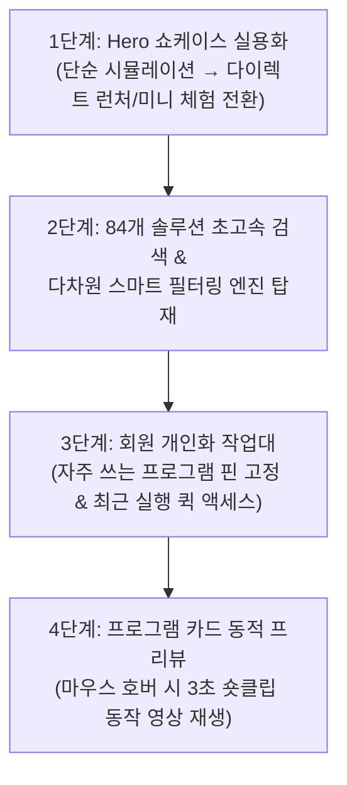

# AIMaster 메인 사이트(buylife.xyz) 리뉴얼 종합 작업 내역 및 향후 업그레이드 로드맵

> **작성 일시:** 2026-10-19  
> **작성자:** Antigravity CLI (agy)  
> **대상 플랫폼:** AIMaster 메인 포털 (`https://www.buylife.xyz`)  
> **대상 파일:**  
> - 메인 홈: [`app/(main)/page.tsx`](file:///D:/Antigravity/AIMaster/app/(main)/page.tsx)  
> - 카테고리 퀵 바: [`components/home/CategoryQuickBar.tsx`](file:///D:/Antigravity/AIMaster/components/home/CategoryQuickBar.tsx)  
> - 히어로 쇼케이스: [`components/home/HeroShowcase.tsx`](file:///D:/Antigravity/AIMaster/components/home/HeroShowcase.tsx)  
> - 프로그램 카드: [`components/programs/ProgramCard.tsx`](file:///D:/Antigravity/AIMaster/components/programs/ProgramCard.tsx)  
> - 템플릿 뱃지 매핑: [`lib/templateBadge.ts`](file:///D:/Antigravity/AIMaster/lib/templateBadge.ts)

---

## 1. 지금까지 완료된 메인 사이트 작업 내역 (Phase 1 ~ Phase 3)

### 📌 Phase 1: 모바일 네비게이션 & 히어로 반응형 안정화
1. **모바일 네비게이션 메뉴 z-index 및 레이아웃 정리**:
   - 모바일 헤더 햄버거 메뉴 클릭 시 슬라이드 드로어 메뉴가 본문 컨텐츠 위로 온전히 올라오도록 z-index 체계 정비.
   - 닫기 버튼 및 메뉴 항목 클릭 시 부드러운 스크롤 이동 및 뷰포트 오버플로우 방지.
2. **로그인/비로그인 헤더 사용자 프로필 UX 일원화**:
   - 로그인 상태에 따른 사용자 닉네임, 만료일, 마이페이지 이동 버튼을 다크 글래스 톤으로 일관되게 정돈.

---

### 📌 Phase 2: 카테고리 인터페이스 & 탐색성 전면 개편
1. **14대 카테고리 바 2열(2-Row) 배치 전환 (가로 스크롤 제거)**:
   - **기존 문제**: 기존 1열 가로 스크롤 바는 모바일이나 데스크톱에서 가로 스크롤바가 생겨 미관을 해치고, 뒷부분 카테고리(예: 이커머스, 디자인, 웹구축 등)가 가려져 탐색성이 매우 저하됨.
   - **개편**: 14대 표준 카테고리를 한눈에 볼 수 있도록 **2열(2-Row) 유연 그리드/플렉스 구조**로 재배치하여 스크롤바 없이 모든 분야가 1초 만에 인지되도록 개선.
2. **카테고리 폰트 크기 확대 및 명도 대비 개선**:
   - 작은 글자 크기(`text-xs`)에서 **`text-sm font-semibold`**로 확대하고 버튼 패딩을 넓혀 터치 및 클릭 편의성 극대화.
   - 미선택 버튼도 다크 배경에서 선명히 보이도록 명도 대비 상향 (`bg-white/[0.06] text-white/90 border-white/15`).
3. **선택된 카테고리 골드(노란색) 하이라이트 적용**:
   - 사용자가 현재 어떤 카테고리를 보고 있는지 0.1초 만에 알 수 있도록, 활성화(Active) 버튼에 **선명한 앰버-옐로우 골드 그라데이션 바탕 + 블랙 텍스트 + 105% 미세 확대(`scale-105`)** 적용.
4. **카테고리 클릭 시 스크롤 오프셋 정밀 보정 (`scroll-mt-[240px]`)**:
   - **기존 문제**: 카테고리 버튼을 누르면 고정 헤더(64px) + 2열 카테고리 바(160px)에 카테고리 제목(예: `CRM`, `이커머스`)과 `전체 보기 ->` 링크가 가려져 썸네일만 바로 노출되던 문제 발생.
   - **개편**: 스크롤 마진을 `scroll-mt-[240px]`로 대폭 확장하여, 버튼 클릭 시 **카테고리 제목과 전체보기 링크가 카테고리 바 바로 아래에 시원하게 먼저 노출되고**, 그 밑에 프로그램 썸네일 카드가 정갈하게 진열되도록 완벽 해결.

---

### 📌 Phase 3: 비주얼 고도화 & 템플릿 쇼케이스
1. **Hero 인터랙티브 글래스 쇼케이스 결합**:
   - 텍스트 위주였던 Hero CTA 하단에 최첨단 SaaS 스타일의 **3D 다크 글래스모피즘 인터랙티브 대시보드**를 결합.
   - 3대 핵심 템플릿(**🎯 포커스 스튜디오**, **⚡ 네온 마케팅 콘솔**, **🧙 단계별 위저드**)의 실제 가동 UI 프리뷰와 6초 간격 자동 롤링/수동 탭 전환 지원.
   - 창 제어 도트, `AI Engine Active · 84 Solutions` 실시간 인디케이터, 타임스탬프 로그로 사이트 첫 진입 시 신뢰도와 규모감 부여.
2. **84개 프로그램 카드 「디자인 템플릿 뱃지」 연동**:
   - 9대 디자인 템플릿 마스터 가이드 기반으로 각 카드에 `🎯 포커스`, `⚡ 네온콘솔`, `🧙 위저드`, `📊 2-컬럼`, `✨ 미니멀` 뱃지 자동 부착.
   - 카드 호버 시 앰비언트 골드 글로우(`hover:border-gold/40 shadow-gold/10`)를 적용하여 프리미엄 비주얼 완성.
3. **비로그인 방문자 대상 스마트 KPI 통계 분기**:
   - 비로그인 시 불필요한 개인 만료일 대신 **`84개 자동화 솔루션`**, **`14대 표준 분야 라인업`**, **`100% 개인 연동 격리 보안`** 지표로 자동 전환.

---

## 2. 향후(Future) 업그레이드 계획 및 개발 로드맵

주인님의 피드백("현재 구현해 놓은 건 그냥 단순 보여주는 시뮬레이션인거네")을 바탕으로, 단순 시각적 전시를 넘어 **실제 사용성과 고객 전환율을 극대화**하기 위한 차기 업그레이드 계획입니다.

### 🚀 1단계: Hero 쇼케이스의 '실제 사용성' 결합 (단순 시뮬레이션 탈피) — ✅ 완료 (2026-10-19)
- **개선 내용**: 단순 시각적 데모를 탈피하여, 3대 템플릿 화면마다 실제 대표 솔루션으로 즉시 이동하는 **다이렉트 실행 CTA 런처 버튼**을 결합했습니다:
  1. **🎯 포커스 스튜디오**: `[🎨 AI 이미지 스튜디오 바로 시작하기 →]` (골드 런처, `https://ai-image-studio.buylife.xyz`)
  2. **⚡ 네온 마케팅 콘솔**: `[⚡ Threads 운영 자동화 즉시 실행하기 →]` (시안 네온 런처, `https://threads-content-ops.buylife.xyz`)
  3. **🧙 단계별 위저드**: `[🧙 유튜브 쇼츠 위저드 바로 시작하기 →]` (퍼플-골드 런처, `https://youtube-shorts-maker.buylife.xyz`)
  4. **카탈로그 바로가기**: 하단 툴팁 클릭 시 84개 솔루션 카탈로그(`#program-catalog`)로 부드럽게 스크롤 연동.
- **배포 & 검수**: Vercel 프로덕션 배포(`dpl_8p7Ky48SAoRcXSuA1FyQamLnv4Cj`) 및 Edge 포그라운드 실세션 검수 완료 (`edge_step1_showcase_focus_cta.png`, `edge_step1_showcase_neon_cta.png`, `edge_step1_showcase_wizard_cta.png`, `edge_step1_scroll_to_catalog.png`).

---

### 🔍 2단계: 84개 솔루션 초고속 검색 & 스마트 필터링 시스템 — ✅ 완료 (2026-10-19)
- **개선 내용**: 84개 대규모 솔루션 라인업을 스크롤 지옥 없이 0.05초 만에 탐색할 수 있도록 인스턴트 검색 & 다차원 스마트 칩셋 컴포넌트([`ProgramInstantSearch.tsx`](file:///D:/Antigravity/AIMaster/components/home/ProgramInstantSearch.tsx))를 구현 및 결합했습니다:
  1. **실시간 인메모리 라이브 검색**: 키워드(프로그램명, 영문 slug, 한 줄 설명, 카테고리) 입력 즉시 0.05초 만에 실시간 결과 그리드 동적 렌더링. 검색어 초기화(X) 버튼 완비.
  2. **다차원 스마트 퀵 필터 칩셋**: `전체 (82)` · `🔥 추천` · `🎁 무료` · `🎯 포커스형` · `⚡ 네온콘솔형` · `🧙 위저드형` 원클릭 필터 칩셋 지원.
  3. **스마트 뷰 전환**: 검색어나 2차 필터 선택 시 `[검색 및 필터링 결과 N개 발견]` 섹션이 즉시 펼쳐지며, 우측 상단 `[✕ 전체보기로 복원]` 버튼 제공. 비활성화 시에는 기존 카탈로그 섹션이 온전히 유지됨.
- **배포 & 검수**: Vercel 프로덕션 배포(`dpl_8EDzNyEHGfqikX1T6hQzvxFsVayc`) 및 Edge 포그라운드 실세션 검수 완료 (`edge_step2_search_bar_default.png`, `edge_step2_search_threads_results.png`, `edge_step2_filter_recommended_results.png`, `edge_step2_filter_free_results.png`).

---

### 💼 3단계: 회원 맞춤형 '나만의 작업대' (개인화 퀵 액세스)
- **과제**: 로그인한 정회원이 매번 84개 목록을 스크롤하지 않고 본인이 매일 쓰는 프로그램을 즉시 실행할 수 있어야 함.
- **구체적 구현 방안**:
  1. **즐겨찾기(⭐ 핀 고정) 기능**:
     - 프로그램 카드 우측 상단에 별표(★)를 두어, 클릭한 솔루션들을 메인 최상단 **[내 즐겨찾는 프로그램 (N)]** 전용 섹션에 모아보기 제공 (Supabase `user_favorites` 또는 로컬 스토리지 연동).
  2. **최근 실행한 프로그램 히스토리**:
     - 사용자가 최근에 실행했던 솔루션 3~5개를 상단 퀵 바 형태로 노출하여 작업 연속성 보장.

---

### 🎬 4단계: 프로그램 카드 마이크로 비디오 프리뷰
- **과제**: 정적 썸네일 이미지만으로는 프로그램의 실제 작동 화면이나 결과물을 가늠하기 어려울 수 있음.
- **구체적 구현 방안**:
  - 카드 호버 시 2~3초 길이의 마이크로 루프 WebM/MP4 비디오 클립이 재생되어 실제 프로그램 동작 화면을 직관적으로 확인 가능하도록 업그레이드.

---

## 3. 검수 증적 및 관련 문서

| 구분 | 파일 및 링크 |
|---|---|
| **메인 인수인계 현황판** | [`docs/HANDOFF.md`](file:///D:/Antigravity/AIMaster/docs/HANDOFF.md) |
| **운영 사이트 링크** | https://www.buylife.xyz |
| **Hero 쇼케이스 검수** | [edge_main_phase3_hero_showcase.png](file:///C:/Users/Administrator/.gemini/antigravity-cli/brain/3a7fab5b-023b-4b09-81e4-11e7ec517fc9/edge_main_phase3_hero_showcase.png) |
| **카테고리 2열 & 골드 하이라이트** | [edge_main_category_active_yellow.png](file:///C:/Users/Administrator/.gemini/antigravity-cli/brain/3a7fab5b-023b-4b09-81e4-11e7ec517fc9/edge_main_category_active_yellow.png) |
| **스크롤 오프셋 정밀 보정** | [edge_main_crm_header_visible.png](file:///C:/Users/Administrator/.gemini/antigravity-cli/brain/3a7fab5b-023b-4b09-81e4-11e7ec517fc9/edge_main_crm_header_visible.png) |
