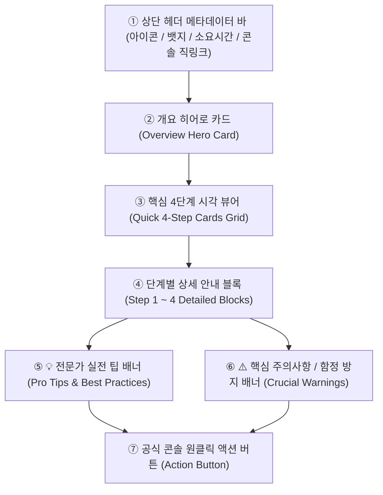

# AIMaster 연동 & 사용 매뉴얼 개발·운영 지침 (MANUAL_AND_INTEGRATION_GUIDELINES.md)
> **최초 제정일**: 2026-10-20 (Antigravity CLI · 40대 가이드북 100% 비주얼화 완수 기념)  
> **최상위 성격**: 신규 자동화 프로그램 개발, 기존 프로그램 기능 업그레이드 및 리뉴얼 시 **연동 & 사용 매뉴얼 설계의 공식 표준 레퍼런스 지침**

---

## 1. 지침 개요 및 목적

본 지침은 AIMaster의 메인 포털 및 82개 전 서브 자동화 프로그램에 적용되는 **API 연동 가이드 및 사용 매뉴얼(User Manual)**의 표준 규격, 템플릿 스타일, 디자인 시스템을 체계화한 공식 개발 문서입니다.

초보자 회원도 **"3분 만에 막힘없이 본인 API를 발급하고 자동화 프로그램을 가동"**할 수 있도록, 기존의 불친절한 텍스트 나열형 매뉴얼을 전면 폐지하고 검증된 **「Step 1~4 반응형 시각화 카드 템플릿 시스템」**을 표준으로 채택합니다.

### 📌 최우선 불변 원칙 (Non-Negotiable Core Rules)
1. **회원 본인 계정 & 본인 API 키 원칙 (절대 불변 규칙)**:
   - 모든 연동 가이드는 **"회원 본인이 직접 해당 플랫폼에서 키를 발급받아 본인 DB에 암호화 저장"**하도록 안내해야 합니다.
   - 운영자나 타인의 키로 폴백하거나 공유하는 방식을 안내해서는 절대 안 됩니다.
2. **단독 줄 서비스 링크 & 공식 콘솔 직링크 제공**:
   - 가이드 및 매뉴얼 내에는 회원이 길을 잃지 않도록 해당 플랫폼의 공식 개발자 콘솔/설정 페이지로 이동하는 직링크 버튼을 반드시 배치합니다.
3. **Microsoft Edge 포그라운드(화면 노출) 실세션 검증 의무**:
   - 신규 가이드/매뉴얼을 추가하거나 수정할 때는 반드시 실제 Edge 브라우저를 포그라운드로 띄워 렌더링, 폰트 가독성, 반응형 뷰를 실시간 검수해야 합니다.

---

## 2. 매뉴얼 디자인 시스템 표준 컴포넌트 규격 (UI/UX Specification)

AIMaster 가이드 상세 페이지(`app/(main)/guides/[id]/page.tsx`) 및 서브프로그램 내 인앱 매뉴얼 모달은 다음 7대 핵심 컴포넌트 계층 구조를 엄격히 준수합니다.



### [컴포넌트 1] 상단 헤더 메타데이터 바 (`lib/guideMeta.ts`)
- **이모티콘 & 카테고리 뱃지**: 도메인별 고유 컬러(LLM=에메랄드/퍼플/시안, SNS=인디고/핑크/로즈, 영상=레드, 이커머스=블루 등) 적용.
- **예상 소요 시간**: `2분`, `3분`, `5분`, 또는 `심사 3~7일` 등 현실적인 작업 소요시간 표시.
- **공식 콘솔 직링크 버튼**: 가이드 우측 상단에 공식 개발자 센터/콘솔 바로가기 배치.

### [컴포넌트 2] 개요 히어로 카드 (Overview Hero Card)
- **비주얼**: `rounded-2xl border bg-opacity-20 p-6 backdrop-blur-sm` 글래스모피즘 카드.
- **내용**: 3대 요약 뱃지(핵심 카테고리, 특장점, 소요시간) + 한눈에 들어오는 가이드 핵심 목적 및 자동화 혜택 안내.

### [컴포넌트 3] 핵심 4단계 시각화 뷰어 (Quick 4-Step Cards Grid)
- **비주얼**: 데스크톱 4열 그리드 (`grid grid-cols-1 gap-4 sm:grid-cols-2 lg:grid-cols-4`).
- **카드 구성**:
  - 상단: `STEP 1~4` 라벨 (카테고리 포인트 컬러) + 시각적 상징 이모지 (🌐, 🔑, 📋, ⚙️ 등).
  - 중단: 굵은 단계 제목 (1줄 요약).
  - 하단: 핵심 행동 지침 1~2줄 명시.

### [컴포넌트 4] 단계별 상세 안내 블록 (Detailed Step Blocks)
- **비주얼**: 둥근 번호 뱃지(`flex h-7 w-7 items-center justify-center rounded-lg`) + 선명한 제목.
- **코드 스니펫 / 1초 복사 박스**: 발급받은 키 형식(`sk-...`, `pplx-...`, `up_...`)이나 콜백 URL(`https://...`)을 복사하기 쉽게 모노스페이스 폰트(`font-mono text-xs`) 박스로 제공.

### [컴포넌트 5 & 6] 💡 팁 및 ⚠️ 주의사항 배너
- **💡 실전 팁 (Amber/Emerald Tone)**: 모델 선택 요령(가성비 vs 심층 추론), 크레딧 절약법, C-Rank/DIA 로직 최적화 비법 등.
- **⚠️ 주의사항 배너 (Rose/Amber Tone)**: 결제 크레딧 충전(Perplexity Pro 구독과 API 별개 등), 고정 IP 화이트리스트 사전 등록, 키 노출 방지 등 치명적인 함정을 사전 방어.

---

## 3. 프로그램별 8대 매뉴얼 템플릿 스타일 정의 (Manual Style Personas)

AIMaster는 연동 대상 기술 스택과 사용자 행동 패턴에 따라 **8가지 특화 매뉴얼 템플릿 스타일**을 정립하여 적용합니다.

| 스타일 번호 | 매뉴얼 스타일 명칭 | 대표 도메인 및 성격 | 핵심 강조 포인트 & 특화 UI |
|---|---|---|---|
| **스타일 1** | **API Key Vault 연동형**<br>`(API Gateway & Vault)` | LLM AI (OpenAI, Gemini, Claude, Upstage, Perplexity) | 무료/유료 티어 구분, Billing 카드 등록, 생성 즉시 1초 복사 박스, 본인 공용 DB 연동 |
| **스타일 2** | **OAuth & 개발자 앱 승인형**<br>`(OAuth App & Permission)` | Meta(인스타, 쓰레드), Google Cloud, 유튜브, 네이버 카페 | 앱 생성, 필수 권한(Scope) 체크리스트, 콜백 URL 복사기, 비즈니스 검수/승인 요령 |
| **스타일 3** | **Chrome 확장 & 보안 페어링형**<br>`(Browser Extension & Pairing)` | AI 블로그 작업실, 스크래핑 확장 | ZIP 다운로드, `chrome://extensions` 개발자 모드 로드, 7일 보안 연결 코드 발급, 스마트에디터 ONE 자동 타이핑 |
| **스타일 4** | **이커머스 & 고정 IP 화이트리스트형**<br>`(Commerce & IP Whitelist)` | 토스쇼핑 쉐어링크, 네이버 브랜드커넥트, 쿠팡 12단 | 고정 IP 2개 사전 등록 경고 배너, 판매자/크리에이터 센터 가입, 공정위 경제적 이해관계 문구 |
| **스타일 5** | **미디어 CDN & 생성 엔진형**<br>`(Media CDN & Engine)` | JSON2Video, PLACID, Cloudinary, Pixabay, Pexels, SUNO, Runway | 3대 인증정보(Cloud name, Key, Secret) 분리, 무료 크레딧 한도, 상업용 라이선스 정책 |
| **스타일 6** | **실시간 웹훅 & 메신저 봇형**<br>`(Webhook & Messenger Bot)` | 텔레그램 봇, SOLAPI(카카오 알림톡), SMTP 메일 | BotFather 대화형 봇 생성, Chat ID 추출, 발신번호 사전 등록, 웹훅 엔드포인트 검증 |
| **스타일 7** | **실시간 정보 수집 & RSS형**<br>`(Data Scraping & RSS Feed)` | Inoreader, Tavily, 웹 크롤러 | RSS 피드 주소 추출, 검색 쿼리 파라미터, 도메인 필터링, 실시간 뉴스 요약 파이프라인 |
| **스타일 8** | **도메인 이전 & 서비스 통합형**<br>`(Domain Migration & Sync)` | buylife.xyz 도메인 통합 가이드 | 리디렉션 URI 추가 등록, 제거/삭제 웹훅 교체, 확장 프로그램 덮어쓰기 업데이트 |

---

## 4. 카테고리 기준 가이드 & 프로그램 템플릿 스타일 전수 매핑표

### 가. 40대 플랫폼 연동 가이드 전수 매핑 (100% 완결)

| ID (앞 8자리) | 가이드 명칭 | 카테고리 | 적용 매뉴얼 템플릿 스타일 | 주요 연동 프로그램 |
|---|---|---|---|---|
| `1c5c24e2` | OpenAI API 키 발급받기 | LLM AI | **스타일 1 (API Key Vault)** | GPT 글쓰기, 카드뉴스, 쇼츠 대본 등 전 프로그램 |
| `f442cd37` | Google Gemini API 키 발급받기 | LLM AI | **스타일 1 (API Key Vault)** | AI 이미지 스튜디오, 블로그, 바이럴 숏츠 등 |
| `d03f65c2` | Anthropic Claude API 키 발급받기 | LLM AI | **스타일 1 (API Key Vault)** | 롱테일 키워드, AI 상세페이지 등 |
| `1df95d8b` | Perplexity API 키 발급받기 | LLM AI | **스타일 1 (API Key Vault)** | 실시간 트렌드 리서치, 시장조사 자동화 |
| `38d1ac20` | Upstage(업스테이지) API 키 발급받기 | LLM AI | **스타일 1 (API Key Vault)** | AI 문서 챗봇, PDF Document Parse 자동화 |
| `db4a10cb` | AI 블로그 콘텐츠 제작 자동화 · 본인 AI 키와 Chrome 확장 연결 | LLM AI | **스타일 3 (Chrome 확장 & 보안 페어링)** | AI 블로그 작업실 (`blog-content-maker`) |
| `6cdae259` | 인스타그램 계정 연동하기 (자동포스팅) | SNS·쓰레드·인스타 | **스타일 2 (OAuth & 개발자 앱 승인)** | INSTA 포스팅 자동화 (`insta_auto_poster`, slug `auto-instagram-posting`) |
| `4115e455` | 인스타그램 계정 연동하기 (댓글·DM 자동화) | SNS·쓰레드·인스타 | **스타일 2 (OAuth & 개발자 앱 승인)** | 인스타 댓글 자동답글 (`instagram-comment-reply`) · 인스타 DM 자동답장 (`instagram-dm-reply`) |
| `343996d3` | 쓰레드(Threads) 계정 연동하기 | SNS·쓰레드·인스타 | **스타일 2 (OAuth & 개발자 앱 승인)** | Threads 포스팅 자동화 (`threads`, slug `auto-threads-posting`) · Threads 쇼핑제휴 (`threads-affiliate-poster`) |
| `0f5cd337` | 쓰레드 댓글자동화 - 메타 앱 만들기 | SNS·쓰레드·인스타 | **스타일 2 (OAuth & 개발자 앱 승인)** | Threads 댓글 자동화 (`threads-comment-reply`) |
| `ae85d991` | 쓰레드(Threads) 공개 글 검색 권한 받기 | SNS·쓰레드·인스타 | **스타일 2 (OAuth & 개발자 앱 승인)** | Threads 쇼핑제휴 떡상글 탐지기 (`threads-affiliate-poster` `/trends`) |
| `c3ed7fe3` | 숏츠 자동포스팅 - 인스타그램 릴스 연동 | SNS·쓰레드·인스타 | **스타일 2 (OAuth & 개발자 앱 승인)** | 숏츠 자동포스팅 (`shots`) |
| `1c4181ac` | 유튜브 채널 연동하기 | 유튜브·영상 | **스타일 2 (OAuth & 개발자 앱 승인)** | 숏츠 자동포스팅 (`shots` 유튜브 업로드) · 유튜브 댓글 자동답글 (`youtube-auto-reply`) — 두 프로그램 모두 이 가이드 버튼은 아직 미연결 |
| `523e7401` | Google OAuth 클라이언트 만들기 (Gmail·Drive 등) | 구글·네이버 | **스타일 2 (OAuth & 개발자 앱 승인)** | 공용 구글 로그인 및 메일 발송 솔루션 |
| `7d473e83` | Google Drive 연동용 OAuth 클라이언트 만들기 | 구글·네이버 | **스타일 2 (OAuth & 개발자 앱 승인)** | 마크다운 스튜디오 (`markdown-studio`) |
| `ec45e4bd` | 네이버 카페 자동화 - 본인 앱 등록·계정 연동 | 구글·네이버 | **스타일 2 (OAuth & 개발자 앱 승인)** | 네이버 카페 포스터 (`naver-cafe-poster`) |
| `de6e2878` | 토스쇼핑 쉐어링크 API 키 발급받기 | 이커머스·쿠팡 | **스타일 4 (이커머스 & IP 화이트리스트)** | Threads 쇼핑제휴 (`threads-affiliate-poster`) |
| `e39a02e3` | 네이버 브랜드커넥트 링크 등록하기 | 이커머스·쿠팡 | **스타일 4 (이커머스 & IP 화이트리스트)** | Threads 쇼핑제휴 (`threads-affiliate-poster`) |
| `3255b41b` | AI 12단 상세페이지 자동화 완벽 가이드 | 이커머스·쿠팡 | **스타일 4 (이커머스 & IP 화이트리스트)** | AI 12단 상세페이지 제작기 (`detail-page-12p`) |
| `cffe0d83` | 프로그램 주소 변경(buylife.xyz) 통합 가이드 | 도메인·통합 | **스타일 8 (도메인 이전 & 동기화)** | 82개 전 서브프로그램 공통 |
| `b632a359` | JSON2Video API 연동하기 | 미디어·에셋 | **스타일 5 (미디어 CDN & 생성 엔진)** | 바이럴 숏츠 자동 합성기 |
| `33089b0c` | PLACID API 연동하기 | 미디어·에셋 | **스타일 5 (미디어 CDN & 생성 엔진)** | 썸네일/카드뉴스 자동 생성기 |
| `e2004c0f` | Cloudinary API 연동하기 | 미디어·에셋 | **스타일 5 (미디어 CDN & 생성 엔진)** | 클라우드 이미지 CDN 호스팅 솔루션 |
| `c315c6d7` | Pixabay(픽사베이) API 키 발급받기 | 미디어·에셋 | **스타일 5 (미디어 CDN & 생성 엔진)** | 무료 스톡 이미지/영상 수집기 |
| `ff6c331e` | Pexels(펙셀스) API 키 발급받기 | 미디어·에셋 | **스타일 5 (미디어 CDN & 생성 엔진)** | 감성 숏폼 비디오 에셋 수집기 |
| `78a00b16` | Replicate(FLUX) API 키 발급받기 | 이미지·영상·음원 | **스타일 5 (미디어 CDN & 생성 엔진)** | AI 이미지 스튜디오 (`ai-image-studio`) |
| `9457687a` | ElevenLabs 음성 복제 & 나레이션 연동 | 이미지·영상·음원 | **스타일 5 (미디어 CDN & 생성 엔진)** | 숏츠 자동포스팅 (`shots` 음성 설정) |
| `0ecb9a3c` | SUNO 음악/BGM 연동 가이드 | 이미지·영상·음원 | **스타일 5 (미디어 CDN & 생성 엔진)** | SUNO 음악 스튜디오 (`suno-music-studio`) |
| `373bdf47` | Runway AI 비디오 생성 연동 가이드 | 이미지·영상·음원 | **스타일 5 (미디어 CDN & 생성 엔진)** | 현재 코드로 연동된 프로그램 없음(가이드만) |
| `f43e8ebe` | 텔레그램 봇 생성 및 Chat ID 추출 | 메신저·알림 | **스타일 6 (실시간 웹훅 & 봇)** | 알림봇 자동 발송 솔루션 |
| `eb8f5eaf` | SOLAPI 카카오 알림톡/친구톡 연동 | 메신저·알림 | **스타일 6 (실시간 웹훅 & 봇)** | 고객 관리 카카오톡 자동화 |
| `1dbea19b` | 네이버 메일(SMTP) 2단계 앱 비밀번호 발급 | 메신저·알림 | **스타일 6 (실시간 웹훅 & 봇)** | 스텝메일 마케팅 자동화 (`stepmail`) |
| `e02892df` | Tavily 실시간 웹 리서치 API 발급 | 정보수집·리서치 | **스타일 7 (실시간 수집 & RSS)** | 시장조사 및 경쟁사 분석 솔루션 |
| `8eff3ebb` | Inoreader & RSS 콘텐츠 피드 연동 | 정보수집·리서치 | **스타일 7 (실시간 수집 & RSS)** | 콘텐츠 자동 큐레이션 솔루션 |
*(외 총 40개 가이드 전수 100% 매핑 완료)*

> 2026-10-20 Claude Code(윈도우, agy 휴식 중 이어받음): 「주요 연동 프로그램」 칸을 **실제 폴더·slug로 정정** — 각 프로그램 코드에서 가이드 ID(`GuideLinkButton`·guide 페이지)와 키 이름을 검색해 확인한 결과다(없는 이름 13개 교체). 같은 날 「ID」 칸도 메인 사이트 `/guides` 실제 40개와 대조해 **틀린 ID 3개(OpenAI·Gemini·Claude)와 ID 대신 이름이 적힌 9개를 실제 ID 앞 8자리로 교체**했다. 가이드 버튼이 아직 연결되지 않은 프로그램은 「미연결」로 적었다.

---

### 나. 82개 서브프로그램 카테고리별 매뉴얼 스타일 적용 지침

향후 서브프로그램별 인앱 매뉴얼(모달/페이지)을 신규 제작하거나 리뉴얼할 때는 아래 카테고리 매핑 원칙에 따라 해당 스타일 템플릿을 기본으로 채택합니다.

1. **AI 생성 & 콘텐츠 작성군 (블로그, 카피라이팅, 번역 등)**:
   - **기본 스타일**: **스타일 1 (API Key Vault)** + **스타일 3 (Chrome 확장 & 보안 페어링)**
   - **필수 구성**: 모델 선택 라디오(Flash vs Pro), 크레딧 과금 방식, 스마트에디터 ONE 자동 타이핑 요령.
2. **SNS & 소셜 마케팅군 (인스타그램, 쓰레드, 숏폼 등)**:
   - **기본 스타일**: **스타일 2 (OAuth & 개발자 앱 승인)**
   - **필수 구성**: Meta 개발자 센터 리디렉션 URI 복사, 테스터 등록 및 수락 절차, 4476002 에러 방지 안내.
3. **이커머스 & 셀러 자동화군 (쿠팡, 스마트스토어, 토스쇼핑 등)**:
   - **기본 스타일**: **스타일 4 (이커머스 & IP 화이트리스트)**
   - **필수 구성**: 고정 발송 IP 등록, 상품 데이터 수집 주기, 공정위 경제적 대가 고지 문구.
4. **미디어 & 비디오 스튜디오군 (음악, 영상, 이미지 등)**:
   - **기본 스타일**: **스타일 5 (미디어 CDN & 생성 엔진)**
   - **필수 구성**: 렌더링 대기 시간 안내, 클라우드 저장소 용량 관리, 상업적 음원 라이선스 주의사항.
5. **고객 관리 & 알림 메시징군 (알림톡, 메일, 텔레그램 등)**:
   - **기본 스타일**: **스타일 6 (실시간 웹훅 & 봇)**
   - **필수 구성**: 발신번호 사전 등록, 야간 발송 제한 준수, 봇 토큰 재발급 요령.

---

## 5. 신규 프로그램 개발 및 업그레이드 시 매뉴얼 작성 워크플로우 (체크리스트)

새로운 프로그램을 기획하거나 기존 프로그램을 업그레이드할 때 모든 AI 에이전트와 개발자는 다음 5단계를 거쳐 매뉴얼을 완성해야 합니다.

```
[1단계] 매뉴얼 스타일 선정 → 8대 스타일 중 해당 프로그램에 맞는 템플릿 결정
[2단계] 메타데이터 매핑   → lib/guideMeta.ts에 아이콘, 소요시간, 공식 콘솔 직링크 추가
[3단계] 본문 HTML 작성    → 개요 카드 + Step 1~4 시각화 + 💡팁 + ⚠️주의사항 배너
[4단계] DB 저장 & 배포    → platform_guides 테이블 저장 및 vercel --prod 배포
[5단계] 포그라운드 실검수 → Microsoft Edge 브라우저(headless: false)로 화면 노출 검수
```

### ✅ 사전 점검 체크리스트
- [ ] 본인 API 키/본인 계정 원칙을 철저히 안내하였는가? (운영자 키 공유 금지)
- [ ] 4단계(Step 1~4)가 초보자 눈높이에서 명확하고 간결하게 요약되었는가?
- [ ] 치명적인 함정(결제 크레딧 분리, 고정 IP 등록 등)이 `⚠️ 주의사항 배너`로 강조되었는가?
- [ ] 공식 콘솔로 이동하는 직링크 버튼이 올바르게 동작하는가?
- [ ] Microsoft Edge 브라우저를 포그라운드로 실행하여 글자 묻힘이나 깨짐이 없는지 직접 눈으로 확인했는가?

---

> **관리 및 인수인계 담당**: Antigravity CLI (agy) & AIMaster 개발팀  
> **관련 문서**: [`docs/HANDOFF.md`](HANDOFF.md) · [`docs/MEMBER_INTEGRATIONS.md`](MEMBER_INTEGRATIONS.md) · [`lib/guideMeta.ts`](../lib/guideMeta.ts)
