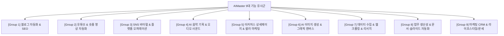

# AIMaster 전체 프로그램 기능 유사군 그룹화 및 전면 재작업 로드맵 (PROGRAM_REDESIGN_GROUPING_ROADMAP.md)

> **최초 제정**: 2026-10-25 (주인님 지시: 「선택 못받은 디자인도 버리는게 아니고 이름을 붙이고 디자인 특징, 컨셉을 붙여서 디자인 템플릿 관련 지침에 계속 추가해줘. 일단 그동안 잘못작업한 프로그램 처음부터 다시 만든다고 생각하고 하나씩 다시 잡아보자. 작업해야할 프로그램 리스트 다시 정리하고 순서를 정해서 그리고 같은 기능 비슷한 기능을 하는 프로그램을 그룹화 하고 작업을 해나가도록 하자. 지침에 추가해놔」, 모든 CLI 공통 최우선 의무)  
> **상태**: 공식 마스터 작업 로드맵 문서 (Living Roadmap)  
> **적용 범위**: AIMaster 9대 기능군 80여 개 전체 서브프로그램

---

## 1. 재작업 4대 기본 철학 및 핵심 원칙 (Core Principles)

1. **처음부터 다시 만든다는 완성도 기준 (Zero-Base Rebuilding)**:
   - 그동안 단순 엔지니어링 중심, 딱딱한 사각형 입력창, 어설픈 UI, 규격 미달, 불완전하거나 날림으로 구현된 프로그램들을 **처음부터 완전히 새롭게 상용 SaaS급 프리미엄 인터페이스로 다시 만든다는 각오로 하나씩 전면 재정비**합니다.
2. **기능 유사군 그룹화 및 순차 확장 (Functional Clustering & Sequence)**:
   - 전체 프로그램을 9대 핵심 기능 유사군으로 묶고, 무분별한 개별 작업 대신 **각 그룹의 대표 프로그램 1개를 먼저 완벽하게 잡아낸 후 해당 그룹의 유사 프로그램들로 연계 확장**합니다.
3. **4대 핵심 화면 3개 시안 사전 제시 및 주인님 선택·승인 (Strict Pre-Approval)**:
   - 프로그램마다 최종 코드를 확정하기 전에 **1) 메인 페이지(스튜디오) 3종, 2) 상세 결과 페이지 3종, 3) 사용자 매뉴얼(`/guide`) 3종, 4) 플랫폼 연동 및 API설정(`/settings`) 3종 (총 12개 뷰)**을 창의적으로 제작하여 네이버 웨일 브라우저 화면으로 먼저 보여드리고, 주인님의 선택과 승인을 받은 후에만 구현을 진행합니다.
4. **비선택 시안의 공식 템플릿 자산화 및 영구 축적 (Template Assetization)**:
   - 특정 프로그램에서 선택받지 못한 2개 디자인도 **절대로 버리지 않고, 고유 명칭(예: `○○○ 스타일`), 시각적 특징, 디자인 컨셉, 추천 도메인을 명시하여 [`DESIGN.md`](../DESIGN.md) 및 [`docs/DESIGN_TEMPLATE_CATALOG.md`](DESIGN_TEMPLATE_CATALOG.md)에 공식 등재하고 영구 자산화**합니다.

---

## 2. 전체 서브프로그램 9대 기능 유사군 그룹화 및 전수 분석 (Functional Clustering)



### [Group 1] 블로그 자동화 & SEO 그룹 (총 8개)
> **핵심 기능**: 블로그 원고·이미지 자동 생성, 크롬 확장을 통한 자동 포스팅(발행전까지/즉시발행/예약발행), SEO 키워드 분석 및 최적화
> **★ 2026-10-25 주인님 마스터 지침**: 「네이버 블로그 쪽은 네이버 분위기를 내는 1번 디자인 시안(네이버 스마트 그린 저널 스타일)을 메인 템플릿으로 하자」 — 네이버 블로그 전체 프로그램에 1번 시안 규격 적용.
- **그룹 대표 프로그램 (기준 모델)**: `tistory-auto-blog` (티스토리 자동화 — **클린 에디토리얼 오렌지 스타일 확정**) & `ai-auto-blog` (네이버 AI 자동 블로그 — **네이버 스마트 그린 저널 스타일 확정**)
- **그룹 소속 프로그램 목록**:
  1. `tistory-auto-blog` (티스토리 원문생성 및 자동 포스팅 — **2026-10-25 4대 화면 3시안 검수 및 시안 1 클린 에디토리얼 오렌지 스타일 확정 적용 v1.47 배포 완료**)
  2. `ai-auto-blog` (실시간 이슈 AI 자동 블로그 포스팅 — **2026-10-25 4대 화면 3시안 검수 및 시안 1 네이버 스마트 그린 저널 스타일 확정 적용 v1.82 배포 완료**)
  3. `naver-blog-seo-studio` (네이버 블로그 SEO 및 리라이팅 스튜디오 — **2026-10-26 4대 화면 3시안 검수 및 시안 1 네이버 스마트 그린 저널 스타일 확정 적용, 포스팅 3종 모드 & 3D 엠보싱 버튼 탑재 v2.21 배포 완료**)
  4. `naver-blog-agent` (5단계 네이버 블로그 AI 에이전트 — **네이버 스마트 그린 저널 메인 템플릿 적용 대상**)
  5. `naver-blog-allinone` (사진 기반 맛집/여행 블로그 올인원 — **네이버 스마트 그린 저널 메인 템플릿 적용 대상**)
  6. `blog-keyword` (블로그 키워드 분석 및 연관검색어 발굴)
  7. `blog-workroom` (문체 분석 및 네이버 블로그 작업실 — **네이버 스마트 그린 저널 메인 템플릿 적용 대상**)
  8. `blog-content-maker` (블로그 콘텐츠 제작 및 발행 점검)

### [Group 2] 유튜브 & 숏폼 영상 자동화 그룹 (총 10개)
> **핵심 기능**: 쇼츠·릴스 숏폼 원스톱 제작, 유튜브 떡상 트렌드 분석, A/B 썸네일 생성, NLE 영상 렌더링, 오디오 비주얼라이저
- **그룹 대표 프로그램 (기준 모델)**: `shots` (YOUTUBE Shots 자동화) & `shorts-onestop-studio` (쇼츠 원스톱)
- **그룹 소속 프로그램 목록**:
  1. `shots` (auto-shorts-posting, YOUTUBE Shots 이미지 스토리 자동화)
  2. `shorts-onestop-studio` (원스톱 숏폼 영상 자동화 스튜디오)
  3. `shorts-viral-studio` (쇼츠 떡상 분석 및 대본 자동화)
  4. `youtube-viral-studio` (유튜브 트렌드 분석 및 황금 채널 발굴)
  5. `thumbnail-master` (AI 유튜브 썸네일 & SEO A/B 최적화)
  6. `playlist-channel-studio` (유튜브 플레이리스트 및 비주얼 영상 자동화)
  7. `video-to-gif` (AI 영상렌더 스튜디오, WASM/초고속 비디오 NLE)
  8. `infinite-loop-video` (무한루프 영상 자동화 스튜디오)
  9. `music-video-studio` (Gemini Omni Flash 기반 뮤직비디오 자동화)
  10. `youtube-auto-reply` (유튜브 채널 댓글 자동 답글 스튜디오)

### [Group 3] SNS 바이럴 & 플랫폼 오퍼레이션 그룹 (총 7개)
> **핵심 기능**: 인스타그램/쓰레드 게시물 자동 기획·발행, 카드뉴스 생성, 쇼핑 제휴 마케팅, AI 댓글·DM 고객 응대
- **그룹 대표 프로그램 (기준 모델)**: `threads-content-ops` (쓰레드 콘텐츠 운영) & `auto-instagram-posting` (인스타 포스팅)
- **그룹 소속 프로그램 목록**:
  1. `threads-content-ops` (쓰레드 다계정 콘텐츠 운영 및 발행 관리)
  2. `threads-easy-planner` (쓰레드 첫 문장 훅 및 초보자 기획 도구)
  3. `threads-affiliate-poster` (쓰레드 쇼핑제휴 쿠팡/알리 자동화)
  4. `threads-comment-reply` (쓰레드 댓글 링크 포함 자동 답글)
  5. `auto-instagram-posting` (인스타 카드뉴스 및 피드 포스팅 자동화)
  6. `ai-influencer-studio` (가상 인플루언서 화보 및 캡션 스튜디오)
  7. `instagram-comment-reply` (인스타 댓글 및 DM 문의 AI 자동 응대)

### [Group 4] AI 음악 기획 & 오디오 사운드 그룹 (총 6개)
> **핵심 기능**: Suno V6 기반 음원 생성, 브라우저 실시간 마스터링, 오디오 스펙트럼 시각화, 음성/오디오 역분석
- **그룹 대표 프로그램 (기준 모델)**: `music-automation` (Suno 음악 자동화) & `ai-mastering-studio` (마스터링 스튜디오)
- **그룹 소속 프로그램 목록**:
  1. `music-automation` (Suno 정밀 음악 기획 및 실제 음원 생성)
  2. `ai-mastering-studio` (WASM 브라우저 실시간 음원 마스터링 스튜디오)
  3. `vinyl-lp-studio` (나만의 LP 턴테이블 아트 및 회전 영상 제작)
  4. `ai-audio-analyzer` (회의록·화자 분석 및 Suno 역설계 오디오 진단)
  5. `music-player` (사이버 네온 다크 콘솔 브라우저 뮤직 플레이어)
  6. `suno-music-studio` (Suno 사운드 프롬프트 및 가사 기획)

### [Group 5] 이커머스 상세페이지 & 셀러 마케팅 그룹 (총 6개)
> **핵심 기능**: 쿠팡/스마트스토어 상세페이지 15섹션 자동 완성, 상품 소싱 및 발굴, 주문 리포트, 배송 라벨 문서화
- **그룹 대표 프로그램 (기준 모델)**: `shop-detail-page` (AI 상세페이지 자동화) & `trending-product-finder` (상품소싱)
- **그룹 소속 프로그램 목록**:
  1. `shop-detail-page` (쿠팡 12단/스마트스토어 9단 15섹션 상세페이지 자동화)
  2. `trending-product-finder` (네이버 쇼핑 데이터 기반 급상승 소싱 상품 발굴)
  3. `seller-label-docs` (셀러 라벨 및 송장 문서 정리 자동화)
  4. `shop-order-report` (쇼핑몰 일일/주간 주문 데이터 분석 리포트)
  5. `auto-detail-page` (상세페이지 초안 생성기)
  6. `detail-page-12p` (12단 통이미지 상세페이지 자동화)

### [Group 6] AI 이미지 생성 & 그래픽 캔버스 스튜디오 그룹 (총 9개)
> **핵심 기능**: Nano Banana 이미지 복원/합성, 인스타툰 4컷 만화 제작, 인물 프로필 사진, 화풍 DNA 분석, 상업 그래픽 캔버스
- **그룹 대표 프로그램 (기준 모델)**: `banana-canvas` (바나나 캔버스) & `four-cut-comics` (AI 4컷 만화)
- **그룹 소속 프로그램 목록**:
  1. `banana-canvas` (Nano Banana 이미지 복원·합성·123종 그래픽 캔버스)
  2. `four-cut-comics` (캐릭터·대본·말풍선 포함 3/4/6컷 인스타툰 제작)
  3. `portrait-photo` (증명사진·프로필·화보 AI 인물사진 스튜디오)
  4. `style-dna-analyzer` (이미지 스타일·카메라·화풍 분석기)
  5. `ai-image-studio` (한국어 프롬프트 기반 멀티 AI 이미지 생성기)
  6. `image-convert-studio` (WebP/AVIF 일괄 변환 및 콜라주 스튜디오)
  7. `fashion-style` (가상 피팅 및 패션 코디네이션 스튜디오)
  8. `emotion-writer` (감성 글귀 카드 이미지 제작기)
  9. `cinematic-storyboard-studio` (9컷 영화 스토리보드 및 영상 프롬프트 제작)

### [Group 7] 데이터 수집 & 웹 크롤링 & 리서치 그룹 (총 4개)
> **핵심 기능**: 웹사이트 본문/표/이미지 추출, 대용량 웹 크롤링 데이터 정제, 검색 상위 경쟁사 리서치
- **그룹 대표 프로그램 (기준 모델)**: `website-scraper` & `competitor-analysis`
- **그룹 소속 프로그램 목록**:
  1. `website-scraper` (웹사이트 본문·표·이미지 자동 추출 및 엑셀 변환)
  2. `web-crawler-saas` (AI 사이트 구조 분석 및 대용량 웹 크롤러)
  3. `ghost-scraper` (동적 웹페이지 및 싱글페이지 스크래핑 엔진)
  4. `competitor-analysis` (키워드·경쟁사 분석 및 콘텐츠 기회 리서치)

### [Group 8] 업무 생산성 & 문서·슬라이드 자동화 그룹 (총 8개)
> **핵심 기능**: 마크다운 작업실, AI 글쓰기 에디터, 업무 성과 매트릭스, 팀 위키 워크스페이스, 슬라이드/전자책 자동화
- **그룹 대표 프로그램 (기준 모델)**: `markdown-studio` & `ai-work-workspace`
- **그룹 소속 프로그램 목록**:
  1. `markdown-studio` (마크다운 폴더 관리·Google Drive 동기화 작업실)
  2. `ai-work-workspace` (스마트 프로 업무 워크스페이스 및 위키/칸반)
  3. `ai-writing-editor` (AI 글쓰기 에디터 및 페르소나 문체 변환)
  4. `ai-task-planner` (AI 할 일·성과 관리 다크 매트릭스 대시보드)
  5. `ai-slide-builder` (IR 피치덱 및 사업계획서 PPTX 슬라이드 빌더)
  6. `ebook-studio` (HTML/EPUB/PDF 전자책 출판 스튜디오)
  7. `document-translator` (10개 언어 실시간 대조 문서 번역기)
  8. `file-merge` (엑셀·CSV·텍스트 머리글 기준 파일 합치기 도구)

### [Group 9] 마케팅 CRM & 라이프스타일/운세 그룹 (총 8개)
> **핵심 기능**: 구글폼 연동 CRM, 예약 노쇼 방지 리마인더, 대량 메일링, 부동산 실거래 투자 분석, MBTI/타로 진단
- **그룹 대표 프로그램 (기준 모델)**: `crm-google-form` & `real-estate-sales`
- **그룹 소속 프로그램 목록**:
  1. `crm-google-form` (구글폼 신청 자동 접수 및 관리자 CRM)
  2. `stepmail` (고객 DB 기반 차수별 AI 이메일 예약 발송)
  3. `booking-reminder` (예약일시 기준 알림톡/문자/메일 노쇼 방지 리마인더)
  4. `real-estate-sales` (서울 부동산 실거래가 및 AI 투자 매력도 분석)
  5. `realty-listing-alert` (네이버 부동산 매물 텔레그램 실시간 알리미)
  6. `personality-suite` (16가지 종합 성격 진단 및 프로필 발급)
  7. `personality-code` (성격코드 MBTI 측정기)
  8. `tarot-reading` (AI 타로 리딩 및 고화질 카드 생성 스튜디오)

---

## 3. 그룹별 순차 리뉴얼 로드맵 파이프라인 (Execution Sequence)

```
[Phase 1] Group 1 (블로그 자동화 & SEO 그룹)
    ↓  대표 모델: tistory-auto-blog / naver-blog-seo-studio 4대 화면 3시안 확정 후 8개 확장
[Phase 2] Group 2 (유튜브 & 숏폼 영상 자동화 그룹)
    ↓  대표 모델: shots / shorts-onestop-studio 4대 화면 3시안 확정 후 10개 확장
[Phase 3] Group 3 (SNS 바이럴 & 플랫폼 오퍼레이션 그룹)
    ↓  대표 모델: threads-content-ops / auto-instagram-posting 확정 후 7개 확장
[Phase 4] Group 4 (AI 음악 기획 & 오디오 사운드 그룹)
    ↓  대표 모델: music-automation / ai-mastering-studio 확정 후 6개 확장
[Phase 5] Group 5 (이커머스 상세페이지 & 셀러 마케팅 그룹)
    ↓  대표 모델: shop-detail-page / trending-product-finder 확정 후 6개 확장
[Phase 6] Group 6 (AI 이미지 생성 & 그래픽 캔버스 그룹)
    ↓  대표 모델: banana-canvas / four-cut-comics 확정 후 9개 확장
[Phase 7] Group 7 (데이터 수집 & 웹 크롤링 & 리서치 그룹)
    ↓  대표 모델: website-scraper / competitor-analysis 확정 후 4개 확장
[Phase 8] Group 8 (업무 생산성 & 문서·슬라이드 그룹)
    ↓  대표 모델: markdown-studio / ai-work-workspace 확정 후 8개 확장
[Phase 9] Group 9 (마케팅 CRM & 라이프스타일/운세 그룹)
       대표 모델: crm-google-form / real-estate-sales 확정 후 8개 확장
```

---

## 4. 리뉴얼 작업 시 프로그램별 12대 검수 체크리스트 (Quality Gate)

모든 프로그램은 리뉴얼 시 아래 항목을 전수 충족해야 합니다:
1. **[사전 승인]** 메인 3개, 상세 3개, 매뉴얼 3개, 설정 3개(총 12개 뷰) 시안을 브라우저 캡처로 제시하고 주인님 승인을 득하였는가?
2. **[템플릿 자산화]** 채택된 디자인은 고유 명칭으로 등록하고, 선택받지 못한 2개 디자인도 특징/컨셉을 명시하여 카탈로그에 공식 축적하였는가?
3. **[API 설정 표준]** 2단 분리형 카드 표준 구조(1행 플랫폼/역할 바 + 3D 발급 버튼, 2행 마스킹 키 박스 + 모델 셀렉트박스)를 준수하였는가?
4. **[3D 엠보싱 버튼]** 주요 링크, 핵심 실행 버튼, 상세페이지 핵심 CTA에 3D 엠보싱 버튼(하단 5px 입체 그림자, 4px 눌림 모션)을 적용하였는가?
5. **[매뉴얼 동기화]** 좌측 메뉴에 `📖 연동 & 사용 매뉴얼`을 배치하고, 단계별(Step 1~4) 파이프라인 가이드북(`/guide`)을 완성하였는가?
6. **[회원 본인 키/계정]** 플랫폼 핵심 철학인 회원 본인 API 키 및 본인 계정 1:1 불변 원칙을 철저히 유지하였는가?
7. **[브라우저 검수]** Antigravity는 네이버 웨일 브라우저 실제 창(포그라운드)에서 데스크톱(1440px) 및 모바일(375px)을 직접 검수하였는가?
