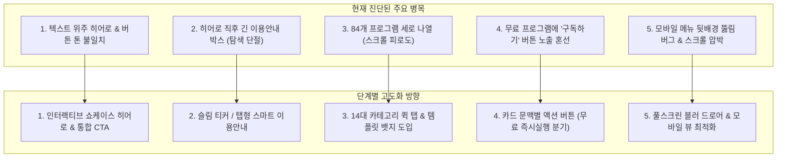

# 🌟 AIMaster 메인 사이트 디자인 점검 및 고도화 개선 제안서

> **작성일**: 2026-10-19  
> **검수 도구**: Microsoft Edge 전용 브라우저 포그라운드(화면 노출) 실세션 검수 완료  
> **검수 대상**: `https://www.buylife.xyz` (메인 홈, 헤더, 모바일 375px, `/programs` 탐색 페이지)  
> **관련 소스**: `app/(main)/page.tsx`, `components/layout/Header.tsx`, `components/programs/ProgramCard.tsx`, `components/programs/CategoryNav.tsx`

---

## 1. 종합 진단 요약 (Executive Summary)

현재 AIMaster 메인 사이트는 **블랙(#0a0a0f) + 골드(#d4af37)** 의 세련된 다크 테마 기반을 갖추고 있으며, 84개에 달하는 방대한 마케팅 자동화 솔루션을 성공적으로 서비스하고 있습니다. 

그러나 **84개 프로그램의 대규모 확장**에 따라, 초기 설계된 단순 텍스트 히어로와 세로 나열식 카드 레이아웃이 사용자의 **첫인상 몰입도(First Impression)**, **탐색 편의성(Discoverability)**, **모바일 사용성(Mobile UX)** 측면에서 개선이 필요한 지점들이 발견되었습니다.

---

## 2. 영역별 상세 분석 및 개선안

### ① 첫인상 및 Hero 섹션 (First Impression & Hero)

#### 🔍 현재 상태 점검
- **텍스트 중심 구성**: "마케팅을 자동화하세요"라는 대형 텍스트와 서브 텍스트만 존재하여, 실제 84개 프로그램의 강력한 기능이나 화면 퀄리티를 미리 체감하기 어렵습니다.
- **CTA 버튼 디자인 불일치**:
  - `프로그램 둘러보기 →`: 골드 배경 + 검은 글씨 (Primary)
  - `API키생성|플랫폼연동`: 완전 흰색 배경 + 검은 글씨 (배색 이질감)
  - `수익 공유 알아보기`: 짙은 회색 배경 + 흰 글씨 (가독성 저하)
- **통계 카드 표시 로직**: 비로그인 상태에서도 `내가 이용 가능한 프로그램: 82개`, `가장 빠른 이용 만료: 평생`으로 표기되어 이용자에게 오해를 줄 소지가 있음.

#### 💡 고도화 개선 제안
1. **인터랙티브 대시보드 프리뷰 / 롤링 쇼케이스 카드 결합**:
   - 히어로 우측 또는 하단에 대표 템플릿(포커스 스튜디오, 위저드, 네온 콘솔 등)의 실제 인터페이스 프리뷰를 3D 글래스 카드 형태로 배치하여 즉각적인 기술적 신뢰도 전달.
2. **Hero CTA 3종 톤앤매너 재정렬**:
   - **Primary**: `84개 프로그램 둘러보기 →` (골드 그라데이션 + 은은한 글로우)
   - **Secondary**: `API 키·플랫폼 연동 안내` (골드 테두리 아웃라인 글래스 버튼)
   - **Tertiary**: `수익 공유 파트너스` (텍스트 링크 + 화살표 아이콘 형태)
3. **소셜 프루프(Social Proof) 통계 리디자인**:
   - `총 84개 솔루션` | `14대 마케팅 분야` | `100% 본인 API 연동 보안` 3대 핵심 가치 지표로 개편.

---

### ② 정보 구조 및 스크롤 플로우 (Information Architecture)

#### 🔍 현재 상태 점검
- **히어로 바로 아래 거대한 이용안내/드림팀 박스 배치**:
  - 현재 Hero 섹션과 KPI 박스 바로 아래에 `이용 안내` 및 `드림팀 수강생 혜택` 긴 텍스트 박스가 전체 너비로 자리 잡고 있습니다.
  - 신규 방문자가 메인에 들어왔을 때 솔루션을 구경하기도 전에 "경고문이나 약관" 같은 긴 주의사항을 먼저 읽어야 해 이탈률이 높아질 수 있습니다.

#### 💡 고도화 개선 제안
1. **스마트 탭(Tab) 또는 팝오버/슬림 배너화**:
   - `이용 안내`와 `드림팀 수강생 혜택`을 가로형 슬림 배너 또는 [일반회원 안내 | 수강생 혜택] 2-Tab 구조로 컴팩트하게 축소.
   - 또는 히어로 하단에 한 줄짜리 슬라이딩 알림 티커(Ticker)로 노출하고, 상세 내용은 클릭 시 모달로 열리도록 전환.
2. **프로그램 쇼케이스로의 즉각적인 시선 연결**:
   - 이용안내의 공간을 줄임으로써 첫 스크롤 한 번에 "최신 프로그램"과 "인기 무료 프로그램"이 즉각 화면 상단에 꽂히도록 레이아웃 재배치.

---

### ③ 84개 프로그램 탐색 경험 (Program Discovery & Card UI)

#### 🔍 현재 상태 점검
- **끝없는 세로 스크롤**: 최신(3개) → 무료(12개) → 추천(12개) → 카테고리별(수십 개)이 메인 홈에 전부 나열되어 페이지 길이가 수만 픽셀에 달함.
- **무료(FREE) 프로그램 카드 버튼 혼선**:
  - 무료 뱃지가 붙어 있는 프로그램인데도 우측 하단에 골드 컬러의 `구독하기` 버튼이 노출되어 사용자가 "무료인데 결제해야 하나?" 혼란 유발.
- **디자인 템플릿 소구점 부재**:
  - 84개 프로그램이 각각 고유한 템플릿(포커스 스튜디오, 위저드, 네온 콘솔 등)을 가지고 있으나 카드에서는 텍스트 설명만 있어 프로그램의 UI/UX 강점이 드러나지 않음.

#### 💡 고도화 개선 제안
1. **14대 표준 카테고리 퀵 내비게이션 바 (메인 상단 스티키)**:
   - 메인 화면 상단에 14대 카테고리(유튜브, 블로그, 인스타, 쓰레드, 숏폼, 텍스트/기획 등) 칩셋 롤링 바를 배치하여, 클릭 시 즉시 해당 분야 프로그램만 필터링되어 보여지도록 개선.
2. **프로그램 카드 버튼 액션 분기 처리**:
   - **무료 프로그램**: `무료 바로가기` 또는 `즉시 실행` (초록/에메랄드 또는 밝은 골드)
   - **유료 프로그램(미구독)**: `구독하기`
   - **구독 중인 프로그램**: `실행하기` (에메랄드 글로우)
3. **디자인 템플릿 뱃지 및 메타정보 보강**:
   - 카드 상단에 템플릿 태그 표기 (예: `⚡ 네온 콘솔`, `🎯 포커스`, `🧙 위저드`)
   - 썸네일 호버 시 동적 미리보기 효과(스케일 업 및 은은한 골드 보더 글로우).

---

### ④ 모바일 반응형 및 메뉴 점검 (Mobile 375px UX)

#### 🔍 현재 상태 점검
- **모바일 햄버거 메뉴 오버레이 버그**:
  - 모바일(375px)에서 햄버거 메뉴를 열었을 때, 드롭다운 창 아래로 Hero의 버튼(`API키생성`, `수익 공유`)이 튀어나와 겹쳐 보이는 현상 확인 (z-index 및 배경 차단 부재).
- **모바일 히어로 버튼 3열 적체**:
  - 모바일 세로 화면에서 버튼 3개가 꽉 찬 세로 블록으로 쌓여 첫 화면에 다른 정보가 전혀 보이지 않음.

#### 💡 고도화 개선 제안
1. **풀스크린 슬라이드오버(Slide-over) 드로어 메뉴 적용**:
   - 모바일 메뉴 오픈 시 전체 화면을 `backdrop-blur-xl bg-black/80`으로 덮어 뒤쪽 콘텐츠와의 시각적 간섭을 100% 차단하고 우측에서 매끄럽게 슬라이드되는 모바일 전용 드로어 구현.
2. **모바일 Hero 버튼 간소화**:
   - 메인 CTA인 `프로그램 둘러보기 →`를 와이드 골드 버튼으로 배치하고, 나머지 2개는 하단에 깔끔한 서브 칩 링크로 가로 2열 배치하여 세로 공간 절약.
3. **모바일 카드 캐러셀(Swipe) 적용**:
   - 추천 프로그램 및 카테고리별 목록을 세로로 길게 나열하는 대신, 모바일에서는 좌우 스와이프 가능한 가로 스크롤 카드 뷰 제공.

---

## 3. 우선순위 및 작업 로드맵 제안

| 단계 | 항목 | 주요 작업 내용 | 난이도/영향 |
|---|---|---|---|
| **Phase 1 (긴급 버그/UX 정돈)** | **모바일 메뉴 & 카드 버튼 정돈** | • 모바일 햄버거 메뉴 백드롭 오버레이 z-index 수정 • 무료 프로그램 카드 버튼 문구 분기 (`구독하기` → `무료 바로가기`) • Hero CTA 버튼 3종 톤앤매너 일치화 | 낮음 / **즉시 체감도 높음** |
| **Phase 2 (정보 구조 개편)** | **이용안내 슬림화 & 퀵 카테고리** | • 히어로 직후 긴 이용안내를 탭/아코디언/슬림 티커로 정돈 • 14대 표준 카테고리 퀵 필터 바 메인 상단 배치 | 중간 / **탐색 편의성 극대화** |
| **Phase 3 (비주얼 고도화)** | **인터랙티브 히어로 & 쇼케이스** | • 히어로 영역 3D 글래스 프리뷰 쇼케이스 결합 • 프로그램 카드 디자인 템플릿 뱃지 연동 • 앰비언트 골드 글로우 및 세련된 마이크로 인터랙션 | 중간 / **브랜드 가치 극대화** |

---

> [!NOTE]
> 본 제안서는 사용자(주인님)의 승인 후 단계별로 안전하게 구현을 진행할 예정입니다.
