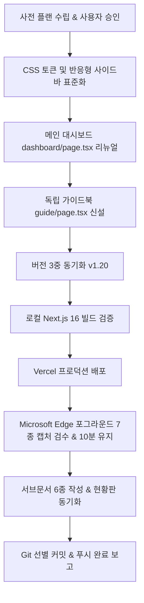

# 카카오톡 뉴스레터 자동화 (kakao_auto_poster) 디자인 리뉴얼 & 가이드북 구축 플랜

> **작성일시**: 2026-10-19  
> **담당**: Antigravity (윈도우 환경)  
> **목표 버전**: `v1.20` (기존 `v1.16`)  
> **서비스 주소**: `https://kakao-auto-posting.buylife.xyz`  
> **컨셉 테마**: **플로우 위저드 스타일 — 카카오 옐로우 뉴스레터 마케팅 에디션**

---

## 1. 개요 및 목적
- **배경**:
  - `kakao_auto_poster`는 관심 주제 키워드를 등록하면 Perplexity 및 OpenAI AI가 실시간 웹 정보를 분석하여 풍부한 뉴스레터 리포트를 생성하고, 카카오톡(나에게 보내기, 수신자 그룹 발송), 텔레그램 검토, 이메일로 자동 전송하는 올인원 뉴스레터 자동화 도구입니다.
  - 현재 사이드바에 `📖 연동 & 사용 매뉴얼` (`/guide`) 메뉴가 누락되어 있고, 독립 비주얼 가이드북 페이지가 없어 `DESIGN.md` 9번 필수 원칙을 충족하지 못하고 있습니다.
  - 또한 모바일 햄버거 슬라이드 드로어가 없고 대시보드 화면이 단순 회색 테두리 박스로 되어 있어 카카오톡 서비스다운 친근하고 세련된 시각적 몰입감이 부족합니다.
- **목적**:
  - `DESIGN.md`의 9대 디자인 원칙을 적용하여 **플로우 위저드 스타일 — 카카오 옐로우 뉴스레터 마케팅 에디션**으로 전면 리뉴얼합니다.
  - 좌측 사이드바(데스크톱 고정 + 모바일 반응형 햄버거 토글 드로어)에 `📖 연동 & 사용 매뉴얼` (`/guide`) 메뉴를 신설합니다.
  - 대시보드(`/dashboard`) 상단에 프리미엄 `.studio-hero` 배너, 3대 핵심 KPI 통계 카드, 4단계 파이프라인 가이드 바를 탑재합니다.
  - 독립 비주얼 가이드북(`app/(dashboard)/guide/page.tsx`)을 신설하여 4단계 뉴스레터 자동화 워크플로우, 발송 채널별(카카오톡/텔레그램/이메일) 기능 매트릭스 표, 뉴스레터 오픈율 7대 황금 수칙, FAQ 5종을 완비합니다.
  - 버전 3중 동기화(`v1.20`), Next.js 16 빌드 통과, Vercel 프로덕션 배포, Microsoft Edge 포그라운드 실세션 검수(7종 캡처)를 성공적으로 완수합니다.

---

## 2. 디자인 시스템 및 시각 아이덴티티

### 2.1 컬러 팔레트 (카카오 옐로우 & 다크 차콜)
- **Primary Color (카카오 옐로우)**: `#fee500` (Kakao Yellow) / `#f59e0b` (Amber 500) — 친근하고 즉각적인 주목성
- **Dark Neutral (다크 차콜)**: `#191919` (Kakao Black) / `#0f172a` (Slate 900) — 세련된 대비와 높은 텍스트 가독성
- **Background & Card**: `#f8fafc` (Slate 50), `#ffffff` (White), 서브 `#f1f5f9` (Slate 100)
- **Status & Channel Points**:
  - 카카오톡 옐로우: `#fee500` / `#d97706`
  - 텔레그램 스카이블루: `#0284c7` (Sky 600)
  - 이메일 인디고: `#4f46e5` (Indigo 600)
  - 성공/활성 에메랄드: `#10b981` (Emerald 500)

### 2.2 타이포그래피 & 컴포넌트
- 일관된 카드 라운딩(`rounded-2xl`), 섬세한 테두리 및 섀도우, 직관적인 상태 칩 및 액션 버튼.

---

## 3. 핵심 리뉴얼 컴포넌트 및 페이지 구성

### 3.1 좌측 반응형 사이드바 표준화 (`src/components/layout/Sidebar.tsx`)
- **데스크톱 (md 이상)**:
  - 260px 좌측 고정 사이드바.
  - 상단: `💬 카카오톡 뉴스레터 자동화` 로고 + `v1.20` 카카오 옐로우 배지 + 부제(뉴스레터 마케팅 에디션).
  - 대시보드 개요 메뉴 (`/dashboard`).
  - 4단계 플로우 스텝퍼:
    - Step 1: `📌 관심 주제 등록` (`/topics`)
    - Step 2: `📰 생성리포트 목록` (`/reports`)
    - Step 3: `📣 카카오톡 수신자 목록` (`/recipients`)
    - Step 4: `📨 발송 내역` (`/broadcast-log`)
  - 유틸리티 메뉴:
    - `🔑 API키등록·플랫폼연동` (`/settings`)
    - **`📖 연동 & 사용 매뉴얼` (`/guide`)** (신설!)
    - `← 전체 프로그램 목록` (`https://buylife.xyz/programs`)
  - 하단: 접속 계정 이메일 및 원클릭 로그아웃 버튼.
- **모바일 (md 미만)**:
  - 상단 56px 헤더 바 (로고 + 햄버거 토글 버튼).
  - 햄버거 클릭 시 부드럽게 열리는 슬라이드 오버레이 드로어 네비게이션 제공.

### 3.2 메인 대시보드 리뉴얼 (`src/app/(dashboard)/dashboard/page.tsx`)
- **`.studio-hero` 프리미엄 그라디언트 배너**:
  - 카카오 옐로우 & 다크 차콜의 감각적인 그라디언트 배너.
  - 타이틀: "AI 카카오톡 뉴스레터 자동화 마케팅 스튜디오"
  - 설명: "관심 키워드만 등록하면 AI가 최신 트렌드를 심층 분석하여 완성도 높은 리포트를 생성하고 카카오톡 채팅방에 원클릭 자동 발송합니다."
  - 퀵 액션: `📖 연동 & 사용 매뉴얼` (`/guide`), `📌 새 주제 등록하기` (`/topics`).
- **3대 핵심 KPI 통계 카드**:
  1. `📌 등록된 주제`: 총 등록된 관심 주제 수
  2. `🔔 활성 예약 주제`: 실시간 자동 모니터링 중인 주제 수
  3. `📰 생성된 뉴스레터`: AI가 작성 완료한 총 리포트 수
- **4단계 파이프라인 가이드 바**:
  - `① 키워드·주제 등록` ➔ `② AI 리포트 생성` ➔ `③ 수신자·그룹 지정` ➔ `④ 카카오톡·채널 자동 발송`
- **프로그램 소개 및 실전 활용 가이드 섹션**:
  - 명확하고 친절한 스텝별 안내 카드.

### 3.3 독립 비주얼 가이드북 전면 신설 (`src/app/(dashboard)/guide/page.tsx`)
1. **상단 네비게이션 & 가이드 히어로 배너**:
   - "카카오톡 뉴스레터 자동화 완벽 매뉴얼"
   - `← 대시보드로 돌아가기` 퀵 링크.
2. **4단계 뉴스레터 자동화 워크플로우**:
   - 주제/키워드 선정 ➔ AI 심층 리서치 ➔ 카카오톡/텔레그램 발송 설정 ➔ 수신자 반응 분석.
3. **발송 채널별 기능 및 권장 활용 매트릭스 표**:
   - 카카오톡 나에게 보내기, 카카오톡 알림톡/친구톡(Solapi 연동), 텔레그램 사전 승인 봇, 예약 이메일 알림 비교.
4. **뉴스레터 오픈율을 3배 높이는 7대 황금 수칙**:
   - 첫 2줄 요약 후킹, 타깃 그룹별 세분화, 발행 주기 최적화, 출처 신뢰도 명시, 인터랙티브 공유 링크 등.
5. **자주 묻는 질문 (FAQ 5종)**:
   - 카카오 개발자 앱 연동, Perplexity/OpenAI 키 등록, 친구톡 수신자 번호 등록, 자동 크론 스케줄링 등.

---

## 4. 버전 3중 동기화 계획 (`v1.20`)
1. `kakao_auto_poster/package.json`: `"version": "1.20.0"`
2. `kakao_auto_poster/src/lib/version.ts`: `export const APP_VERSION = "v1.20";`
3. Supabase DB `programs` 테이블: `UPDATE programs SET version = 'v1.20' WHERE slug = 'kakao-auto-posting';`
   - 스크립트: `scripts/update_kakao_auto_poster_version.cjs` 실행 및 검증.

---

## 5. 실행 및 검수 로드맵

1. **Step 1: CSS 클래스 확장 및 사이드바 반응형 개편**
   - `src/app/globals.css`: `.studio-hero`, `.stat-card`, `.pipeline-step`, `.guide-card` 추가.
   - `src/components/layout/Sidebar.tsx`: 모바일 햄버거 토글 드로어 완비, `📖 연동 & 사용 매뉴얼` (`/guide`) 메뉴 신설.
2. **Step 2: 대시보드 리뉴얼 (`src/app/(dashboard)/dashboard/page.tsx`)**
   - 히어로 배너, 3대 KPI 카드, 4단계 파이프라인 가이드 바 탑재.
3. **Step 3: 독립 가이드북 신설 (`src/app/(dashboard)/guide/page.tsx`)**
   - 4단계 워크플로우, 발송 채널 매트릭스 표, 7대 황금 수칙, FAQ 5종 카드.
4. **Step 4: 버전 3중 동기화 (`v1.20`)**
   - 코드 2곳 및 Supabase DB `programs` 테이블 동기화.
5. **Step 5: 로컬 빌드 및 Vercel 배포**
   - `npm run build` 무오류 통과 ➔ `npx vercel --prod --yes` 배포.
6. **Step 6: Edge 전용 브라우저 실세션 검수 (7종 캡처 & 10분 유지)**
   - 데스크톱 대시보드, 히어로/KPI 영역, 4단계 파이프라인 영역, 가이드북 상단, 가이드북 매트릭스 표, 모바일 대시보드(375px), 모바일 드로어/가이드북.
7. **Step 7: 서브문서 6종 및 루트 현황판 동기화, 커밋/푸시**
   - `DESIGN_HANDOFF.md`, `IMPROVEMENTS.md`, `IMPROVEMENT_HANDOFF_20261019.md`, `AGENTS.md`, `README.md`.
   - `DESIGN.md` (누적 78개 완료 / 94.0%), `docs/ACTIVE_WORK.md`, `docs/DESIGN_TEMPLATE_CATALOG.md`, `docs/HANDOFF.md`.
