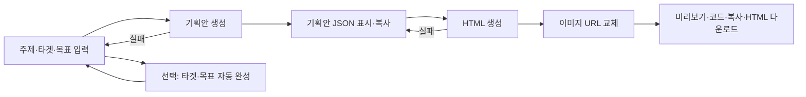

# AI 랜딩페이지 자동화 — 원본 소스 대조와 개발 계획 보완

작성일: 2026-10-13. [개발 계획](DEVELOPMENT_PLAN.md)과 함께 읽는다. 이 문서는 참고 앱의 확인 사실과 개발 제안을 구분한다. 코드 구현·DB 적용·프로덕션 배포 완료 보고가 아니다.

## 1. 확인 범위와 근거

- 참고 앱: [AI Landing Page Architect Enhance](https://aistudio.google.com/apps/fedca9b9-75d5-48a2-9643-3b55c8f57502?fullscreenApplet=true&showAssistant=true&showPreview=true).
- 실제 Chrome에서 초기 입력 화면과 앱 제목을 확인했다. 입력 필드와 버튼을 접근성 트리 및 화면 캡처로 대조했다.
- 공유 작업 환경에 확보된 원본 소스는 `D:/PDS/lpa-source/`. 원본 README의 앱 UUID가 참고 URL과 일치한다. 실행 코드·컴포넌트·서비스·타입·HTML·빌드 설정·README·메타데이터 18개 파일을 정독했다.
- 전체 파일 목록은 `.gitignore`, `.env.example`을 포함하여 20개다. 환경 파일의 키 값은 분석 문서에 포함하지 않는다. [소스 목록과 SHA-256](REFERENCE_MANIFEST.json)으로 후속 CLI가 같은 자료인지 확인한다.
- `scratch/landing-reference/index.html`은 일반 HTTP 요청으로 받은 Google의 쿠키 확인 페이지다. 앱 HTML이나 앱 JS 번들로 취급하지 않는다.
- 운영 미리보기의 빌드 JS와 소스 ZIP의 바이트 일치, 실제 네트워크 응답, AI가 생성한 JSON·HTML 결과는 확인하지 않았다. 아래 결과 구조는 소스의 요구사항과 반환 처리 분석이다. 실제 결과 예시를 지어내지 않는다.
- 원본 서버의 비공개 설정·비밀 값·Google 내부 인증 로직은 확보 범위 밖이다. 운영 앱 전체를 100% 검증했다고 표현하지 않는다.

## 2. 사용자 흐름과 상태 전이

`types.ts`의 상태는 `IDLE`, `GENERATING_PLAN`, `PLAN_COMPLETE`, `GENERATING_CODE`, `CODE_COMPLETE`, `ERROR`다. `App.tsx`는 상태에 따라 입력 화면과 결과 화면을 교체한다. 기획 실패는 `ERROR`, 코드 생성 실패는 오류 문구를 보이면서 `PLAN_COMPLETE`로 돌아온다.

기획 완료 후 입력 폼이 사라진다. 완료 화면에 새 프로젝트·처음으로·기획 편집·HTML 재생성 버튼은 구현되어 있지 않다. 새로고침하면 기획과 코드, 채팅 세션이 사라지고 이미지 설정만 남는다. 코드 생성 성공 후에는 생성 버튼도 사라진다.

## 3. 입력과 모든 선택 옵션

| 항목 | 원본 동작 | 개발 시 반영 |
|---|---|---|
| 주제 | 텍스트 직접 입력 또는 예시 20개 선택 | `presetId`와 실제 주제 설명을 분리 |
| 타겟 | 필수 텍스트 | 직접 편집, 자동 완성 전후 값 보존 |
| 목표 | 필수 여러 줄 텍스트 | 측정 지표와 설명을 편집 가능하게 |
| 자동 완성 | 주제가 있을 때 활성, 결과가 타겟·목표를 덮어씀 | 기존 값이 있으면 적용 전 비교, 실패 시 원래 값 유지 |
| 기획 시작 | HTML `required`와 문자열 참 여부 검사 | 서버에서도 공백 제거·길이·필수 값 검사 |
| 이미지 소스 | LoremFlickr / Unsplash / Pexels / Pixabay | 명시적인 제공자 선택과 회원 본인 키 확인 |
| 제공자 키 | 해당 소스의 비밀번호 입력란, 연결 시험, 저장·닫기 | 공용 `user_api_keys`, 서버 경유, 화면에 원문 키 반환 금지 |
| 결과 보기 | 미리보기 / 코드 두 탭 | 모바일·태블릿·데스크톱 폭 추가 |
| 출력 | JSON 복사, HTML 복사, HTML 다운로드 | Markdown·JSON 파일·변환 요청문도 명시적 결과물로 추가 |

원본에는 모델 선택·온도 조절·색상 선택·페이지 수 선택·자동 배포·회원 로그인·프로젝트 목록 옵션이 없다. 색상은 AI 기획 결과에 들어가는 값이며 사용자가 고르는 고정 팔레트가 아니다.

### 주제 템플릿 20개

아래는 원본 구조를 요약한 목록이다. 각 행의 서브 구성은 4개이며 상세 문자열은 `services/templateData.ts`가 근거다.

| 번호 | 주제 분류 | 레이아웃 | 서브 구성 요약 |
|---|---|---|---|
| 1 | 개인 소개 | Card | 소개 / 이력 / 사진 / 연락 |
| 2 | 프로필·SNS 링크 | Card | 프로필 / 추천 링크 / 작업 / 문의 |
| 3 | 이력서·경력 | Document | 경력 / 프로젝트 / 기술 / 자기소개 |
| 4 | 포트폴리오 | Gallery | 작품 / 소개 / 서비스 / 견적 |
| 5 | 기업·병원·가게 홍보 | Landing | 소개 / 제품·서비스 / 후기 / 위치·문의 |
| 6 | 뉴스레터 | Hero | 지난 호 / 에디터 / 구독 혜택 / FAQ |
| 7 | 콘텐츠 모음 | Gallery | 영상 / 글 / 자료 / 커뮤니티 |
| 8 | 디지털 상품 | Gallery | 상품 / 사용법 / 라이선스 / 지원 |
| 9 | 컨설팅·멘토링 | Landing | 전문가 / 프로그램 / 사례 / 예약 |
| 10 | 프리랜서 서비스 | Landing | 서비스 / 절차 / 작업 / 견적 |
| 11 | 강의·워크숍 | Landing | 과정 / 강사 / 후기 / 신청 |
| 12 | 지역 서비스 | Landing | 안내 / 가격 / 사진 / 예약 |
| 13 | 후원·펀딩 | Hero | 이야기 / 내역 / 후원자 / 보상 |
| 14 | 도구 모음 | Gallery | 개발 / 디자인 / 생산성 / 제보 |
| 15 | 바로가기 | Card | 업무 / 학습 / 취미 / 자료 |
| 16 | 미니 앱·게임 | Hero | 사용법 / 변경 이력 / 개발자 / 오류 제보 |
| 17 | 오픈소스 | Landing | 문서 / 튜토리얼 / 기여 / 릴리스 |
| 18 | 출시 대기자 | Hero | 기능 / 일정 / 팀 / FAQ |
| 19 | 설문·피드백 | Hero | 참여 / 결과 / 혜택 / 개인정보 |
| 20 | 직접 입력 | Auto-Detect | 상세 / 기능 / 안내 / 문의 |

**중요:** 코드가 주제를 의미 분석하여 프리셋을 고르는 것이 아니다. `TOPIC_TEMPLATES[inputs.topic]`으로 문자열이 정확히 일치할 때만 해당 프리셋을 사용한다. 예시 이름을 선택한 뒤 회사 이름이나 설명을 덧붙이면 직접 입력 템플릿으로 바뀐다. `Auto-Detect`는 여섯 번째 화면 유형이 아니라 모델에게 유형 선택을 맡기는 표시 값이다. 5개 실제 레이아웃의 특징은 다음과 같다.

| 유형 | 요구 레이아웃 |
|---|---|
| Card | 화면 중앙의 좁은 프로필 카드, 전체 폭 헤더·푸터 제외 |
| Document | 회색 배경 위 문서형 컨테이너, 타이포그래피 중심 |
| Hero | 한 화면 헤드라인과 입력 폼, 스크롤 억제 |
| Gallery | 반응형 이미지·작품 그리드 |
| Landing | 히어로·특징·콘텐츠·행동 유도 섹션을 순서대로 배치 |

## 4. 프롬프트·AI 호출 로직

`services/geminiService.ts`의 모든 호출은 원본에서 `gemini-3.1-pro-preview`를 사용한다. 이는 소스에서 확인한 모델명이며 현재 모든 회원이 호출할 수 있다는 뜻은 아니다. 원본에는 모델 폴백이나 재시도가 없다.

| 기능 | 입력·컨텍스트 | 출력 처리 |
|---|---|---|
| 자동 완성 | 주제, 한국어 타겟과 측정 가능한 목표를 요청 | JSON MIME·`target`/`goal` 문자열 스키마, `JSON.parse` |
| 기획 | 새 채팅, 시스템 지침, 주제·타겟·목표, 선택 템플릿 구조 | 온도 0.7, 프롬프트 안 JSON 예시, 코드블록 제거·파싱 |
| HTML | 같은 모듈 전역 채팅에 후속 요청, 이전 기획을 대화 이력으로 사용 | HTML 시작·끝 추출 → HTML 코드블록 → 태그로 둘러싸인 원문 → 오류 화면 |

시스템 지침은 디자이너·개발자 역할, 유형별 레이아웃, 4개 서브 구성 유지, 한국어, 기획 JSON·코드 HTML 출력, LoremFlickr 이미지 URL, 대화 문구 생략을 요구한다. 기획 호출에는 실제 API `responseSchema` 설정이 없다. 프롬프트에 스키마 예시를 적는 것과 API의 구조화 출력은 구별해야 한다.

HTML 요청은 순수 HTML/JS, Tailwind·FontAwesome CDN, 기획에 있을 때만 지도, 메인·서브 컨테이너 전환과 돌아가기 버튼을 요구한다. 생성 결과의 importmap·React import를 금지하지만 검사 코드는 없다. 원본 앱 자체의 `index.html`에는 importmap이 있으므로 원본 실행 설정과 생성 HTML 조건도 구별한다.

기획 JSON 파싱 실패 시 오류를 반환하지 않고 원문을 보여준다. HTML 형식 오류도 오류 HTML 문자열을 정상 반환하므로 상태는 `CODE_COMPLETE`가 될 수 있다. 오류 메시지를 정상 결과로 저장하는 구현은 재사용하지 않는다.

## 5. 결과값 구조

### 자동 완성

`{ target: string, goal: string }`. API 내부 오류를 잡으면 둘 다 빈 문자열이다. 입력 폼이 이 값을 그대로 적용하여 사용자가 작성한 타겟·목표를 지울 수 있다. 실제 필수 필드 보장은 없다.

### 기획안 JSON

아래는 프롬프트의 기대 구조다. 서버에서 보장되는 스키마가 아니다.

| 경로 | 기대 값 |
|---|---|
| `projectInfo.topic`, `target`, `goal` | 사용자 입력 반영 문자열 |
| `projectInfo.language`, `selectedStyle`, `structureStrategy`, `designIntent` | 언어, 유형, 구조 전략, 디자인 의도 |
| `structure.mainPage.sections`, `description` | 메인 섹션 배열, 설명 |
| `structure.subPages[]` | `id`, `title`, `path`, `purpose`, `contentSpecs`; 지침상 4개 |
| `contentStrategy.headline`, `cta`, `keyMessages` | 헤드라인, 행동 유도 문구, 핵심 메시지 배열 |
| `designSystem.colorPalette` | `primary`, `secondary`, `background` 색상 문자열 |
| `designSystem.typography`, `moodboard` | 글꼴·타이포와 분위기 설명 |
| `developmentGuide.stack`, `folderStructure` | Vite·React·TypeScript와 파일 구조 안내 |
| `developmentGuide.vercelDeploymentConfig` | `instruction`, `indexHtmlSetup` |
| `developmentGuide.imageConfiguration` | `storagePath`, `manifestFile` |
| `imageAssets[]` | `name`, `url`, `description`, `prompt` |

`imageAssets[].prompt`는 설명용 텍스트다. 원본이 AI 이미지 생성 API를 호출한다는 뜻은 아니다. `subPages[].path`도 실제 배포된 URL이 아니라 기획 값이다.

### HTML과 내보내기

- HTML은 텍스트 문자열. 기획에 요구한 메인·서브 화면이 실제 생성되었는지는 실행 확인이 필요하다.
- 이미지는 HTML의 URL을 교체한다. 기획 JSON의 `imageAssets`는 교체 결과와 자동 동기화하지 않는다.
- 미리보기는 `srcDoc` iframe, 높이 800px. 샌드박스는 scripts/forms/popups/modals를 허용하고 same-origin은 허용하지 않는다.
- 코드 탭은 HTML 텍스트, 다운로드는 `text/html` Blob의 `landing-page.html`이다. ZIP·React 프로젝트·Vercel 배포 결과는 출력하지 않는다.
- `components/ConversionFooter.tsx`에는 변환 요청문 복사 기능이 있으나 **App·index 어디에서도 import/렌더하지 않는다**. 기존 개발 계획의 고정 하단 바·세 번째 결과물 설명은 현재 소스의 실제 기능으로 보장되지 않는다. 우리 프로그램에서는 별도 기능으로 구현한다.
- `VERCEL_TROUBLESHOOTING_GUIDE`도 정의만 있고 사용하지 않는다. 원본에 노출되는 전체 사용 매뉴얼로 취급하지 않는다.

## 6. 이미지 API·저장·UI 설정

| 제공자 | 검색 동작 | 선택 응답 필드 | 연결 시험 |
|---|---|---|---|
| LoremFlickr | 키워드 URL 그대로 사용, 키 없음 | URL | 항상 성공 처리 |
| Unsplash | `/search/photos`, 가로형, 1개 | `results[0].urls.regular` | `/photos/random` HTTP 상태 |
| Pexels | `/v1/search`, 가로형, 1개, Authorization 헤더 | `photos[0].src.large2x` 또는 `large` | `/v1/curated` HTTP 상태 |
| Pixabay | `/api/`, 사진·가로형, 3개 | `hits[0].largeImageURL` | `/api/` HTTP 상태 |

비기본 제공자는 검색 페이지 1~10을 무작위 선택한다. HTML에서 `https://loremflickr.com/1600/900/` 뒤 영문·숫자·하이픈·밑줄·쉼표 키워드만 찾고 중복 키워드를 한 번씩 병렬 조회한다. 다른 해상도·한글·URL 인코딩 키워드는 이 정규식으로 처리하지 못한다. 동시성 상한·시간 제한·취소·재시도·사진 출처 메타데이터 보존이 없다. 실패하면 원래 URL을 그대로 둔다.

`App.tsx`의 `isKeyMissing` 계산값은 사용하지 않는다. 키 기반 소스를 선택하고 키를 등록하지 않아도 생성이 진행된다. 이를 AIMaster에 그대로 옮기면 키 미등록 안내 규칙을 충족하지 못한다.

이미지 설정은 `landing_arch_config` 로컬 저장소에 고정 문자열을 사용하는 XOR 난독화로 저장된다. 안전한 암호화 저장이나 회원별 격리가 아니다. 설정창의 암호화·서버 미전송 설명과 달리 제공자에 키를 실어 요청한다. Gemini 키는 Vite `define`으로 클라이언트에 주입하는 구조다. 해당 구조가 실제 운영 앱에서 어떤 키로 실행되는지는 확인하지 않았다.

원본 앱은 slate 계열 다크 UI, blue·purple 포인트, Inter 글꼴, Tailwind CDN과 FontAwesome 6.0.0을 사용한다. `index.html`에 본문 배경 `#0f172a`, 글자 `#e2e8f0`, 스크롤바 `#1e293b`·`#475569`·`#64748b`가 정의되어 있다. 새 프로그램 작업 화면에는 플랫폼 규칙에 따라 흰색 베이스를 적용한다.

## 7. 기존 개발 계획에 추가할 필수 조건

1. **본인 키 확인:** AI 호출과 키 기반 이미지 검색은 서버에서 본인 키를 확인한다. 없으면 `needKey`와 등록 안내를 반환한다. 다른 모델·무료 사진으로 자동 전환하여 키 미등록을 숨기지 않는다. 키 없는 이미지 소스는 사용자가 처음부터 명시적으로 선택한 경우에만 별개 경로로 처리한다. 키 등록 완료 후 검색 실패도 실패 항목과 재시도·소스 변경 선택을 보여준다.
2. **템플릿 유지:** `presetId`, `topicDescription`, `layoutType`을 분리한다. 프리셋을 고르고 상세 설명을 입력해도 선택한 4개 서브 구성은 유지한다. 직접 입력은 유형을 자동 제안하고 사용자가 확인·변경할 수 있도록 한다.
3. **입력·결과 검증:** 주제·타겟·목표를 서버에서 검증한다. 기획 생성에 API 구조화 출력을 적용하고 서버 스키마로 다시 검증한다. AI 스키마 적용이 내용의 정확성을 보장하지는 않으므로 4개 서브·id/path 중복·입력 반영도 확인한다. [Google 구조화 출력 문서](https://ai.google.dev/gemini-api/docs/structured-output).
4. **복원 가능한 생성:** HTML 요청에 저장된 기획안과 지침을 넣어 새로고침·다른 기기에서도 이어서 생성한다. 전역 채팅 변수에 의존하지 않는다. 편집하면 기존 HTML이 이전 기획 기준임을 표시한다.
5. **오류와 중복 처리:** 자동 완성 실패는 입력값을 유지한다. 잘못된 JSON·오류 HTML은 실패로 반환한다. 실행 ID와 프로젝트 수정 번호를 대조하여 늦게 도착한 응답이 최신 편집을 덮어쓰지 않도록 한다. 생성 취소는 가능한 요청 중단과 늦은 응답 적용 차단을 구분한다.
6. **키 노출 차단:** 브라우저 번들·localStorage·로그에 원문 키를 넣지 않는다. API 키는 서버에서 사용한다. [Google API 키 보안 문서](https://ai.google.dev/gemini-api/docs/api-key). 환경변수·키 값·DB 제약 변경은 실제 실행 전에 저장소 승인 규칙을 따른다.
7. **모델 가용성:** 기존 계획의 모델 폴백 체인은 원본의 구현 사항이 아니다. 구현 시 회원 본인 키로 [models.list](https://ai.google.dev/api/models)를 확인하고 지원 기능에 맞춰 선택한다. 인증 실패·키 미등록·요금 한도 오류를 다른 키로 우회하지 않는다. 모델명이 오래되었다고 무조건 재시도하거나 과금 호출 수를 늘리지 않는다.
8. **HTML 실행 경계:** DOM 기반으로 HTML과 외부 자원을 검증한다. iframe은 same-origin·상위 이동·팝업·폼 전송을 기본 차단하고 제한된 스크립트 실행만 검토한다. 접근 권한 검사와 회원 데이터 API는 iframe의 요청도 신뢰하지 않는다. 외부 이미지·CDN·지도 로드 범위를 명시하고 키가 포함된 URL 저장을 거부한다. 문자열 검사만으로 안전한 HTML을 보장했다고 표현하지 않는다.
9. **내보내기 일치:** 현재 기획·현재 HTML·이미지 목록을 하나의 수정 번호로 묶는다. JSON/Markdown/HTML 다운로드와 변환 요청문 기능을 실제 화면에 연결한다. 변환 요청문 복사와 실제 React 프로젝트 생성·배포를 다른 단계로 표시한다.
10. **정책 준수:** 공유 인증·이용 권한, owner-only RLS, 서버 `user_id` 필터, `force-dynamic`과 `force-no-store`, 당해 연도 프롬프트, 한국인 기본 인물 묘사, 흰색 작업 화면·표준 사이드바를 사용한다. 프로그램 등록은 버전 v1.01·라이브 주소·요금제·썸네일을 함께 처리한다.

## 8. 구현 순서와 완료 기준

| 단계 | 결과물 | 완료 기준 |
|---|---|---|
| 1. 기반 | 인증·권한·API키등록·플랫폼연동·표준 화면 | 비로그인·무권한·키 미등록 요청 차단; 관리자·정상 회원 허용 |
| 2. 기획 | 20개 프리셋, 직접 입력, 자동 완성, 구조화 기획과 편집 | 설명 변경에도 프리셋 유지; 유효한 4개 서브; 자동 완성 실패 시 입력 유지 |
| 3. 프로토타입 | 저장된 기획 기반 HTML 생성·이미지 검색·폭별 미리보기 | 새로고침 후 재생성; 형식 실패 분리; 키 미등록 차단; 이미지 실패 표시 |
| 4. 보관·출력 | 사용자별 저장·복원·JSON/Markdown/HTML·변환 요청문 | 다른 회원 접근 차단; 기획·HTML 수정 번호 일치; 모든 버튼 실제 연결 |
| 5. 검수 | 자동 검사·실제 Chrome·본인 키 소량 실호출 | 각 결과를 구분해 증거 기록; 모바일·PC, 메인·4개 서브·복사·다운로드 확인 |
| 6. 운영 | 문서·버전·카탈로그·커밋·푸시·배포·운영 확인 | 라이브 로그인·권한·키 등록·생성·저장·출력 전 흐름 확인 후 완료 보고 |

검수 표본에는 정확한 프리셋명과 수정된 설명, 공백 입력, 정상/비정상 JSON, 빠진 서브·중복 경로, DOCTYPE 대소문자·코드블록·빈 HTML, 중복 이미지 키워드, 제공자 키 미등록·401·429·빈 검색, 새로고침·다른 기기·동시 편집·다른 회원을 포함한다. 실제 AI 결과물은 본인 키로 실행한 결과만 별도 보관하고 모의 데이터에는 모의 표시를 한다.

## 9. 후속 CLI 재개

[분석 인수인계](ANALYSIS_HANDOFF.md)를 먼저 읽는다. 다른 CLI의 구현 중 파일이 이 폴더에 있으므로 기존 작업을 확인한 뒤 담당 파일을 나눈다. 이 조사 작업에서는 앱 코드·DB·환경변수·운영 배포를 변경하지 않았다.
