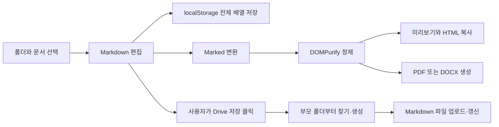

# Markdown Studio 원본 정밀 분석

조사일: 2026-10-13. 참고: https://markdown-studio-mauve.vercel.app/

## 1. 결론과 확인 범위

원본은 **마크다운 문서 관리·편집·변환 도구**입니다. 폴더 트리 → 텍스트 편집 → HTML 미리보기 → 복사/PDF/DOCX → 선택적 Drive 저장으로 이어집니다. 공개 번들에는 AI 프롬프트·LLM 호출·앱 자체 문서 API가 확인되지 않았습니다. 문서 변환은 AI 없이 브라우저에서 수행합니다.

확인한 자료:

- 서버가 반환한 HTML과 실제 렌더링된 HTML, 메인 JavaScript 번들 전체.
- 기본 안내 문서 3개, Google Client ID 설정 화면, 목록·특수기호 메뉴, 파일·폴더 우클릭 메뉴.
- 독립된 **화면이 보이는 Chrome**에서 서식 17개, 목록 3종, 특수기호, 단축키, 생성·이름 변경·이동·검색, 새로고침 복원, 크기 조절, 모바일, 복사·소스보기, PDF/DOCX 다운로드, 폴더 DOCX 내보내기.
- 실제 PDF 구조/텍스트 추출, DOCX ZIP·OOXML 구조.
- 별도 브라우저 컨텍스트에서 Google API를 모의 응답으로 대체하여 401 저장 실패 처리 재현.

실제 Google 로그인·본인 Drive 쓰기·가져오기, Word/Google Docs의 화면 렌더링, 접근할 수 없는 서버 구현은 검증하지 않았습니다. 전체 공개 번들을 읽었다는 사실을 비공개 시스템까지 확인했다는 의미로 쓰지 않습니다.

수집 위치: `D:/PDS/markdown-review-20261013/`. 메인 파일 `/assets/index-Bq4-Ts5h.js`: 324,432 bytes, SHA-256 `4e4a8f5477711e8f491a38f02e4d5d8bd8344df91ef493f4597f8096b84c9336`. 분석용으로 별도 파일을 정렬했고 원본 파일은 보존했습니다. 핵심 실험은 [review-results.json](evidence/review-results.json)에 보관합니다.

## 2. 화면 구성

| 영역 | 기능·현재 구성 |
|---|---|
| 상단 | 프로그램명, Drive 연결, PDF/DOCX 아이콘, 설정, 새 문서 |
| 서식 툴바 | 20개 명령, 목록 메뉴 3종, 특수기호 32개 |
| 좌측 탐색기 | 폴더·파일 트리, 이름 검색, 최상위 생성, 이름 변경·삭제, 드래그 이동, 폴더 내보내기 |
| 중앙 | 제어형 `textarea`, 선택 영역에 Markdown 기호 삽입 |
| 우측 | HTML 미리보기/소스보기 전환, HTML 코드 복사 |
| 경계 | 탐색기 폭 150~500px, 편집 영역 비율 20~80% 마우스 조절 |
| 하단 | 원 개발자 표시·YouTube 링크; AIMaster에 그대로 가져올 항목 아님 |

기본 탐색기 폭은 260px, 편집기 비율은 50%입니다. 크기 값은 React 상태이고 새로고침 후 유지되지 않습니다. 390px 모바일에서도 같은 3열이 유지되어 문서 영역이 지나치게 좁습니다. 실제 기본 상태 측정은 증거 JSON을 참고합니다.

## 3. 옵션 전수 목록

### 3-1. 툴바 20개

| 명령 | 실제 입력/동작 |
|---|---|
| 제목 1 / 2 / 3 | `# ` / `## ` / `### `를 현재 선택 앞에 삽입 |
| 굵게 / 기울임 / 취소선 | 선택 영역을 `**` / `*` / `~~`로 감쌈 |
| 목록 스타일 | 아래 3종 메뉴를 열음; 기존 형식 제거·토글은 아님 |
| 체크리스트 | `- [ ] ` 삽입 |
| 들여쓰기 / 내어쓰기 | 선택한 줄에 공백 2개 추가/제거 |
| 인용 | `> ` 삽입 |
| 코드 블록 | 선택을 삼중 백틱으로 감쌈; 언어 선택 없음 |
| 링크 | `[선택](url)`; URL 입력 대화상자 없음 |
| 이미지 | ``; 파일 업로드·자산 관리 없음 |
| 표 삽입 | 머리글 3열 + 본문 2행, 정렬 구분자 `:---:` |
| 표 행 추가 | 커서가 있는 `\|` 포함 줄 아래 동일 열 수의 빈 행 추가 |
| 표 열 추가 | 인접한 `\|` 포함 줄들에 새 열 추가; 구분자는 가운데 정렬 |
| 구분선 | 줄바꿈과 `---` 삽입 |
| 특수문자 | 32개 기호 선택 팝업 |
| 복사 | 현재 Markdown 원문을 클립보드에 복사 |

목록 옵션은 **글머리 기호 (`- `), 숫자 (`1. `), 알파벳 (`a. `)** 3종입니다. Enter로 다음 숫자/알파벳을 증가시킵니다. 빈 목록에서 Enter를 누르면 목록을 종료합니다. `a. 항목`은 실제 HTML에서 `
`가 되어 의미 있는 순서 목록으로 표시되지 않습니다. 체크리스트 Enter는 다음 줄을 `- `로 이어서 새 체크박스를 만들지 않습니다.

특수기호 32개:

`★ ☆ ✓ ✕ → ← ↑ ↓ ↔ © ® ™ € ¥ £ § ¶ • ○ ● ▲ ▼ ∞ ≠ ≈ ≤ ≥ ± α β Ω µ`

### 3-2. 탐색기·설정·내보내기

- 최상위 폴더/파일 생성 버튼, 상단 새 문서 버튼. 새 문서는 현재 선택 폴더 또는 선택 파일의 부모 아래 생성됩니다.
- 파일 우클릭: 이름 변경, 삭제. 폴더 우클릭: 새 파일, 새 폴더, PDF, DOCX, 이름 변경, 삭제.
- 생성 이름은 `제목 없음.md`/`새 폴더`, 내용은 새 문서 제목; UUID ID. 이름 중복·빈 이름 검증 없음.
- 드래그로 폴더 또는 루트로 이동. 상위 폴더를 자손으로 옮기는 순환은 막습니다.
- 검색은 **파일 이름만** 검색합니다. 본문·폴더 이름 검색, 확장 검색 옵션은 없습니다.
- 설정 입력은 **Google Cloud Client ID 하나**입니다. 현재 도메인 표시·복사, 설정 저장/취소, Drive API 활성화 링크, 원본/테스트 사용자 체크리스트가 있습니다. AI API 키 설정이 아닙니다.
- Drive 연결 후 **파일 저장**, **전체 동기화** 버튼이 나타납니다. 원격에서 문서를 가져오는 메뉴, 계정 표시, 연결 해제, 충돌 처리 화면은 공개 코드에서 확인되지 않았습니다.
- PDF: 고정 A4 세로, 여백 15mm, JPEG quality 0.98, canvas scale 2, CORS 사용, 페이지 나눔 avoid-all/css/legacy. 사용자가 바꾸는 용지·여백 옵션 없음.
- DOCX: HTML 문자열을 `htmlDocx.asBlob()`에 전달, 추가 옵션 없음. 실제 OOXML은 Letter 세로(12240×15840 twips), 여백 1440 twips, `w:altChunk`를 참조합니다.
- 폴더 내보내기는 하위 폴더까지 재귀 순회한 파일을 **한 문서**로 합칩니다. 파일 이름을 제목으로 넣고 파일 사이에 페이지 구분을 삽입합니다. ZIP으로 여러 개를 받는 기능은 아닙니다. 폴더 DOCX 다운로드를 실제 확인했습니다.
- `.md` 가져오기/다운로드, 전체 JSON 백업·복원, HTML 파일 다운로드 기능은 공개 화면·번들에서 확인되지 않았습니다. HTML은 본문 조각 복사만 제공합니다.

## 4. 내부 로직·사용 도구

| 도구·구조 | 확인한 역할 |
|---|---|
| React / React DOM | 단일 페이지 상태·컴포넌트 렌더링; importmap은 React 19 계열을 선언 |
| Tailwind CDN | 작업 화면 CSS, 동적으로 로드 |
| Lucide / UUID | 아이콘·항목 식별자 |
| Marked | Markdown → HTML, GFM 활성화, 단일 줄바꿈을 강제 ` `로 바꾸지 않음 |
| DOMPurify | HTML 정제 후 미리보기·HTML 복사·내보내기에 사용 |
| Google Identity Services | 본인 Client ID로 OAuth token client 생성 |
| Drive API v3 | 파일/폴더 검색·생성·갱신·삭제; multipart Markdown 업로드 |
| html2pdf.js 0.10.1 | html2canvas+jsPDF 계열의 브라우저 PDF 생성 |
| html-docx-js 0.3.1 | HTML/MHT를 포함한 DOCX 생성 |
| FileSaver 2.0.5 | DOCX 다운로드 |
| localStorage | 문서 배열·Google Client ID 설정 저장 |

HTML importmap에 Marked 15.0.4·DOMPurify 3.2.3 등이 선언되어 있습니다. 이 선언만으로 번들 안의 모든 라이브러리 실제 버전을 확정하지 않습니다. 신규 프로젝트는 구현 당시 지원 버전을 확인하여 lockfile로 고정합니다.

데이터는 평면 배열 `{id, name, type, parentId, content?, isOpen?, driveFileId?}`입니다. 부모 ID로 재귀 트리를 만듭니다. 문서 변경마다 **전체 배열**을 `md_studio_items_v6`에 기록합니다. 회원 ID·문서 수정 시각·리비전·휴지통·백업 필드는 없습니다.

`md_studio_client_id_enc`는 고정 문자열 XOR + Base64 난독화입니다. 안전한 비밀 보관 암호화로 평가하지 않습니다. 다만 Client ID 자체는 공개 식별자이며 Client Secret/API 비밀 키 노출이 확인된 것은 아닙니다. OAuth access token은 React 메모리에만 보관합니다.

변환 흐름:

## 5. Google Drive 동작 분석

1. 회원 입력 Client ID로 `initTokenClient`; 범위는 `https://www.googleapis.com/auth/drive.file`.
2. 사용자가 Drive 연결을 클릭하면 `requestAccessToken`, 반환 토큰을 메모리에 저장.
3. `Markdown Studio`라는 Drive 루트 폴더를 이름으로 검색, 없으면 생성.
4. 저장할 문서의 부모 체인을 순서대로 동기화. 기존 `driveFileId`가 있으면 해당 파일 상태를 조회하고 PATCH.
5. ID가 없으면 부모 아래 이름+MIME로 검색. 같은 이름이 있으면 그 파일을 갱신하고, 없으면 새 폴더/Markdown 파일 생성.
6. 전체 동기화는 루트 항목에서 깊이 우선 순차 업로드. 반환 ID를 로컬 배열에 기록.
7. 로컬 삭제 시 연결 상태이고 ID가 있으면 Drive `DELETE /files/{id}`도 실행. 휴지통 이동이 아니라 영구 삭제 요청이며 HTTP 실패를 검사하지 않습니다.

이는 **로컬에서 Drive로 수동 업로드하는 구조**입니다. 문서 본문을 Drive에서 읽는 `alt=media`, 원격 트리 복원, 변경 목록·리비전·충돌 병합 로직은 확인되지 않았습니다. 안내의 “불러오기/동기화”를 실제 양방향 동기화로 해석하면 안 됩니다.

## 6. 재현한 문제와 코드상 보완점

| 구분 | 증상·근거 | 개발 시 보완 |
|---|---|---|
| **실제 재현** | `배열[1].md` 생성 후 `[` 검색 → 정규식 SyntaxError, 전체 화면 오류 | 검색어를 정규식으로 직접 쓰지 않음; 문자열 기반 강조, 경계 오류 처리 |
| **모의 API로 재현** | 업로드 PATCH가 401이어도 “저장 완료” 알림; HTTP 상태 미검사 | 모든 응답 상태/본문 검사, 재연결 안내, 실패 수 유지, 확인된 결과만 성공 |
| **실제 파일 검사** | PDF 63,499 bytes, 1쪽, 추출 텍스트 빈 값 | 텍스트 기반 PDF 엔진, 한글 글꼴·긴 표·페이지 분할 검사 |
| **실제 파일 검사+공식 문서** | DOCX 5,767 bytes, `w:altChunk`/MHT 구조 | 표준 Word 문단·표 OOXML 생성, Word/Docs 호환 검수 |
| **실제 재현** | `Ctrl+B/I`에서 선택 내용 변화 없음; S 저장 처리도 없음. 공개 이벤트는 Enter만 처리 | 안내와 일치하는 실제 단축키·실행 취소/다시 실행 |
| **실제 재현** | 표 원문은 왼쪽/오른쪽인데 CSS로 모두 가운데 표시 | Markdown 열 정렬을 미리보기·변환까지 유지 |
| **실제 재현** | `a. 항목`은 HTML 문단, 체크리스트 Enter는 `- `로만 이어짐 | 알파벳 목록 의미 처리 또는 지원 범위 안내; 체크박스 자동 이어쓰기 |
| **실제 재현** | 390px에서 탐색기 고정폭 유지, 편집·미리보기 매우 좁음 | 모바일 탐색기 서랍과 편집/미리보기 탭 |
| **코드 확인** | 기존 Drive 파일 이동에서 parentId만 로컬 변경; PATCH에 원격 parent 이동 없음 | Drive 부모 이동 반영 또는 로컬 이동임을 명시 |
| **코드 확인** | 같은 이름 검색 후 내용 덮어쓰기; 로컬 중복 이름 허용 | UUID/Drive ID 연결, 중복 이름 규칙, 덮어쓰기 선택 화면 |
| **코드 확인** | 토큰 만료 시각·401 재인증·취소·연결 해제·연결 계정 표시 없음 | 만료 관리·본인 계정 확인·재연결·연결 해제 |
| **코드 확인** | 루트 폴더 준비 실패 시 `root`로 폴백 | 준비 실패 시 중단; 사용자 Drive 최상위에 뜻밖의 파일 생성 금지 |
| **코드 확인** | 전체 동기화 실패 수를 계산하지만 알림에 표시하지 않음 | 성공/실패/취소 건수와 파일별 재시도 표시 |
| **코드 확인** | localStorage 쓰기 예외 미처리, 모든 문서 매번 기록, 빈 배열은 기본 3문서로 복원 | IndexedDB, 개별 문서 저장·실패 상태·비어 있는 보관함 유지 |
| **실제 재현+코드** | 문서는 복원되나 선택 문서는 새로고침 시 `file-1`로 초기화 | 마지막 선택·분할 비율을 회원별로 복원 |
| **코드 확인** | 파일 이름을 폴더 내보내기 HTML 제목에 문자열로 삽입 | 파일명도 출력 전에 escape, 변환 전체 경로에서 정제 유지 |

좋은 부분도 보존합니다. GFM 렌더러와 HTML 정제 분리, 폴더의 재귀 내보내기, 선택 영역 삽입, 부모 폴더 체인 준비, 이동 순환 차단은 재사용할 **설계 패턴**입니다. HTML 실험에서 `<script>`·이벤트 속성이 제거됐고 시험용 스크립트가 실행되지 않았습니다. 이것을 모든 XSS 입력에 대한 보안 보증으로 확대하지 않습니다.

## 7. AIMaster 적용 판단

- 흰색 문서 작업 화면·편집/미리보기 구조는 목적에 맞습니다. 원본의 탐색기는 우측 작업 영역에 두고 AIMaster 공통 좌측 메뉴를 따릅니다.
- 원본에 통합 회원·이용 권한·회원별 문서 격리가 없는 것은 단일 브라우저 도구의 설계입니다. AIMaster에 이식할 때는 로그인/권한/회원별 로컬 캐시/서버 소유자 검증을 새로 넣어야 합니다.
- 기본 변환에 AI 키는 필요하지 않습니다. 추후 “요약/문체 수정/문서 초안”을 추가하면 본인 AI 키를 이용하는 선택 기능으로 분리합니다.
- 본인 Google OAuth 앱·계정 패턴은 유지하며 실제 Drive 저장 성공을 확인해야 완료입니다. 공용 운영자 앱으로 단순화하지 않습니다.
- 웹 편집기·문서 변환·공식 Drive API로 충분하므로 현재 기능에 Chrome 확장은 필요하지 않습니다.

## 8. 확인 자료

- [참고 프로그램](https://markdown-studio-mauve.vercel.app/)
- [Marked 공식 문서: HTML 정제 필요](https://marked.js.org/)
- [html-docx-js 공식 README: altchunks·호환성·이미지 제약](https://github.com/evidenceprime/html-docx-js)
- [html2pdf.js 공식 README: 브라우저 변환 흐름](https://github.com/eKoopmans/html2pdf.js)
- [Google token model: 토큰 재발급·만료](https://developers.google.com/identity/oauth2/web/guides/use-token-model)
- [Google Drive 업로드 API](https://developers.google.com/workspace/drive/api/guides/manage-uploads)
- [Google Drive 범위 선택](https://developers.google.com/workspace/drive/api/guides/api-specific-auth)

공식 자료는 도구 성질을 확인하는 자료이며, 원본 프로그램의 시험 결과는 별도 증거 JSON에 근거합니다.
