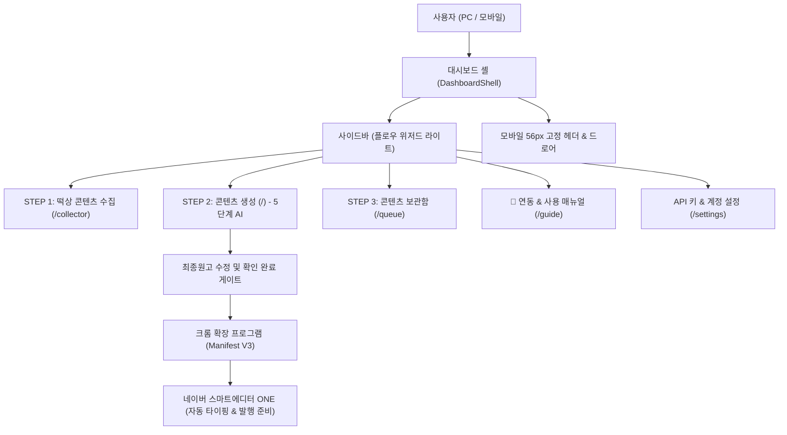

# 네이버 블로그 에이전트 (naver-blog-agent) — AI 에이전트 인수인계 문서

> **공식 서비스 URL**: https://naver-blog-agent.buylife.xyz  
> **현재 버전**: `v1.94` (2026-10-18)  
> **디자인 템플릿**: **플로우 위저드 스타일 (네이버 그린 라이트 변형)**

---

## 1. 프로그램의 사용 목적 및 대상
- **사용 목적**:
  - 네이버 블로그 포스팅의 3단계 워크플로우(실시간 떡상 콘텐츠 수집 → 5단계 AI 원고/이미지 생성 → 콘텐츠 보관함 & 스마트에디터 ONE 크롬 확장 자동 발행)를 자동화하여 안전하고 신속한 블로그 운영 지원.
- **주요 대상**:
  - 실시간 인기 검색어와 트렌드 글감을 바탕으로 1일 1포스팅을 꾸준히 작성하고자 하는 블로거
  - 네이버 스마트에디터 ONE의 복사/붙여넣기 번거로움 없이 크롬 확장을 통해 사람처럼 안전하게 원클릭 주입을 원하는 크리에이터
  - 복수의 네이버 블로그 계정을 운영하며 대기열 관리가 필요한 1인 마케터

---

## 2. 개발 구현에 사용된 도구 / 개발기법 / 플러그인 / 스킬
- **프론트엔드/백엔드**: Next.js 16.2.11 (App Router, Turbopack), React 19.2.4, TypeScript 5
- **스타일링**: Tailwind CSS v4, Lucide React 아이콘 세트
- **AI 엔진**: Google Gemini 2.5, OpenAI GPT-4o, Claude 3.5 Sonnet, NanoBanana (이미지 생성)
- **에디터**: Tiptap Editor (`@tiptap/react`, `@tiptap/starter-kit`, 이미지/테이블/링크 확장)
- **크롬 확장 프로그램**: Manifest V3 기반 전용 인젝터 (`web-bridge.js`, `background.js`, `connect.html`)
- **인증 및 DB**: Supabase Auth (SSR 쿠키), Supabase DB (`programs`, `posts`, `naver_accounts` 등)
- **테스트 & 검증**: Node.js 내장 테스트 러너, Microsoft Edge (`msedge`) Playwright 포그라운드 실세션 검수

---

## 3. 핵심 기능 및 시스템 로직 / 아키텍처, 장점 및 단점

### 1) 시스템 아키텍처

### 2) 장점
- **안전 발행 모드 (발행 전 준비까지만)**: 제목·본문·이미지를 자동으로 스마트에디터에 세팅해 두고 최종 발행 버튼은 회원이 직접 확인 후 누르도록 하여 안전성 극대화.
- **5단계 체계적 AI 생성 파이프라인**: 기획 → 초안 → 윤문 → AI 검수 → 이미지 컷 생성의 단계별 완성도 높은 원고 도출.
- **375px 모바일 반응형 완벽 호환**: 모바일 전용 56px 고정 헤더와 햄버거 토글 슬라이드 오버레이 드로어로 언제 어디서나 조작 가능.
- **BYOK 개인 키 보안 원칙**: 모든 AI API 키는 사용자 본인의 계정에 격리 보관되며 플랫폼 관리자나 타 회원과 절대 공유되지 않음.

### 3) 단점 및 한계
- 크롬 확장 프로그램이 네이버 스마트에디터 ONE의 DOM 요소를 직접 조작하므로, 네이버 에디터 구조 개편 시 셀렉터 업데이트가 필요할 수 있음.
- 백그라운드 탭 입력 시 브라우저 절전 모드로 인해 타이핑 속도가 지연될 수 있어 활성 탭 유지가 권장됨.

---

## 4. 현재 버전 및 버전별 변경 히스토리

- **`v1.94` (2026-10-18, 현재 버전)**:
  - **디자인 테마 전면 리뉴얼**: 플로우 위저드 라이트 테마 (네이버 그린 `#03c75a` 변형, `bg-[#f8fafc]`, 화이트 서피스 카드, 섬세한 테두리) 일관 적용.
  - **모바일 반응형 내비게이션 구축**: `Header.tsx` 햄버거 버튼 추가, `Sidebar.tsx` 모바일 슬라이드 드로어 구축, `DashboardShell.tsx` 도입으로 375px 완벽 호환.
  - **비주얼 연동 & 사용 매뉴얼 (`guide/page.tsx`) 전면 고도화**: 공식 가이드북 히어로 배너, 3단계 파이프라인 카드, 크롬 확장 1초 설치/페어링 가이드, C-Rank/D.I.A.+ 노하우, FAQ 5종 아코디언 탑재.
  - **확장 프로그램 & DB 버전 일괄 동기화**: `manifest.json`, `package.json`, `version.ts`, DB `version` / `extension_version` `v1.94` 일치 완료 (`check-extension-release.mjs`: PASS).
  - **검증 완결**: 테스트 스크립트 통과, Next.js 프로덕션 빌드 성공, Vercel 프로덕션 1회 배포, Microsoft Edge 포그라운드 실세션 검수 5종 캡처 보존.
- `v1.82` ~ `v1.93`:
  - 대기열 필터링 고도화, 보관함 저장 복구 로직 강화, 다중 AI 모델 어댑터 연동.
- `v1.81` (2026-10-12):
  - 가이드 사용 순서 8개 구간 및 5단계 빠른 시작 정리.
- `v1.01` ~ `v1.80`:
  - 떡상 글감 수집기, 5단계 AI 생성기, 크롬 확장 프로그램 최초 구축 및 안전 발행 게이트 탑재.

---

## 5. 남아 있는 추가 프로그램 및 디자인 작업 대기 내용
- 상세 백로그는 [`docs/IMPROVEMENT_BACKLOG.md`](docs/IMPROVEMENT_BACKLOG.md)를 참조하십시오.
  1. 스마트에디터 ONE 전송 실시간 타이핑 프로그레스 바 시각화 (P1)
  2. 리치 텍스트 에디터 30초 자동 로컬 백업 (P1)
  3. 다중 네이버 계정 순환 발행 스케줄러 (P2)
  4. 네이버 블로그 올인원 비전 엔진 연동 (P2)

---

## 6. 기존 다른 프로그램과의 연계 / 기능 병합 제안 및 아이디어
- **네이버 블로그 올인원 자동화 (`naver-blog-allinone`) 연동**:
  - `naver-blog-allinone`의 멀티모달 비전 사진 분석과 7대 키워드 분석 엔진을 상호 연동하여 사진 기반 핫토픽 작성 지원.
- **AI 이미지 스튜디오 (`ai-image-studio`) 연동**:
  - 본문 컷 이미지 생성 시 최신 나노바나나 고화질 엔진과 연동하여 대표 썸네일 자동 생성.
- **인스타 카드뉴스 (`cardnews-studio`) 및 스레드 포스팅 (`threads-posting`) 연계**:
  - 발행된 블로그 본문을 멀티채널 SNS 콘텐츠로 원클릭 재가공하여 유입량 극대화.

---

## 7. 사용자 편의성 증대를 위한 디자인 UI 개선안과 레이아웃 / 테마 변경 제안
- **실시간 타이핑 진행도 인디케이터**: 확장이 글을 작성하는 동안 웹 대시보드에서 진행률(%)과 상태를 실시간 스낵바로 표시.
- **가상 스마트폰 뷰어**: 네이버 블로그 앱 프레임으로 모바일에서 읽히는 형태를 미리보기 제공.
- **에디터 자동 백업 알림 뱃지**: 로컬 스토리지에 안전하게 임시 보관 중임을 에디터 우측 상단에 인디케이터로 안내.

## 2026-10-20 — OpenAI 요청 규칙 공용 기준 코드 사본 적용 (Claude Code 윈도우, **미배포 — 다음 배포 때 함께**)
- `naver-blog-agent/src/lib/ai/openaiRequestParams.ts`는 공용 기준 코드 `openai-request-params` 사본(기준 `naver-blog-seo-studio/lib/ai/openaiRequestParams.ts`) — **직접 고치지 않는다**. 「GPT-4 계열일 때만 온도」 분기를 `openAIGenerationParams(model, { temperature })`로 바꿈(동작 같음, 추론 모델 규칙은 기준 한 곳에서 관리).
- 검수: tsc 0, 기존 테스트 통과. 급하지 않은 정리라 배포하지 않음(빌드 비용 규칙). **다음에 이 프로그램을 배포하는 CLI는 버전 +0.01(코드·DB)하고 버전 기록에 이 항목을 적을 것.** 목록: 루트 `docs/SHARED_MODULES.md` 「미배포 사본」.
- **다음에 이 프로그램을 고칠 때 함께(주인님 결정 2026-10-20)**: 글 모델 선택 칸(`src/app/(dashboard)/page.tsx`) 아래에 모델 성격·상대 비용·GPT-5 지연 안내 붙이기 — 사본에 이미 `openAIModelBadge`·`openAIModelTierHint`·`openAIModelNotice`가 있어 화면 한두 줄만 추가. 기준 구현·방법: 루트 `docs/SHARED_FEATURE_MAP.md` §8.
