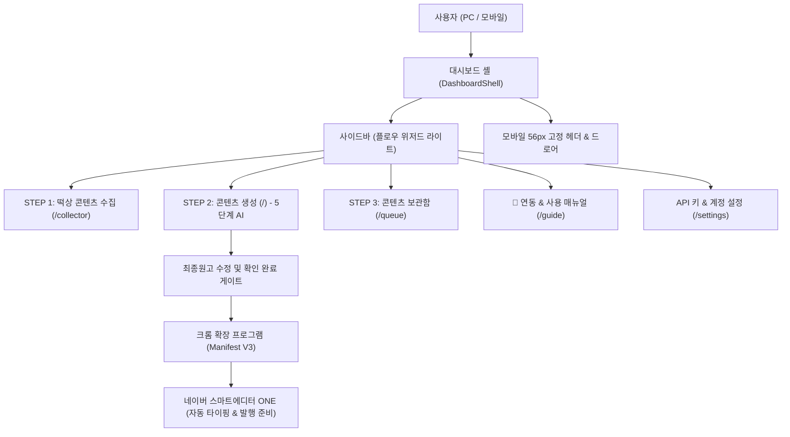

# 네이버 블로그 에이전트 (naver-blog-agent) — AI 에이전트 인수인계 문서

> **✅ v2.11로 배포 완료(2026-10-23) — 쓰이지 않은 연결 번호 정리:** `src/app/api/extension/auth/route.ts` GET(번호 발급)이 새 번호를 저장한 뒤, 이 회원의 **기한이 지났고 연결에 쓰이지 않은 번호(`pair_code` 남아 있음)만** 삭제(토큰이 확장에 전달된 적 없어 다시 쓰일 수 없는 행, 연결된 기기 행은 그대로). 운영 DB 조회: 현재 대상 0행·연결된 기기 7. tsc 통과.

> **✅ v2.11로 배포 완료(2026-10-23) — 설치 상태 문구:** `src/components/extension/ExtensionConnectButton.tsx` `ExtensionInstallStatus`가 확장 응답이 없을 때 「확장을 찾지 못했습니다 · 설치 전이거나 v2.09 이하 버전입니다」로 표시(v2.09 이하 확장의 연결 통로는 `ping`에 답하지 않아, v2.10에서는 설치돼 있어도 「설치 전」으로 보였음 — 웨일 실확인). tsc 통과.

> **✅ v2.10 배포 완료 (2026-10-23, Claude Code 윈도우 — 주인님 지시 「나머지 블로그 자동화 프로그램도 이 방식으로 싹다 바꿔」) — 확장 자동 연결·실제 설치 상태 표시(기준 구현 naver-blog-seo-studio v2.09~v2.10, 루트 `docs/SHARED_FEATURE_MAP.md` §16):** 이 프로그램은 8자리 연결 번호 방식이라 **서버 API는 그대로** 두고 ① 웹 `src/components/extension/ExtensionConnectButton.tsx`가 `GET /api/accounts`로 등록 블로그를 불러와(하나면 자동 선택, 여럿이면 선택 칸) `GET /api/extension/auth`로 번호를 받아 `src/lib/extensionPageBridge.ts`(`nba-publishing-app`↔`-extension`, 서버용 `extensionBridge.ts`와 다른 파일)로 확장에 넘김 ② `extension/web-bridge.js`에 `ping`·`connect` 추가 ③ `extension/background.js` 기존 `pair` 처리를 `pairWithCode()`로 꺼내 팝업 직접 입력과 새 `pairFromWeb`(이 사이트 출처·`^[0-9A-F]{8}$`·블로그 ID 검사, 요청 시 탭 닫기)이 함께 씀 ④ 확장 팝업 `connect.html`에 「자동 연결」 버튼(→ 새 화면 `/extension-connect?from=extension`, 대시보드 레이아웃 밖이라 로그인 뒤 `/login?redirect=`로 복귀), 번호 직접 입력은 접힘 칸 ⑤ 설정 화면에 바로 연결 버튼·실제 설치 상태 한 줄, 기존 번호 발급 버튼은 「직접 입력용 연결 번호 발급하기」. 시험 `test:extension-tabs` 44(연결 시나리오 2 추가) 통과·tsc 통과·eslint 오류 0(경고 4는 설정 화면 기존 `any`)·로컬 빌드 통과. **원래 있던 시험 실패 3건(이번 변경 무관, 미처리):** `test:writing-styles`(`collectedMaterials.ts` 불러오기), `test:post-status`(`privatePhotoPost.ts` 불러오기), `test:categories`(186행 저장 흐름). 배포 Ready·DB/확장/ZIP v2.10(`check-extension-release` OK). 웨일 설정: 블로그 2개 → 선택 칸+바로 연결 버튼 확인, 실제 버튼 연결은 주인님 확장 새로고침(v2.10) 뒤.

> **v2.09 (2026-10-22) BLC-07 입력 검증 보강 운영 완료:** 빈 본문 원고 차단(서버 failed·확장 EMPTY_BODY), 발행 직전 문서 전체 정확 대조(FINAL_MISMATCH). 실제 비공개 자동 발행·주소 기록 재확인. [플랜](docs/PLAN_20261022_BLC07_INPUT_VERIFY.md) · [IMPROVEMENTS](docs/IMPROVEMENTS.md) 맨 아래.

> **2026-10-22 실제 비공개 자동 발행 검수 완료(Claude Code 윈도우, 웨일):** 비공개 합성 원고 1건 → 최종 발행·`post_url`/`published_at` 자동 기록, 외부에서 「비공개 글」 확인. 미시험: 전체공개·예약·이미지 포함. 상세 [IMPROVEMENTS](docs/IMPROVEMENTS.md) 맨 아래.

> **BLC-06 v2.08 운영 확인:** BLC-06 v2.08 편집 상태 보존·이미지 생성 선택 운영 확인. 코드 8c3b1f39 푸시·배포 Ready·DB/설치 확장/라이브 ZIP 일치. 회귀 202개·확장 모의 42개·타입/빌드, 실제 회원 원문 보존/H1·링크 왕복·저장/재열기·출처 불변·이미지 선택·4단계/복사·516px 확인. 추가 AI/이미지 호출 0·최종 발행 0. 다음은 주인님 요청 SEO 블로그 스튜디오 비교이며 BLC-07 즉시 착수 아님. [증거·한계·다음 단계](docs/IMPROVEMENT_HANDOFF_20261021_BLC06_EDITOR.md).

> **BLC-05 v2.07 운영 확인:** [자료 수집·출처 연결 인수인계](docs/IMPROVEMENT_HANDOFF_20261021_BLC05_SOURCE_MATERIALS.md) · [플랜](docs/PLAN_20261021_BLC05_SOURCE_MATERIALS.md). 공개 피드/회원 서버 글감·원고 출처/수명 보존, 195개 회귀·실제 Edge 원고 저장/편집/재열기·516px/복사·설치 확장 일치. Replicate 이미지 인증/모델 권한 오류는 미해결로 기록, BLOG 인증 피드와 원래 서비스 유지. 다음 BLC-06 편집 조작 비교 플랜.

> **BLC-04 v2.05 운영 완료:** [사진 후기 편집·저장·검수 인수인계](docs/IMPROVEMENT_HANDOFF_20261021_BLC04_PHOTO_SAVE.md) · [플랜/해석 정정](docs/PLAN_20261021_BLC04_PHOTO_SAVE.md). 코드 `4b3f84b6`/`342eef52` 푸시·운영 Ready·DB/확장/설치/라이브 ZIP 일치. 회귀 185개·확장 모의 42개·타입/빌드, 지정 회원 후기 1회·저장/편집/재열기/검수 해제·실제 네이버 prepared 8/8·516px 안내/사진 검수 완료. 새 시험 사진 2장/763바이트·원고 1건·최종 발행 0. 원본 사진 AI 활용 표시/초기 폴링 지연은 후속 검토, 상세창 모의 해석 정정은 인수인계에 기록. 다음은 BLC-05 자료 수집/출처 비교 플랜입니다.

> **공식 서비스 URL**: https://naver-blog-agent.buylife.xyz
> **현재 버전**: `v2.08` (2026-10-21 BLC-06 편집 상태·생성 선택 운영 확인)
> **디자인 템플릿**: **플로우 위저드 스타일 (네이버 그린 라이트 변형)**

> **BLC-03 v2.03 운영 완료:** [사진·방문 메모 후기](docs/IMPROVEMENT_HANDOFF_20261021_BLC03_PHOTO_REVIEW.md) · [플랜](docs/PLAN_20261021_BLC03_PHOTO_REVIEW.md). 회귀 176개·확장 모의 42개·타입/빌드 통과. 코드 `1812bf7f` 푸시·배포 Ready·DB/확장/라이브 ZIP 일치. 지정 회원 Edge에서 GPT-4o-mini 후기 1회 생성(관찰·작성 API 2회)·근거 대조·복사·메모 변경 시 결과 해제·안내/516px 화면 검수 완료. 시험 PNG 1장/422바이트·새 원고 저장/최종 발행 0. BLC-02 바로가기 가림/펼침도 재확인했습니다. 다음은 BLC-04 원고 편집·저장·대기열/확장 연결 플랜입니다.

---

> **BLC-01 완료 이력:** [BLC-01 v2.01 인수인계](docs/IMPROVEMENT_HANDOFF_20261020_BLC01_RELEASE.md). 비공개 사진 버킷·정책 적용, 실제 로컬 회원 API 9개 통과, 운영 배포 Ready와 코드/DB/manifest/다운로드 ZIP v2.01 일치 확인. 공용 OpenAI 사본과 모델 안내를 함께 배포했습니다. 운영 일반 회원·실제 확장 준비(prepared 6/6)까지 확인해 BLC-01을 완료했습니다. 준비 화면 픽셀 캡처 실패 한계는 인수인계에 기록했습니다.

> **BLC-02 v2.02 운영 완료 이력:** [사진 준비 UI 인수인계](docs/IMPROVEMENT_HANDOFF_20261020_BLC02_PHOTO_INPUT.md). 6장·대표/순서/설명·취소 실회원 로컬 검수, 회귀 158개·확장 모의 42개 통과. 운영 Ready·DB/확장/라이브 ZIP 일치·실제 일반 회원 PNG 준비/취소·사용 안내 검수 완료. 당시 남은 좁은 화면 바로가기 픽셀/펼침은 v2.03 검수에서 확인했습니다. 사진 AI 글쓰기는 BLC-03에서 완료, 원고 저장은 BLC-04 대기입니다.

## 1. 프로그램의 사용 목적 및 대상
- **사용 목적**:
  - 네이버 블로그 포스팅의 3단계 워크플로우(실시간 떡상 콘텐츠 수집 → 5단계 AI 원고/이미지 생성 → 콘텐츠 보관함 & 스마트에디터 ONE 크롬 확장 자동 발행)를 자동화하여 안전하고 신속한 블로그 운영 지원.
- **주요 대상**:
  - 실시간 인기 검색어와 트렌드 글감을 바탕으로 1일 1포스팅을 꾸준히 작성하고자 하는 블로거
  - 네이버 스마트에디터 ONE의 복사/붙여넣기 번거로움 없이 크롬 확장을 통해 사람처럼 안전하게 원클릭 주입을 원하는 크리에이터
  - 복수의 네이버 블로그 계정을 운영하며 대기열 관리가 필요한 1인 마케터

---

## 2. 개발 구현에 사용된 도구 / 개발기법 / 플러그인 / 스킬
- **프론트엔드/백엔드**: Next.js 16.2.11 (App Router, Turbopack), React 19.2.4, TypeScript 5
- **스타일링**: Tailwind CSS v4, Lucide React 아이콘 세트
- **AI 엔진**: Google Gemini 2.5, OpenAI GPT-4o, Claude 3.5 Sonnet, NanoBanana (이미지 생성)
- **에디터**: Tiptap Editor (`@tiptap/react`, `@tiptap/starter-kit`, 이미지/테이블/링크 확장)
- **크롬 확장 프로그램**: Manifest V3 기반 전용 인젝터 (`web-bridge.js`, `background.js`, `connect.html`)
- **인증 및 DB**: Supabase Auth (SSR 쿠키), Supabase DB (`programs`, `posts`, `naver_accounts` 등)
- **테스트 & 검증**: Node.js 내장 테스트 러너, Microsoft Edge (`msedge`) Playwright 포그라운드 실세션 검수

---

## 3. 핵심 기능 및 시스템 로직 / 아키텍처, 장점 및 단점

### 1) 시스템 아키텍처

### 2) 장점
- **안전 발행 모드 (발행 전 준비까지만)**: 제목·본문·이미지를 자동으로 스마트에디터에 세팅해 두고 최종 발행 버튼은 회원이 직접 확인 후 누르도록 하여 안전성 극대화.
- **5단계 체계적 AI 생성 파이프라인**: 기획 → 초안 → 윤문 → AI 검수 → 이미지 컷 생성의 단계별 완성도 높은 원고 도출.
- **375px 모바일 반응형 완벽 호환**: 모바일 전용 56px 고정 헤더와 햄버거 토글 슬라이드 오버레이 드로어로 언제 어디서나 조작 가능.
- **BYOK 개인 키 보안 원칙**: 모든 AI API 키는 사용자 본인의 계정에 격리 보관되며 플랫폼 관리자나 타 회원과 절대 공유되지 않음.

### 3) 단점 및 한계
- 크롬 확장 프로그램이 네이버 스마트에디터 ONE의 DOM 요소를 직접 조작하므로, 네이버 에디터 구조 개편 시 셀렉터 업데이트가 필요할 수 있음.
- 백그라운드 탭 입력 시 브라우저 절전 모드로 인해 타이핑 속도가 지연될 수 있어 활성 탭 유지가 권장됨.

---

## 4. 현재 버전 및 버전별 변경 히스토리

- **`v2.03` (2026-10-21 · Codex)**: 사진 관찰과 방문 메모 기반 후기 초안·문단 근거 대조·확인 필요·복사 UI. 본인 사진/실제 수명/파일 검증, 본인 선택 모델/키만 사용, 최대 2회 호출·재시도 0. 회귀 176개·확장 모의 42개·타입/빌드 통과, 운영 Ready·버전 일치. 실제 지정 회원 GPT-4o-mini 생성 1회·근거/복사/입력 변경·안내/좁은 화면 검수 완료, 최종 발행/원고 저장 0. 저장/대기열/확장은 후속.  [검수·한계·다음 단계](docs/IMPROVEMENT_HANDOFF_20261021_BLC03_PHOTO_REVIEW.md).

- **`v2.02` (2026-10-20 구현·2026-10-21 검수 완료 · Codex)**: 비공개 사진 준비 UI(최대 6장·대표/순서/500자 설명·취소·상태 조회)와 4단계 시각 안내. 공용 사진 판독 사본 재사용·조회 실패 재업로드 방지. 코드 `49c6fd62`, 운영 Ready·실제 회원 사진 준비 확인. 유료 AI/최종 발행 0, 사진 글쓰기/원고 저장은 후속 단계. [검수·한계·다음 단계](docs/IMPROVEMENT_HANDOFF_20261020_BLC02_PHOTO_INPUT.md).

- **`v2.01` (2026-10-20 · Codex)**: 회원 비공개 사진 보관·최초 생성일 기준 30일 만료·짧은 서명 조회·현재 확장 실행에 한정한 다운로드 직전 갱신·구형 확장 사진 작업 차단·일일 정리 기반. 기존 공용 OpenAI 요청 규칙 사본과 모델 성격/비용/추론 안내 포함. 회귀 140개·확장 모의 42개·타입/빌드 통과, 실제 로컬 회원 사진 API 9개 통과. 운영 배포 Ready, DB/확장/ZIP 버전 일치. 사진 입력 UI/사진 글쓰기 미구현, 실제 확장 준비 6/6 완료(최종 발행 0). [릴리스 증거](docs/IMPROVEMENT_HANDOFF_20261020_BLC01_RELEASE.md).

- **`v2.00` (2026-10-20 · Claude Code)**: 좌측 메뉴 계정·로그아웃이 화면 맨 아래로 밀리던 문제 수정 — `src/components/layout/Sidebar.tsx` 바깥 묶음의 `justify-between` 제거, 계정 묶음 `shrink-0`(사이드바 표준, 웹툰 v1.23 등과 같은 원인). v1.99 다음 정상 순서로 v2.00(메이저 승격 아님). 확장 코드 변경 없음, 빌드 스크립트가 manifest `2.0.0`/`v2.00`·ZIP 자동 갱신.
- **`v1.99` (2026-10-20 · Claude Code)**: 여러 기사로 만든 글감마다 내용이 가장 겹치는 기사 하나만 원문으로 보관(`pickBestArticle`). v1.98은 묶음 앞 4,000자를 모든 글감에 같이 넣어 뒤쪽 기사가 잘렸음(운영 검수에서 발견).
- **`v1.98` (2026-10-20 · Claude Code)**: ① 수집 4종이 요약 전 원문 `source_text`(최대 4,000자)를 글감에 함께 보관 → 생성 근거 = 요약 + 원문(`buildSourceMaterial`) ② 원문 대조를 「사실 주장 문장」으로 한정(감상·추측·질문·일반론 제외) ③ 브라우저 `alert` 29곳·`confirm` 11곳을 화면 안 알림·확인 창으로 교체(`src/lib/uiDialog.ts` `notify`/`askConfirm` + `src/components/DialogHost.tsx`, 대시보드 셸에 1회). 닫기·Esc=취소. 새로 코드를 쓸 때도 `alert`/`confirm` 대신 이 두 함수를 쓴다.
- **`v1.97` (2026-10-20 · Claude Code)**: ① 글감 근거 전달 — 생성 화면이 선택한 글감 **전체 내용**을 `sourceMaterial`로 보내고(예전엔 앞 100자만 「발행 목적」으로 감 → 사실 왜곡 원인), 기획·작성 프롬프트에 「이 자료의 사실만」 블록(`src/lib/ai/sourceGrounding.ts`) ② 원문 대조 — 같은 검수 호출에서 자료에 없는 사실 문장(`unsupported`, 최대 5개)을 받아 PASS→WARN·검수 의견에 표시(추가 AI 호출 없음) ③ 보관함 「발행 설정」에 바로/예약 발행(10분 단위, `/api/posts/[id]/publishing` 예약 저장·조회) ④ 랭킹 상태 점검 `/api/collector/ranking-health`(목록만·무료·30분 캐시) + 수집 버튼 🟢/🔴, 매일 `/api/cron/cleanup`에서도 점검 로그 ⑤ 글감 카드 「🏠 홈판형으로 바로 쓰기」(`format=homefeed`) ⑥ 생성 화면이 `/api/accounts`에서 본인 블로그 목록을 직접 불러옴.
- **`v1.96` (2026-10-20 · Claude Code)**: 원고 목록 API가 `is_reserved`·`scheduled_at`을 내보내도록 수정(v1.95 ⏰ 예약 배지가 새로고침 뒤 사라지던 버그). 테스트 계정 실검수 결과·발견(홈판형 사실 왜곡, 생성 화면 블로그 목록 로컬 캐시 의존)은 `docs/IMPROVEMENT_HANDOFF_20261020.md`.
- **`v1.95` (2026-10-20 · Claude Code)**:
  - **네이버 랭킹 글감**: 수집 화면 URL 탭에 「연예 많이 본 뉴스·스포츠 인기 뉴스·경제 최신 뉴스」 버튼(`src/lib/naverRanking.ts`, `api/collector` `action:"ranking"`). 상위 기사 5건 본문만 읽고 기사 이미지는 쓰지 않음. 연예·스포츠는 네이버 화면용 **비공식** JSON(`api-gw.entertain.naver.com`, `api-gw.sports.naver.com`)이라 바뀌면 안내 오류로 분리.
  - **홈판형 글 구성**: 생성 화면 「글 구성 — 기본 정보형 / 홈판형 이슈글」(`src/lib/ai/articleFormats.ts`). 홈판형은 기획·작성 단계에 질문형 도입·소제목 4개·제목 20~40자 규칙을 덧붙임. 기본값은 기존과 동일.
  - **간격 예약 일괄 전송**: 보관함 일괄 전송에 「간격 예약 발행」(첫 시각 + 10분 단위 간격, 목록 순서대로 배정, `src/lib/scheduleSlots.ts`). PUT 저장이 `is_reserved`/`scheduled_at`을 받음(검사: 20분 이후·10분 단위). 목록에 ⏰ 예약 배지. 확장 코드는 기존 예약 입력 그대로 사용.
  - **쇼핑 커넥트 링크**: 생성 화면에 링크(네이버 쇼핑 주소만 최대 5개) 입력 → 소제목마다 「👉 관련 상품 보러 가기 + URL 한 줄」, 맨 앞 대가성 문구 자동(`src/lib/shoppingLinks.ts`). 확장 전송 때(`extensionBridge.ts`) 문구가 빠졌으면 다시 붙임. 자동 수집은 공식 API가 없어 하지 않음.
  - 배경: 외부 설치형 앱 「Naver Blog AI-Setup-0.1.0」 정적 분석 → 새 프로그램 대신 이 프로그램에 흡수(코드 미복사). 플랜 `docs/PLAN_20261020_HOMEFEED_TREND_SCHEDULE.md`, 인수인계 `docs/IMPROVEMENT_HANDOFF_20261020.md`.
- **`v1.94` (2026-10-18)**:
  - **디자인 테마 전면 리뉴얼**: 플로우 위저드 라이트 테마 (네이버 그린 `#03c75a` 변형, `bg-[#f8fafc]`, 화이트 서피스 카드, 섬세한 테두리) 일관 적용.
  - **모바일 반응형 내비게이션 구축**: `Header.tsx` 햄버거 버튼 추가, `Sidebar.tsx` 모바일 슬라이드 드로어 구축, `DashboardShell.tsx` 도입으로 375px 완벽 호환.
  - **비주얼 연동 & 사용 매뉴얼 (`guide/page.tsx`) 전면 고도화**: 공식 가이드북 히어로 배너, 3단계 파이프라인 카드, 크롬 확장 1초 설치/페어링 가이드, C-Rank/D.I.A.+ 노하우, FAQ 5종 아코디언 탑재.
  - **확장 프로그램 & DB 버전 일괄 동기화**: `manifest.json`, `package.json`, `version.ts`, DB `version` / `extension_version` `v1.94` 일치 완료 (`check-extension-release.mjs`: PASS).
  - **검증 완결**: 테스트 스크립트 통과, Next.js 프로덕션 빌드 성공, Vercel 프로덕션 1회 배포, Microsoft Edge 포그라운드 실세션 검수 5종 캡처 보존.
- `v1.82` ~ `v1.93`:
  - 대기열 필터링 고도화, 보관함 저장 복구 로직 강화, 다중 AI 모델 어댑터 연동.
- `v1.81` (2026-10-12):
  - 가이드 사용 순서 8개 구간 및 5단계 빠른 시작 정리.
- `v1.01` ~ `v1.80`:
  - 떡상 글감 수집기, 5단계 AI 생성기, 크롬 확장 프로그램 최초 구축 및 안전 발행 게이트 탑재.

---

## 5. 남아 있는 추가 프로그램 및 디자인 작업 대기 내용
- 상세 백로그는 [`docs/IMPROVEMENT_BACKLOG.md`](docs/IMPROVEMENT_BACKLOG.md)를 참조하십시오.
  1. 스마트에디터 ONE 전송 실시간 타이핑 프로그레스 바 시각화 (P1)
  2. 리치 텍스트 에디터 30초 자동 로컬 백업 (P1)
  3. 다중 네이버 계정 순환 발행 스케줄러 (P2)
  4. 네이버 블로그 올인원 비전 엔진 연동 (P2)

---

## 6. 기존 다른 프로그램과의 연계 / 기능 병합 제안 및 아이디어
- **네이버 블로그 올인원 자동화 (`naver-blog-allinone`) 연동**:
  - `naver-blog-allinone`의 멀티모달 비전 사진 분석과 7대 키워드 분석 엔진을 상호 연동하여 사진 기반 핫토픽 작성 지원.
- **AI 이미지 스튜디오 (`ai-image-studio`) 연동**:
  - 본문 컷 이미지 생성 시 최신 나노바나나 고화질 엔진과 연동하여 대표 썸네일 자동 생성.
- **인스타 카드뉴스 (`cardnews-studio`) 및 스레드 포스팅 (`threads-posting`) 연계**:
  - 발행된 블로그 본문을 멀티채널 SNS 콘텐츠로 원클릭 재가공하여 유입량 극대화.

---

## 7. 사용자 편의성 증대를 위한 디자인 UI 개선안과 레이아웃 / 테마 변경 제안
- **실시간 타이핑 진행도 인디케이터**: 확장이 글을 작성하는 동안 웹 대시보드에서 진행률(%)과 상태를 실시간 스낵바로 표시.
- **가상 스마트폰 뷰어**: 네이버 블로그 앱 프레임으로 모바일에서 읽히는 형태를 미리보기 제공.
- **에디터 자동 백업 알림 뱃지**: 로컬 스토리지에 안전하게 임시 보관 중임을 에디터 우측 상단에 인디케이터로 안내.

## 2026-10-20 — OpenAI 요청 규칙 공용 기준 코드 사본 적용 (Claude Code 윈도우, **미배포 — 다음 배포 때 함께**)

> Codex 후속 로컬 반영: 아래 ‘다음 수정 때 모델 안내’ 지시를 `src/app/(dashboard)/page.tsx`에 연결했습니다. 타입·로컬 빌드·회귀 140개 통과, 일반 회원 화면 검수/운영 배포는 대기입니다. 기존 공용 사본은 변경하지 않았습니다. [현재 검수/인수인계](docs/IMPROVEMENT_HANDOFF_20261020_BLC01_RESUME.md). 운영 v2.00 유지, 다음 실제 배포 때 버전 동기화합니다.
- `naver-blog-agent/src/lib/ai/openaiRequestParams.ts`는 공용 기준 코드 `openai-request-params` 사본(기준 `naver-blog-seo-studio/lib/ai/openaiRequestParams.ts`) — **직접 고치지 않는다**. 「GPT-4 계열일 때만 온도」 분기를 `openAIGenerationParams(model, { temperature })`로 바꿈(동작 같음, 추론 모델 규칙은 기준 한 곳에서 관리).
- 검수: tsc 0, 기존 테스트 통과. 급하지 않은 정리라 배포하지 않음(빌드 비용 규칙). **다음에 이 프로그램을 배포하는 CLI는 버전 +0.01(코드·DB)하고 버전 기록에 이 항목을 적을 것.** 목록: 루트 `docs/SHARED_MODULES.md` 「미배포 사본」.
- **다음에 이 프로그램을 고칠 때 함께(주인님 결정 2026-10-20)**: 글 모델 선택 칸(`src/app/(dashboard)/page.tsx`) 아래에 모델 성격·상대 비용·GPT-5 지연 안내 붙이기 — 사본에 이미 `openAIModelBadge`·`openAIModelTierHint`·`openAIModelNotice`가 있어 화면 한두 줄만 추가. 기준 구현·방법: 루트 `docs/SHARED_FEATURE_MAP.md` §8.
