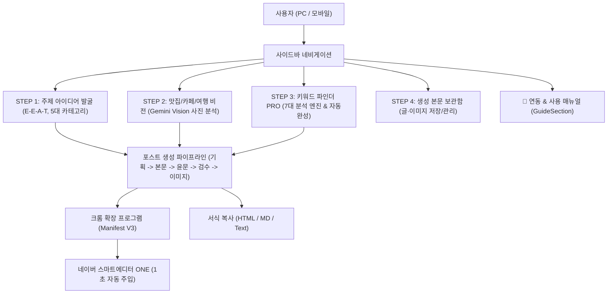

# 네이버 블로그 올인원 자동화 (naver-blog-allinone) — AI 에이전트 인수인계 문서

> **⏳ 미배포 대기 (2026-10-22, Claude Code 윈도우) — BC-05 보관함 30일 자동 삭제:** 커밋만 하고 배포하지 않음(새 배포 지침: 작은 소스 수정은 모았다가 배포). `src/lib/blog/retention.ts`(순수 함수), `GET /api/cron/cleanup`(Vercel Cron 매일 18:40 UTC, `CRON_SECRET` 필요 — 운영 환경변수는 이미 추가, `?dry=1` 미리보기)이 만든 지 30일 지난 글과 그 이미지, 30일 지났고 남은 글이 쓰지 않는 이미지(올리기만 하고 저장 안 한 것 포함)를 지움. 목록·단건 조회도 30일 지난 글을 바로 숨김. 보관함 제목 아래 안내 문구. 카테고리는 보관. 시험 33(새 2)·tsc·빌드 통과. **다음에 이 프로그램을 배포하는 CLI:** 버전 v1.51로 올리고(코드·DB) 배포 → Vercel 대시보드 Cron Jobs 「Run」 200 확인 → 이 줄을 「배포 완료」로 바꿀 것. 운영 기준 오늘 30일 지난 글 0건.

> **서비스 URL**: https://naver-blog-allinone.buylife.xyz  
> **현재 버전**: `v1.50` (2026-10-20 기준)  
> **디자인 템플릿**: **플로우 위저드 스타일 (네이버 그린 라이트 변형)**

---

## 1. 프로그램의 사용 목적 및 대상
- **사용 목적**:
  - 네이버 블로그 포스팅의 전체 라이프사이클(주제 발굴 → 멀티모달 비전 사진 분석 → 7대 엔진 키워드 발굴 → 본문 생성 & 보관함 → 스마트에디터 ONE 1초 자동 주입)을 원스톱으로 자동화하여 블로그 지수(C-Rank / D.I.A.+) 향상과 상위 노출을 극대화.
- **주요 대상**:
  - 1일 1포스팅에 시간과 노력이 많이 드는 전문 블로거 및 초보 블로거
  - 스마트폰으로 촬영한 맛집, 카페, 여행 사진을 생생한 리뷰 글로 전환하고자 하는 인플루언서
  - 스마트에디터 ONE 복사/붙여넣기 번거로움 없이 원클릭 주입을 원하는 크리에이터

---

## 2. 개발 구현에 사용된 도구 / 개발기법 / 플러그인 / 스킬
- **프론트엔드/백엔드**: Next.js 16.2.11 (App Router, Turbopack), React 19.2.4, TypeScript 5
- **스타일링**: Tailwind CSS v4, Lucide React 아이콘 세트
- **AI 멀티모달 & LLM**: Google Gemini 2.5 Flash / Pro (멀티모달 비전 및 텍스트 파이프라인), NanoBanana 2-2K (이미지 생성)
- **크롬 확장 프로그램**: Manifest V3 기반 전용 인젝터 (`content-naver.js`, `content-web.js`, `background.js`)
- **인증 및 데이터베이스**: Supabase Auth (매직링크, SSR 쿠키), Supabase DB (`programs`, `posts` 등)
- **검증 도구**: Node.js 내장 테스트 러너(`tests/blog.test.mjs`), Microsoft Edge (`msedge`) Playwright 포그라운드 실세션 검수

---

## 3. 핵심 기능 및 시스템 로직 / 아키텍처, 장점 및 단점

### 1) 핵심 기능 및 시스템 아키텍처

### 2) 장점
- **원클릭 자동 주입**: 전용 크롬 확장 프로그램을 통해 네이버 블로그 글쓰기 창에서 서식 깨짐 없이 1초 주입 가능.
- **멀티모달 비전 특화**: 스마트폰 사진의 디테일을 AI가 읽어내어 실제 방문자 후기 특유의 생생한 어휘와 문장 구조 생성.
- **개인 키 격리 원칙**: API 키가 서버 DB에 저장되지 않고 브라우저 LocalStorage에만 보관되어 보안 및 계정 안전성 보장.
- **375px 모바일 완벽 대응**: 이동 중 스마트폰으로도 메뉴 조작 및 가이드 열람이 가능한 반응형 UI.

### 3) 단점 및 한계
- 대량의 고용량 사진(10장 이상)을 한 번에 분석할 때 클라이언트 브라우저 메모리 부하 발생 가능.
- 네이버 스마트에디터 ONE 웹 구조 변경 시 크롬 확장 프로그램 content script의 셀렉터 업데이트가 필요할 수 있음.

---

## 4. 현재 버전 및 버전별 변경 히스토리

- **`v1.50` (2026-10-20, 현재 버전, Claude Code 윈도우)**: 좌측 메뉴 계정·로그아웃이 화면 맨 아래로 밀리던 문제 수정 — `src/components/Sidebar.tsx` 바깥 묶음의 `justify-between` 제거, 계정 묶음 `shrink-0`(사이드바 표준, 웹툰 v1.23과 같은 원인). 확장 코드 변경 없음, manifest·ZIP·DB `extension_version`만 v1.50으로 맞춤(ZIP은 python zipfile로 `extension/` 내용물을 `/` 경로로 압축 — 예전 ZIP은 `icons\icon-16.png`처럼 역슬래시 경로였음).
- **`v1.49` (2026-10-18)**:
  - **디자인 테마 전면 리뉴얼**: 플로우 위저드 스타일 (네이버 그린 라이트 변형, `bg-[#f8fafc]`, 화이트 카드, 네이버 그린 `#03c75a` 포인트) 일관 적용.
  - **비주얼 사용 매뉴얼 신설**: `src/components/GuideSection.tsx` 신설 (공식 가이드 히어로 배너, 4단계 파이프라인, 크롬 확장 1초 설치 안내, C-Rank/D.I.A.+ 노하우, FAQ 아코디언).
  - **사이드바 메뉴 및 모바일 드로어 정비**: `Sidebar.tsx` 내 `📖 연동 & 사용 매뉴얼` 탭 추가, 375px 햄버거 토글 슬라이드 오버레이 연동.
  - **확장 프로그램 & DB 버전 일괄 동기화**: `manifest.json`, `package.json`, `version.ts`, DB `version` / `extension_version` `v1.49` 일치 완료 (`check-extension-release.mjs` PASS).
  - **검증 완결**: 31개 단위 테스트 100% 통과, Next.js 프로덕션 빌드 및 Vercel 배포 완료, Microsoft Edge 포그라운드 실세션 5종 캡처 보존.
- `v1.14` ~ `v1.48`:
  - 블로그 본문 보관함 기능 탑재 (`LibrarySection.tsx`), 글 저장 및 다시 열기 지원
  - 공용 Gemini 및 나노바나나 어댑터 동기화, 사용자 본인 키 격리 보관 강화
- `v1.13` (2026-10-11):
  - 헤더 상단 마케팅 슬로건 배너 강조 배치 및 중복 요소 정리
- `v1.01` ~ `v1.12`:
  - 4단계 핵심 작업 흐름 스텝퍼 정립, 맛집/카페 비전 엔진 및 7대 키워드 분석 엔진 탑재, 크롬 확장 프로그램 최초 구축

---

## 5. 남아 있는 추가 프로그램 및 디자인 작업 대기 내용
- 상세 백로그는 [`docs/IMPROVEMENT_BACKLOG.md`](docs/IMPROVEMENT_BACKLOG.md)를 참조하십시오.
  1. 스마트에디터 ONE 가상 모바일 미리보기 (P1)
  2. 키워드 밀도 및 형태소 분석 실시간 바 (P1)
  3. 다중 사진 타임라인 자동 정렬 비전 분석 (P2)
  4. 크롬 확장 프로그램 업데이트 알림 배지 (P3)

---

## 6. 기존 다른 프로그램과의 연계 / 기능 병합 제안 및 아이디어
- **AI 이미지 스튜디오 (`ai-image-studio`) 연동**:
  - 본문에 들어갈 맞춤 일러스트나 고해상도 대표 썸네일을 최신 이미지 생성 엔진과 연동하여 자동 보충.
- **인스타 카드뉴스 스튜디오 (`cardnews-studio`) 및 스레드 포스팅 (`threads-posting`) 연계**:
  - 완성된 블로그 포스팅 원고를 바탕으로 5장 카드뉴스 및 스레드 홍보문으로 원클릭 재가공하여 멀티채널 트래픽 유입.
- **유튜브 쇼츠 생성기 (`shorts-remaker`) 연동**:
  - 맛집/여행 블로그 글을 60초 숏폼 대본으로 변환하여 릴스/쇼츠 영상 제작 파이프라인과 통합.

---

## 7. 사용자 편의성 증대를 위한 디자인 UI 개선안과 레이아웃 / 테마 변경 제안
- **모바일 실시간 폰 프레임 뷰어**: 스마트폰 네이버 블로그 앱에서 실제로 어떻게 읽히는지 좌우 분할 또는 팝업 모달로 실시간 미리보기 제공.
- **원클릭 복사 토스트 피드백**: 원고 복사 시 부드러운 스낵바 토스트 알림과 함께 [네이버 블로그 글쓰기 열기] 액션 버튼 노출.
- **스텝 진행 바 프로그레스**: 1단계에서 4단계까지 진행되는 진행 상황을 상단 인디케이터로 시각화.

<!-- DETAILED_PROGRAM_REVIEW_20261019 -->
## 2026-10-19 Codex — 프로그램별 상세 개선 분석(구현 아님)

[세부 개선안·필요 이유·근거·시험 조건](docs/DETAILED_REVIEW_20261019.md) · [전체 83개 분석](../docs/program-reviews-20261019/INDEX.md) · [공통 아이디어 표](../docs/PROGRAM_IDEA_BACKLOG.md). 이 프로그램 3개 검토 항목입니다. 코드·DB·환경변수·배포는 바꾸지 않았습니다. 작업 전 최신 개선 원장·ACTIVE_WORK와 대조하고 이미 해결된 기능은 보존합니다. 후속 작업 후 처리 ID·증거·미완료·새 인사이트·프로그램 링크를 기록합니다.
<!-- /DETAILED_PROGRAM_REVIEW_20261019 -->

## 2026-10-20 — OpenAI 요청 규칙 공용 기준 코드 사본 적용 (Claude Code 윈도우, **미배포 — 다음 배포 때 함께**)
- `naver-blog-allinone/src/lib/blog/openaiRequestParams.ts`는 공용 기준 코드 `openai-request-params` 사본(기준 `naver-blog-seo-studio/lib/ai/openaiRequestParams.ts`) — **직접 고치지 않는다**. 「GPT-4 계열일 때만 온도」 분기를 `openAIGenerationParams(model, { temperature })`로 바꿈(동작 같음, 추론 모델 규칙은 기준 한 곳에서 관리).
- 검수: tsc 0, 기존 테스트 통과. 급하지 않은 정리라 배포하지 않음(빌드 비용 규칙). **다음에 이 프로그램을 배포하는 CLI는 버전 +0.01(코드·DB)하고 버전 기록에 이 항목을 적을 것.** 목록: 루트 `docs/SHARED_MODULES.md` 「미배포 사본」.
- **다음에 이 프로그램을 고칠 때 함께(주인님 결정 2026-10-20)**: 글 모델 선택 칸(`src/components/blog/ModelSettingsCard.tsx`) 아래에 모델 성격·상대 비용·GPT-5 지연 안내 붙이기 — 사본에 이미 `openAIModelBadge`·`openAIModelTierHint`·`openAIModelNotice`가 있어 화면 한두 줄만 추가. 기준 구현·방법: 루트 `docs/SHARED_FEATURE_MAP.md` §8.
